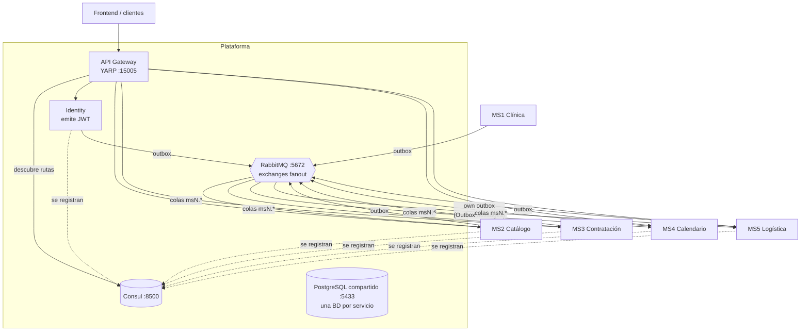

# Arquitectura de la plataforma

> **No REST between services.** The arrows above are all the service-to-service traffic: services only go through the gateway when a person or the frontend does. MS3 → MS4 (calendar and daily order), MS3 → MS1 (patient) and MS4 → MS2 (plan menu) used to be REST calls with a service account; they are now the events `contract-activated`, `production-order-ready`, `paciente-published` and `meal-plan-composition-changed`, which the consumer stores in a local projection. See [communication.md](./communication.md).

> MS1 (`Nur-tricenter/ms1-gestion-clinica-nutricional`) está integrado al stack local desde 2026-10-31: Postgres, JWT, Consul como `clinica-nutricional` y compose de plataforma. Ver [X-13](../gaps/cross-service-gaps.md) y su [ficha](../services/ms1-clinic/README.md).

## Componentes

### API Gateway — `nur-tricenter-api-gateway`
- **YARP** como reverse proxy, con un `ConsulYarpConfigProvider` que relee Consul cada 30 s.
- **Ruteo por convención:** `/api/{consul-service-name}/**` llega al servicio como `/api/**`. Por eso todo servicio expone sus rutas como `/api/v1/...`.
  - Ejemplo: `GET /api/delivery-calendar/v1/calendars/7` → MS4 recibe `GET /api/v1/calendars/7`.
- Solo rutea a instancias con health check **passing**. Un servicio caído desaparece del gateway (404).
- **No valida tokens** (decisión deliberada): cada servicio valida su JWT.
- Puerto en el host: `15005`. Dentro de la red Docker: `http://gateway:8080`.

### Descubrimiento — Consul
- Cada API se **auto-registra** al arrancar con host/puerto fijos y un check HTTP anónimo a `/health`.
- Los workers (consumidores, outbox) **no** se registran: no reciben tráfico HTTP.
- Nombres registrados en la plataforma (definen el prefijo del gateway): `catalog` (MS2; el default del código es `catalog-service`, el compose lo cambia), `identity-service`, `contracting` (MS3), `delivery-calendar` (MS4), `nurtricenter` (MS5). MS1 y el gateway no se registran.
- Check HTTP a `/health` (identity: cada 10 s, deregistro a los 30 s en crítico).

### Identidad — `nur-tricenter-identity`
- Único emisor de JWT (HS256, un solo claim `scope` con los scopes separados por espacio). Login en `POST /api/v1/auth/login` (por el gateway: `/api/identity-service/v1/auth/login`). Ficha: [identity-service](../services/identity-service/README.md).
- Detalle de scopes, service accounts y validación en [security.md](./security.md).

### Mensajería — RabbitMQ
- Librería `Joseco.Communication.External.RabbitMQ` 1.1.0.
- **Un exchange fanout por tipo de evento**, no durable. Los flags tienen que coincidir con la topología o RabbitMQ devuelve `406 PRECONDITION_FAILED`.
- **Una cola por consumidor**: `{consumidor}.{exchange}` (p. ej. `ms4.recipe-updated`). Cada consumidor recibe su propia copia.
- La topología de plataforma (22 exchanges, 38 colas) se importa desde `nur-tricenter-local/topology/rabbitmq-definitions.json`. Los publishers usan `declareDestination: true` (redeclaran su exchange con los mismos flags) y algunos workers declaran un sink propio fuera de la topología (`identity.default`, `catalog.default`, `nurtricenter.default`).
- Catálogo completo: [../contracts/events.yaml](../contracts/events.yaml).

### Persistencia — PostgreSQL
- Una instancia compartida en local (`nur-tricenter-postgres`, puerto host 5433) con **una base de datos por servicio**: `ms2-plans-and-recipes-catalog`, `nur_tricenter_identity`, `nur_tricenter_contracting` (MS3), `ms4_delivery_calendar`. MS5 usa Neon (Postgres gestionado) y MS1 un SQL Server propio fuera del stack.
- No service reads another's database: data owned by others arrives as events and is stored in a local projection (database-per-service). No business REST is left between services.

### Kernels compartidos — `nur-tricenter-shared-kernels`
| Paquete | Para qué |
|---|---|
| `Nur.Tricenter.Access` | Nombres de scopes por servicio (`CatalogPermission`, `IdentityPermission`, `DeliveryCalendarPermission`) y tablas ruta→scope (documentales: ningún servicio las lee en runtime) |
| `Nur.Tricenter.Security` | `AddSecurity()`: validación JWT + una policy de autorización por scope |
| `Nur.Tricenter.Integration` | Contratos de los eventos (`IntegrationMessageContract` y sus derivados) |
| `Nur.Tricenter.Observability` | OpenTelemetry, Jaeger y Serilog con enriquecimiento por span |

Se publican en GitHub Packages. Uso real (2026-10-29): MS4 usa 1.4.0; MS5 solo `Nur.Tricenter.Integration` 1.4.0; MS2 e identity usan 1.2.0 (sus `Joseco.*` siguen en 1.1.0, porque la 1.2.0 no está disponible); MS3 y MS1 no usan ningún paquete (copias locales de los contratos; las de MS3 siguen el formato 1.4.0); el gateway tampoco. Cambios recientes de `Integration`: 1.2.0 agrega `PackageValidated`, 1.3.0 le suma `DeliveryDate` y `PatientName`, 1.4.0 suma `DeliveryDayId` a `PackageValidated` y `DeliveryAddedToRoute`. Ver X-07.

### Observabilidad
- MS2 e Identity usan `Nur.Tricenter.Observability` (OpenTelemetry → Jaeger, Serilog).
- MS4 usa los ServiceDefaults de .NET Aspire (el mismo pipeline OTel).
- La traza cruza servicios por `CorrelationId` en cada evento, más un `TracingConsumer` del lado consumidor.

## Patrones arquitectónicos compartidos
- **Clean Architecture** por servicio (Domain / Application / Infrastructure / Api). MS2 se declara plantilla de referencia para servicios nuevos.
- **CQRS liviano** con MediatR (MS1, MS2, MS4; MS3 usa FastEndpoints + MediatR).
- **Transactional outbox** para publicar y **inbox idempotente** para consumir. Ver [communication.md](./communication.md).
