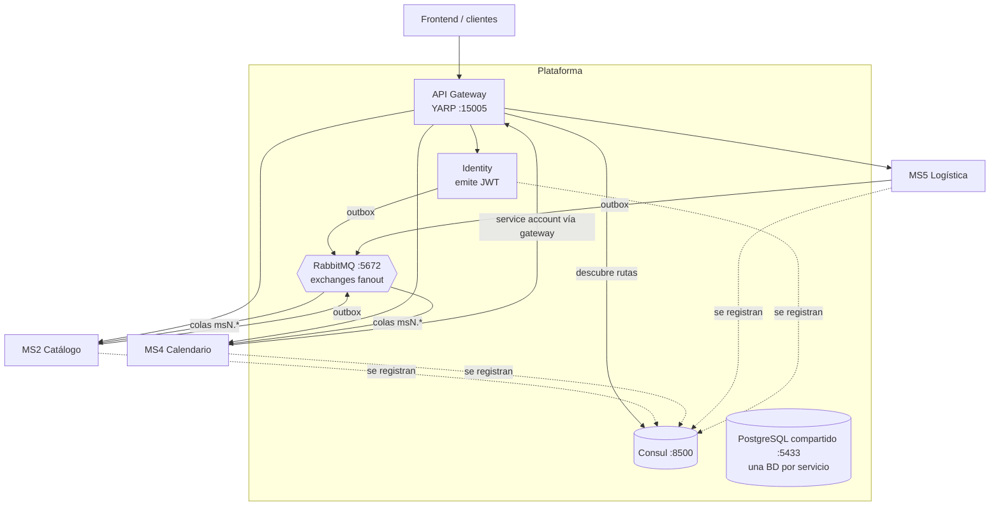

# Arquitectura de la plataforma

## Componentes

### API Gateway — `nur-tricenter-api-gateway`
- **YARP** como reverse proxy, con un `ConsulYarpConfigProvider` que relee Consul cada 30 s.
- **Ruteo por convención:** `/api/{consul-service-name}/**` llega al servicio como `/api/**`. Por eso todo servicio expone sus rutas como `/api/v1/...`.
  - Ejemplo: `GET /api/delivery-calendar/v1/calendars/7` → MS4 recibe `GET /api/v1/calendars/7`.
- Solo rutea a instancias con health check **passing**. Un servicio caído desaparece del gateway (404).
- **No valida tokens** (decisión deliberada): cada servicio valida su JWT.
- Puerto en el host: `15005`. Dentro de la red Docker: `http://gateway:8080`.

### Descubrimiento — Consul
- Cada API se **auto-registra** al arrancar con host/puerto fijos y un check HTTP anónimo a `/health`.
- Los workers (consumidores, outbox) **no** se registran: no reciben tráfico HTTP.
- Nombres registrados hoy: `catalog-service` (MS2), `identity-service`, `delivery-calendar` (MS4), `nurtricenter` (MS5).

### Identidad — `nur-tricenter-identity`
- Único emisor de JWT. Login en `POST /api/v1/auth/login`.
- Detalle de scopes, service accounts y validación en [security.md](./security.md).

### Mensajería — RabbitMQ
- Librería `Joseco.Communication.External.RabbitMQ` 1.1.0.
- **Un exchange fanout por tipo de evento**, no durable. Los flags tienen que coincidir con la topología o RabbitMQ devuelve `406 PRECONDITION_FAILED`.
- **Una cola por consumidor**: `{consumidor}.{exchange}` (p. ej. `ms4.recipe-updated`). Cada consumidor recibe su propia copia.
- La topología (exchanges, colas, bindings) **no la declara ningún servicio**: se importa desde `nur-tricenter-local/topology/rabbitmq-definitions.json`.
- Catálogo completo: [../contracts/events.yaml](../contracts/events.yaml).

### Persistencia — PostgreSQL
- Una instancia compartida en local (`nur-tricenter-postgres`, puerto host 5433) con **una base de datos por servicio**: `ms2-plans-and-recipes-catalog`, `nur_tricenter_identity`, `ms4_delivery_calendar`. MS5 usa Neon (Postgres gestionado).
- Ningún servicio lee la BD de otro: los datos ajenos llegan por REST o por eventos (database-per-service).

### Kernels compartidos — `nur-tricenter-shared-kernels`
| Paquete | Para qué |
|---|---|
| `Nur.Tricenter.Access` | Nombres de scopes por servicio (`CatalogPermission`, `IdentityPermission`, `DeliveryCalendarPermission`) y reglas ruta→scope |
| `Nur.Tricenter.Security` | `AddSecurity()`: validación JWT + una policy de autorización por scope |
| `Nur.Tricenter.Integration` | Contratos de los eventos (`IntegrationMessageContract` y sus derivados) |
| `Nur.Tricenter.Observability` | OpenTelemetry, Jaeger y Serilog con enriquecimiento por span |

Se publican en GitHub Packages. Hoy cada servicio usa una versión distinta (1.0.9, 1.0.10+ y 1.1.0): ver gaps.

### Observabilidad
- MS2 e Identity usan `Nur.Tricenter.Observability` (OpenTelemetry → Jaeger, Serilog).
- MS4 usa los ServiceDefaults de .NET Aspire (el mismo pipeline OTel).
- La traza cruza servicios por `CorrelationId` en cada evento, más un `TracingConsumer` del lado consumidor.

## Patrones arquitectónicos compartidos
- **Clean Architecture** por servicio (Domain / Application / Infrastructure / Api). MS2 se declara plantilla de referencia para servicios nuevos.
- **CQRS liviano** con MediatR (MS2, MS4).
- **Transactional outbox** para publicar y **inbox idempotente** para consumir. Ver [communication.md](./communication.md).
