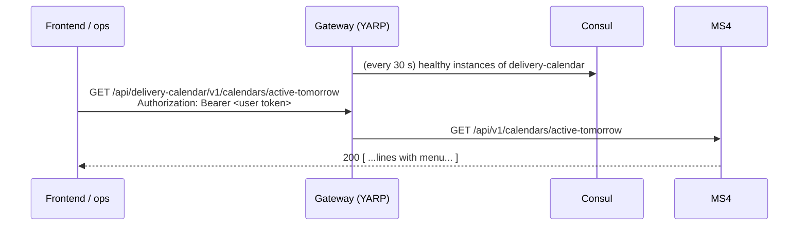
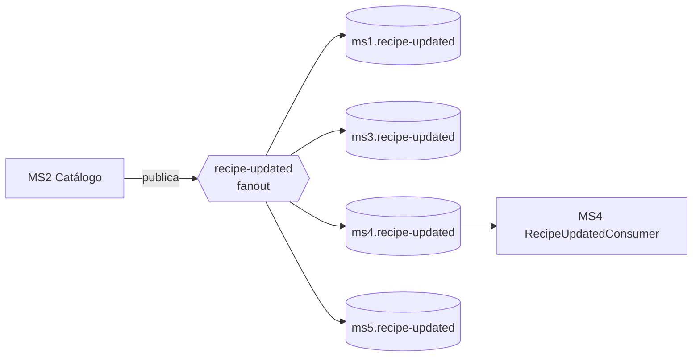

# Comunicación entre microservicios

> Este es el **foco del módulo del diplomado**. Cada patrón tiene su explicación, por qué se eligió y dónde verlo funcionando en el código real. La tabla concepto → evidencia está en [../course/module-focus.md](../course/module-focus.md).

## 1. The two styles and when each is used

| | Synchronous (REST) | Asynchronous (events) |
|---|---|---|
| Mechanism | HTTP through the API gateway | RabbitMQ, fanout exchanges |
| Coupling | Temporal: the other service has to be alive | Decoupled: the publisher does not know who listens |
| Used for | A person or the frontend talking to a service (the gateway is their only entry point) | Announcing that something **already happened** ("a contract was paid", "tomorrow's production order is ready") to whoever cares |
| Real example | Browser → MS4 `PATCH /calendars/days/{id}/address`; ops → MS4 `POST /resolve-daily-catalog` | MS3 publishes `contract-activated` and MS4 creates the calendar; MS4 publishes `production-order-ready` and MS3 projects it |
| Typical failure | Timeout / 5xx → retry, intermediate state | Duplicated or out-of-order message → idempotency |

Project rule, tightened to follow the course rule *"avoid synchronous communication (no REST APIs unless it is a small query)"*: **there is no business REST between services. Whatever a service needs from another arrives as an event and is stored in a local projection; REST is only for people and the frontend, through the gateway.**

Four REST calls broke that rule and were replaced (kernel 1.6.0, MS2#6, MS1#3, MS4#12, MS3#11):

| Was | Is now | Event (exchange → queue) |
|---|---|---|
| MS3 → MS4 `POST /schedule` | MS4 consumes the event and sends the same `CreateScheduleCommand` | `ContractActivated` (`contract-activated` → `ms4.contract-activated`) |
| MS3 → MS4 `GET /calendars/active-tomorrow` | MS3 projects MS4's snapshot of the order into `ScheduledDeliveries` | `ProductionOrderReady` (`production-order-ready` → `ms3.production-order-ready`) |
| MS3 → MS1 `GET /Patient/{id}` | MS3 projects the patient into `ClinicPatients` | `PatientPublished` (`paciente-published` → `ms3.paciente-published`) |
| MS4 → MS2 `GET /meal-plans/{id}` | MS4 projects the plan's day menus into `PlanDayMenus` | `MealPlanCompositionChanged` (`meal-plan-composition-changed` → `ms4.meal-plan-composition-changed`) |

## 2. Synchronous communication (people and frontend only)

### 2.1 Everything goes through the gateway
Services are not called by IP or container name: a caller (a browser, the demo console, an operator) calls the gateway with the prefix of the target's **Consul name**. Services do not call each other this way any more.



Advantage: moving, scaling or restarting a service does not break its callers, because the gateway discovers the new instance through Consul.

### 2.2 Identity: user tokens, and service accounts that no service uses
Endpoints validate the caller's JWT and demand one scope per endpoint (see [security.md](./security.md)). The service accounts `ms3-service` and `ms4-service` still exist in identity (`start-stack` creates them and the demo console's security view shows them), but **no service logs in with them**: MS3 and MS4 make no outbound HTTP and their token handlers, `Identity`, `Clinic`, `DeliveryCalendar` and `Catalog:BaseUrl` options were deleted. Events carry no user identity.

### 2.3 Resilience
- Because a consumer reads its own projection, a producer that is down does not break it: MS3 keeps answering with the last `ProductionOrderReady` it has, MS4 keeps resolving menus from `PlanDayMenus` while MS2 is stopped.
- **Controlled degradation:** if a plan's composition has not been projected yet, MS4 skips that day (it stays `Scheduled`, logged) and the job can be re-run (idempotent) once the composition arrives. It never ends half updated.
- **Do not resolve on demand:** MS4 resolves tomorrow's menu **before** anyone needs it and publishes the whole order as one event.

### 2.4 Event instead of query (decision, reversed)
The architecture phase planned a `ProductionOrderRequired` event; the first implementation replaced it with a `GET active-tomorrow` from MS3 to MS4 ("MS3 needs the whole picture of the day at a given moment, and an idempotent query is easier to reason about"). That decision was **reversed** to follow the course rule: MS4 now publishes `ProductionOrderReady`, a **full snapshot** of the delivery date (lines with address, coordinates and menu), and MS3 replaces its rows for that date. The "whole picture at a moment" argument holds because the event is a snapshot, not a delta; the endpoint stays for the frontend and ops.

## 3. Comunicación asíncrona

### 3.1 Topología: un exchange por evento, una cola por consumidor

- **Fanout:** cada consumidor recibe su propia copia. Agregar un consumidor nuevo no toca al publisher.
- La topología se declara **una sola vez**, de forma central (`rabbitmq-definitions.json`), y no la crea cada servicio. Así se evitan conflictos de flags (406).

### 3.2 El sobre común de todo evento
Todos los contratos heredan de `IntegrationMessageContract` (kernel `Nur.Tricenter.Integration`):

| Campo | Para qué |
|---|---|
| `Id` | Identidad del mensaje: es la clave de idempotencia del inbox |
| `CreatedAt` | Cuándo ocurrió el hecho |
| `CorrelationId` | Une el evento con la traza de la petición que lo originó |
| `Source` | Servicio que lo publicó |
| `EventType` | Nombre lógico, p. ej. `MealPlan.Published` |

### 3.3 Publicar sin perder eventos: transactional outbox
Problema: si guardas en tu BD y después publicas en RabbitMQ, y el proceso muere en el medio, el evento se pierde (o se publica algo que nunca se guardó).

Solution used by MS2, Identity, MS3, MS5 and MS1 (`Joseco.Outbox.EFCore` or an own outbox) and, since MS4#12, also by **MS4** with a minimal own outbox (table `OutboxMessages` + an `OutboxDispatcher` in the worker every 5 s; it does not use `Joseco.Outbox.EFCore` because that package pins MediatR 12 and EF Core 9, and MS4 runs MediatR 14 and EF Core 10):
1. El caso de uso guarda el cambio **y** el evento en una tabla `outbox`, en la **misma transacción**.
2. Un worker lee la tabla y publica en RabbitMQ.
3. Si falla, lo reintenta. La garantía es **at-least-once**: el evento puede llegar más de una vez.

> Ojo: en MS3 el cambio y la fila de outbox se guardan en **dos** `SaveChanges` sin transacción (ver la ficha de MS3); un corte entre ambos pierde el evento.
>
> In MS4 the `ProductionOrderReady` row commits in the same `SaveChanges` as the updated order lines when the order already exists. For a **new** order the order is saved first, because its id is generated by the database and travels in the event, and the outbox row is saved right after: a crash between the two leaves an order without an event, and re-running `resolve-daily-catalog` recovers it (every run stages a new snapshot).

### 3.4 Consumir sin duplicar: inbox idempotente
Como la entrega es at-least-once, el consumidor tiene que tolerar duplicados. MS4 (y MS2) encadenan decoradores:

```
TracingConsumer → IdempotentConsumer (tabla InboxMessages, clave = Id del mensaje) → Handler real
```
- Si el `Id` ya está en el inbox, el mensaje se descarta.
- Además, los handlers hacen **upsert** en lugar de insert, para que re-publicar un plan lo refresque y no falle.

### 3.5 Proyecciones locales (read models)
Un servicio guarda **su propia copia** de los datos ajenos que necesita, alimentada por eventos:
- MS4 → `PlanCatalog` (de `meal-plan-published`): valida que la duración pedida al crear el calendario (`contract-activated` o `POST /schedule`) coincida con la del plan, sin llamar a MS2.
- MS2 → `PlanAuthors` (de `user-published`): sabe quién es el autor de cada plan sin llamar a identity.

Added when the inter-service REST calls were removed (each replaces one):

| Projection | Owner | Fed by | Read by | Replaces |
|---|---|---|---|---|
| `PlanDayMenus` (plan id + day number, with owned menu items) | MS4 | `meal-plan-composition-changed` (MS2 snapshot) | `ProjectedCatalogPort` in `resolve-daily-catalog` | MS4 → MS2 `GET /meal-plans/{id}` |
| `ClinicPatients` (id, full name, phone) | MS3 | `paciente-published` (MS1 snapshot) | contract creation (404 `PATIENT_NOT_FOUND` if unknown), label, package release | MS3 → MS1 `GET /Patient/{id}` |
| `ScheduledDeliveries` (one row per delivery day, with the menu as JSON) | MS3 | `production-order-ready` (MS4 snapshot) | daily order, label, validation | MS3 → MS4 `GET /calendars/active-tomorrow` |

How they are kept consistent:
- **Snapshots, not deltas.** Each message carries the whole state, so the consumer replaces its rows (MS3 replaces every `ScheduledDeliveries` row of the delivery date; MS4 upserts each day of the plan).
- **Older snapshots are ignored.** A message whose `CreatedAt` is older than what is stored is dropped, so out-of-order delivery cannot roll the projection back. MS2 emits **one snapshot per composition change** (many messages while a plan is being composed); the consumer ends up with the latest.
- **Data the consumer rejects is acknowledged, not retried.** MS4's `ContractActivatedConsumer` logs and acks a bad duration or a duration that contradicts the plan (a retry would fail the same way); the contract then stays paid without a calendar (ms3-gap-06).
- **No backfill.** A plan or a patient created before the projections existed is not in them until its producer publishes again (X-15). Demo and smoke create fresh ones.

Esto es **consistencia eventual**: la copia puede ir unos segundos atrás, a cambio de autonomía.

## 4. Seguridad en la comunicación
Detalle en [security.md](./security.md). En resumen: el gateway no autentica; cada servicio valida el JWT y exige **un scope por endpoint**.

## 5. Idempotencia: el hilo conductor
| Dónde | Mecanismo |
|---|---|
| MS4 `ContractActivatedConsumer` / `POST /schedule` | Inbox by message `Id` (MS3 uses its outbox row id) plus a lookup by `contractId` + unique index: a redelivery returns the same calendar |
| MS3 `ProductionOrderReadyConsumer` / `PatientPublishedConsumer`; MS4 `MealPlanCompositionChangedConsumer` | Inbox by `Id` + a full snapshot that replaces rows; an older snapshot (`CreatedAt`) is ignored |
| MS4 job de catálogo | Reemplaza las líneas de la orden existente (índice único por fecha) |
| MS4 `PATCH /delivery-result` | Repetir el mismo resultado no hace nada |
| Consumidores (MS2, MS4) | Inbox por `Id` de mensaje + upsert |
| Publishers (MS1, MS2, Identity, MS3, MS4, MS5) | Outbox: reintentar no pierde ni inventa eventos |

## 6. Matriz de comunicación actual
Source: the code of each repo as of 2026-10-31 (after the removal of the inter-service REST calls). The future visual app will generate it from the `service.yaml` files. **There is no business REST between services any more**: the only REST rows left are people and the frontend (through the gateway), and the gateway itself.

| Origen → destino | Estilo | Qué | Estado |
|---|---|---|---|
| MS3 → MS4 | event | `contract-activated`: a paid contract (`ContractId`, `PatientId`, `CatalogPlanId`, `DurationDays`, `StartDate`) | MS3 publishes it from its outbox relay (local copy of the kernel 1.6.0 contract, ms3-gap-05); MS4 consumes it from `ms4.contract-activated` and sends `CreateScheduleCommand` (idempotent by contract id). Replaces `POST /schedule` (MS3#11, MS4#12) |
| MS4 → MS3 | event | `production-order-ready`: full snapshot of a delivery date's production order (lines with address, coordinates and menu) | MS4 publishes it from its own outbox after `resolve-daily-catalog`; MS3 projects it into `ScheduledDeliveries` from `ms3.production-order-ready`. Replaces `GET /calendars/active-tomorrow` (which stays for the frontend and ops) |
| MS2 → MS4 | event | `meal-plan-composition-changed`: full snapshot of a plan's days, meal times and recipes | MS2 publishes it on every composition change (MS2#6); MS4 projects it into `PlanDayMenus` from `ms4.meal-plan-composition-changed`. Replaces `GET /meal-plans/{id}` |
| MS1 → MS3 | event | `paciente-published`: kernel `PatientPublished` (id, document, name, phone) | MS1 publishes it when a patient is created (MS1#3; there is no update use case); MS3 projects it into `ClinicPatients` from `ms3.paciente-published`. Replaces `GET /Patient/{id}`; it is where the courier's phone comes from. No backfill (X-15) |
| Frontend → MS4 | REST | direcciones, reprogramar, cancelar, consultar | MS4 lo expone; frontend sin repo |
| MS5 → MS4 | Evento | `delivery-added-to-route`, `delivery-completed`, `delivery-failed` | MS4 los consume (MS4#3, mergeado); el día se identifica con `DeliveryDayId` (kernel 1.4.0, MS5#5), con respaldo por `PackageId` numérico y por paciente (X-01, X-10 resueltos; MS4#8). `PATCH /delivery-result` queda como vía manual |
| MS3 → MS5 | evento | `package-validated`: un paquete aprobado por calidad, con dirección, tracking, coordenadas, nombre y teléfono del paciente | MS3 publica (copia local del contrato, con el formato 1.5.0); MS5 lo consume en `main`, guarda nombre y teléfono y reenvía `DeliveryDayId` (kernel 1.4.0 y 1.5.0; X-10 resuelto) |
| Operaciones / app repartidor → MS5 | REST | repartidores, rutas, iniciar, entregar, fallar | MS5 lo expone **sin autenticación** (X-03); sin clientes en la org |
| MS5 → ClinicService | REST directo, sin token | `POST /api/v1/patients/contact-information` | retirado en MS5#4: MS5 ya no llama a MS1; el nombre llega en `PackageValidated.PatientName` |
| MS2 → todos | eventos | food/recipe/meal-plan (5 exchanges) plus `meal-plan-composition-changed` | publicado; of the five, MS3 consumes 3 and MS4 consumes 2; MS4 also consumes the composition snapshot |
| Identity → todos | eventos | user-published, user-updated | `user-published` publicado y consumido por MS2; `user-updated` nunca se emite (no hay endpoint que lo dispare) |
| MS3, MS4 → Identity | — | `POST /api/identity-service/v1/auth/login` | **removed:** MS3 and MS4 no longer log in (no outbound HTTP). `ms3-service` / `ms4-service` still exist in identity for the demo console's security view |
| MS5 → MS4 / ? | eventos | 10 exchanges de logística | publicado (7 alcanzables); los 3 de entrega tienen cola `ms4.delivery-*`; los otros 7 solo llegan al sink `nurtricenter.default` |
| Cualquiera → servicios | REST | gateway YARP, sin validar JWT | funcionando; MS1 no está registrado en Consul |
