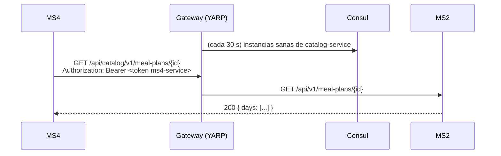
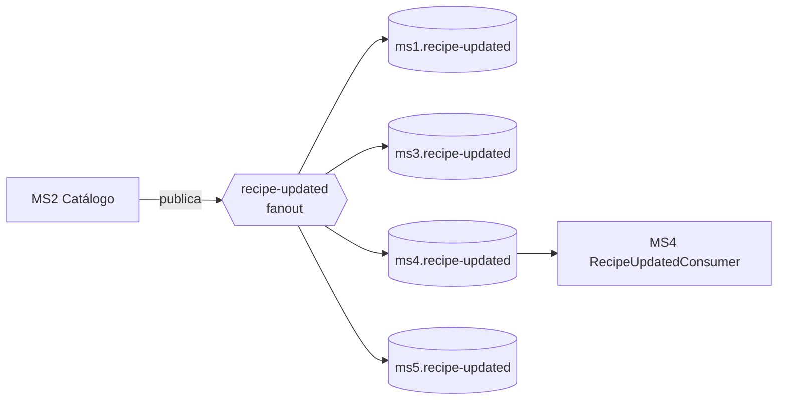

# Comunicación entre microservicios

> Este es el **foco del módulo del diplomado**. Cada patrón tiene su explicación, por qué se eligió y dónde verlo funcionando en el código real. La tabla concepto → evidencia está en [../course/module-focus.md](../course/module-focus.md).

## 1. Los dos estilos y cuándo se usa cada uno

| | Síncrono (REST) | Asíncrono (eventos) |
|---|---|---|
| Mecanismo | HTTP vía API Gateway | RabbitMQ, exchanges fanout |
| Acoplamiento | Temporal: el otro servicio tiene que estar vivo | Desacoplado: el publisher no sabe quién escucha |
| Se usa para | Comandos dirigidos a un dueño ("crea este calendario") y consultas que necesitan el dato fresco | Avisar que algo **ya pasó** ("se publicó un plan") a quien le interese |
| Ejemplo real | MS3 → MS4 `POST /schedule`; MS4 → MS2 `GET /meal-plans/{id}` | MS2 publica `meal-plan-published` y MS4 lo proyecta |
| Falla típica | Timeout / 5xx → reintento, estado intermedio | Mensaje duplicado o desordenado → idempotencia |

Regla práctica del proyecto: **comandos y consultas por REST, hechos por eventos**.

## 2. Comunicación síncrona

### 2.1 Todo pasa por el gateway
Los servicios no se llaman por IP ni por nombre de contenedor: llaman al gateway con el prefijo del **nombre en Consul** del destino.



Ventaja: mover, escalar o reiniciar un servicio no rompe a quien lo llama, porque el gateway descubre la instancia nueva por Consul.

### 2.2 Identidad entre servicios: service accounts
Cuando un servicio llama a otro **por su cuenta** (no en nombre de un usuario), se autentica con una **service account**: un usuario de identity con los scopes mínimos.
- MS4 usa `ms4-service` con el scope `catalog.mealPlan:read`.
- El token se obtiene con `POST /api/identity-service/v1/auth/login`, se cachea hasta 60 s antes de vencer y se renueva una vez si el destino responde 401.

### 2.3 Resiliencia
- Reintentos y timeouts con el resilience handler de .NET (ServiceDefaults en MS4).
- **Degradación controlada:** si MS2 no responde, el día de MS4 queda en `Scheduled` y el job se puede volver a correr (es idempotente). Nunca queda a medio actualizar.
- **No resolver bajo demanda:** MS4 resuelve el menú de mañana **antes** de que MS3 lo pida. Así una caída de MS2 no tumba la consulta de MS3.

### 2.4 Consulta en lugar de evento (decisión documentada)
La orden de producción diaria se obtiene con un **GET** de MS3 a MS4 (`/calendars/active-tomorrow`), y no con el evento `ProductionOrderRequired` que se planteó en la fase de arquitectura. Motivo: MS3 necesita la foto completa del día en un momento concreto, y una consulta idempotente es más simple de razonar que reconstruirla a partir de eventos.

## 3. Comunicación asíncrona

### 3.1 Topología: un exchange por evento, una cola por consumidor

- **Fanout:** cada consumidor recibe su propia copia. Agregar un consumidor nuevo no toca al publisher.
- La topología se declara **una sola vez**, de forma central (`rabbitmq-definitions.json`), y no la crea cada servicio. Así se evitan conflictos de flags (406).

### 3.2 El sobre común de todo evento
Todos los contratos heredan de `IntegrationMessageContract` (kernel `Nur.Tricenter.Integration`):

| Campo | Para qué |
|---|---|
| `Id` | Identidad del mensaje: es la clave de idempotencia del inbox |
| `CreatedAt` | Cuándo ocurrió el hecho |
| `CorrelationId` | Une el evento con la traza de la petición que lo originó |
| `Source` | Servicio que lo publicó |
| `EventType` | Nombre lógico, p. ej. `MealPlan.Published` |

### 3.3 Publicar sin perder eventos: transactional outbox
Problema: si guardas en tu BD y después publicas en RabbitMQ, y el proceso muere en el medio, el evento se pierde (o se publica algo que nunca se guardó).

Solución usada por MS2, Identity y MS5 (`Joseco.Outbox.EFCore`):
1. El caso de uso guarda el cambio **y** el evento en una tabla `outbox`, en la **misma transacción**.
2. Un worker lee la tabla y publica en RabbitMQ.
3. Si falla, lo reintenta. La garantía es **at-least-once**: el evento puede llegar más de una vez.

### 3.4 Consumir sin duplicar: inbox idempotente
Como la entrega es at-least-once, el consumidor tiene que tolerar duplicados. MS4 (y MS2) encadenan decoradores:

```
TracingConsumer → IdempotentConsumer (tabla InboxMessages, clave = Id del mensaje) → Handler real
```
- Si el `Id` ya está en el inbox, el mensaje se descarta.
- Además, los handlers hacen **upsert** en lugar de insert, para que re-publicar un plan lo refresque y no falle.

### 3.5 Proyecciones locales (read models)
Un servicio guarda **su propia copia** de los datos ajenos que necesita, alimentada por eventos:
- MS4 → `PlanCatalog` (de `meal-plan-published`): valida que la duración pedida en `POST /schedule` coincida con la del plan, sin llamar a MS2.
- MS2 → `PlanAuthors` (de `user-published`): sabe quién es el autor de cada plan sin llamar a identity.

Esto es **consistencia eventual**: la copia puede ir unos segundos atrás, a cambio de autonomía.

## 4. Seguridad en la comunicación
Detalle en [security.md](./security.md). En resumen: el gateway no autentica; cada servicio valida el JWT y exige **un scope por endpoint**.

## 5. Idempotencia: el hilo conductor
| Dónde | Mecanismo |
|---|---|
| MS4 `POST /schedule` | Búsqueda previa por `contractId` + índice único: un reintento de MS3 devuelve el mismo calendario |
| MS4 job de catálogo | Reemplaza las líneas de la orden existente (índice único por fecha) |
| MS4 `PATCH /delivery-result` | Repetir el mismo resultado no hace nada |
| Consumidores (MS2, MS4) | Inbox por `Id` de mensaje + upsert |
| Publishers (MS2, Identity, MS5) | Outbox: reintentar no pierde ni inventa eventos |

## 6. Matriz de comunicación actual
Fuente: el código de cada repo a la fecha. La futura app visual la va a generar desde los `service.yaml`.

| Origen → destino | Estilo | Qué | Estado |
|---|---|---|---|
| MS3 → MS4 | REST | `POST /schedule`, `GET /calendars/active-tomorrow` | MS4 lo expone; MS3 sin repo |
| Frontend → MS4 | REST | direcciones, reprogramar, cancelar, consultar | MS4 lo expone; frontend sin repo |
| MS4 → MS2 | REST + service account | `GET /api/catalog/v1/meal-plans/{id}` | funcionando |
| MS5 → MS4 | REST | `PATCH /delivery-result` | **MS5 no lo llama todavía** |
| MS5 → ClinicService | REST | `GET /patients/contact-information` | contra un mock de Postman |
| MS2 → todos | eventos | food/recipe/meal-plan (5 exchanges) | publicado; MS4 consume 2 |
| Identity → todos | eventos | user-published, user-updated | publicado; MS2 consume 1 |
| MS5 → ? | eventos | 10 exchanges de logística | **sin colas enlazadas** |
