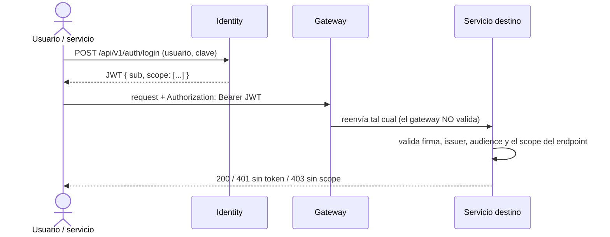

# Seguridad entre servicios

## Modelo

## JWT
- Clave **simétrica** compartida (`Jwt:SecretKey`) entre identity y cada servicio que valida. Es obligatoria al arrancar: el kernel lanza una excepción si falta.
- `issuer`: `nur-tricenter-identity` · `audience`: `nur-tricenter-clients`.
- Los permisos viajan como **claims `scope` repetidos**. Por eso los hosts configuran `MapInboundClaims = false`: si no, .NET renombra los claims y las policies no los encuentran.
- `Nur.Tricenter.Security.AddSecurity()` registra la validación y **una policy de autorización por scope**. El endpoint declara `RequireAuthorization("<scope>")`.

## Scopes por servicio (kernel `Nur.Tricenter.Access`)
Formato: `{servicio}.{recurso}:{acción}`.

| Servicio | Scopes |
|---|---|
| MS2 Catálogo | `catalog.food:{read,create,edit,manage}`, `catalog.recipe:{…}`, `catalog.mealPlan:{…}` |
| MS4 Calendario | `deliveryCalendar.calendar:{read,create,edit}`, `deliveryCalendar.productionOrder:read`, `deliveryCalendar.deliveryResult:edit`, `deliveryCalendar.catalogResolution:manage` |
| Identity | `identity.user:{login,read,create,edit,manage}`, `identity.role:{…}`, `identity:*` |
| MS5 Logística | _no tiene scopes en el kernel_ (no existe `LogisticsPermission`) y no valida JWT: llama a `AddAuthorization()`/`UseAuthorization()` sin `AddSecurity()`, y sus 7 endpoints de negocio son anónimos |
| MS1 | _sin definir_ |
| MS3 Contratación | _sin definir_: sus endpoints son anónimos (X-11) |

- `platform:*` (que tiene el `admin` sembrado) se **expande al hacer login** en todos los scopes concretos (`PlatformPermissions.Expand`).

## Service accounts
Usuarios técnicos para las llamadas servicio → servicio, con **mínimo privilegio**.

| Cuenta | Usada por | Scopes | Para |
|---|---|---|---|
| `ms4-service` | MS4 | `catalog.mealPlan:read` | Leer la composición del plan en MS2 |
| `ms3-service` | MS3 | `deliveryCalendar.calendar:create`, `deliveryCalendar.productionOrder:read` | Crear el calendario de un contrato y leer la orden de producción en MS4 |

MS5 **no tiene service account**: su única llamada saliente (ClinicService, hoy un mock de Postman) va sin token, y no llama a MS4 (el cierre del ciclo va por eventos que MS4 consume). Si se prefiriera cerrar X-01 por REST, haría falta `ms5-service` con el scope `deliveryCalendar.deliveryResult:edit`.

Cuando agregues una service account, documéntala aquí y en el `service.yaml` (`sync_calls[].auth: service-account:<cuenta>`).

## Endpoints anónimos
`/health` y `/alive` de cada servicio: Consul los usa como health check. Login de identity. **Todos** los endpoints de MS5 (`/api/v1/couriers`, `/routes`, `/packages/deliveries`, `…/route/today`, `…/start`, `…/deliver`, `…/fail`), también a través del gateway.

## Riesgos conocidos
- **Autorización por objeto (BOLA):** los scopes dicen *qué tipo* de cliente llama, no *de quién* es el recurso. En MS4, un token con `deliveryCalendar.calendar:edit` puede editar el calendario de cualquier paciente. Cerrarlo requiere mapear el `sub` del token al `PatientId`, que vive en MS1.
- **Clave simétrica compartida:** quien tenga la clave puede emitir tokens. Una evolución natural es pasar a firma asimétrica (RS256 + JWKS).
- **MS5 sin autenticación:** cualquiera que llegue al gateway puede crear repartidores y rutas, cargar paquetes y marcar entregas como entregadas o fallidas. Ver [../services/ms5-logistics/gaps.md](../services/ms5-logistics/gaps.md) (ms5-gap-01) y X-03.
