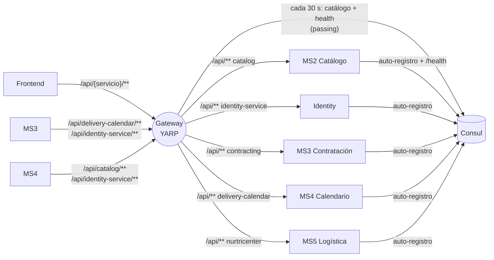

# Gateway — API Gateway de la plataforma

> **Owner:** sin owner asignado · **Repo:** [Nur-tricenter/nur-tricenter-api-gateway](https://github.com/Nur-tricenter/nur-tricenter-api-gateway) · **Estado de la ficha:** complete

## Propósito
Es la **puerta de entrada única** de la plataforma. El frontend y los microservicios no se llaman entre sí por dirección fija: llaman a `/api/{servicio}/...` en el gateway, y el gateway averigua en Consul qué instancia sana atiende ese servicio. Si mañana se borra el gateway, ninguna llamada entre servicios encuentra su destino (todos los adaptadores apuntan a `http://gateway:8080`) y el frontend no tiene a dónde llamar.

## Responsabilidades
- Construir la **tabla de rutas** a partir del catálogo de Consul, cada 30 s, usando **solo instancias que pasan su health check**.
- Reenviar `/api/{consul-name}/**` al servicio, reescribiendo la ruta a `/api/**` (el servicio ve su propia ruta `/api/v1/...`).
- Repartir la carga entre las instancias sanas de un mismo servicio (una destination por instancia).
- Seguir funcionando con la última tabla conocida si Consul no responde.
- Garantizar un `X-Correlation-Id` en cada request (lo respeta si viene, lo genera si no) y devolverlo en la respuesta.
- Exponer su propio estado en `/health` y un tablero en `/health-ui`.

## Lo que NO hace
- **No valida JWT ni scopes.** El token pasa tal cual; cada servicio lo valida (o no) por su cuenta → **identity** emite, **cada MS** valida.
- No tiene CORS, rate limiting, timeouts ni reintentos propios.
- No conoce los endpoints de cada servicio ni publica documentación (sin Swagger/OpenAPI): cada servicio documenta su contrato.
- No se registra en Consul ni tiene base de datos.
- No publica ni consume eventos (no se conecta a RabbitMQ).
- No termina TLS: escucha HTTP plano en `:8080`. Eso le corresponde a un ingress/balanceador.

## Actores y vecinos
| Actor / servicio | Dirección | Mecanismo | Para qué |
|---|---|---|---|
| Frontend (paciente) | entrante | REST | Llamar a MS3/MS4 (y a identity para el login) |
| MS3, MS4 (y scripts de `nur-tricenter-local`) | entrante | REST | Llamadas entre servicios (`http://gateway:8080/api/...`) |
| Operaciones | entrante | REST | `/health`, `/health-ui` |
| Consul | saliente | HTTP API de Consul (directo) | Leer servicios e instancias sanas cada 30 s |
| MS2, MS3, MS4, MS5, identity | saliente | Proxy HTTP (directo a la instancia) | Reenviar cada request a `http://{Address}:{Port}/api/**` |

## Mapa de comunicación

No hay flechas punteadas: el gateway no participa de la mensajería.

## Tabla de rutas actual
La ruta pública es siempre `/api/{nombre en Consul}/**`. El nombre lo elige cada servicio al registrarse (`ServiceRegistration__ServiceName`), no el gateway.

| Servicio | Nombre en Consul | Prefijo público | Ejemplo público → upstream |
|---|---|---|---|
| MS2 Catálogo | `catalog` | `/api/catalog` | `/api/catalog/v1/foods` → `/api/v1/foods` |
| Identity | `identity-service` | `/api/identity-service` | `/api/identity-service/v1/auth/login` → `/api/v1/auth/login` |
| MS3 Contratación | `contracting` | `/api/contracting` | `/api/contracting/v1/...` → `/api/v1/...` |
| MS4 Calendario | `delivery-calendar` | `/api/delivery-calendar` | `/api/delivery-calendar/v1/schedule` → `/api/v1/schedule` |
| MS5 Logística | `nurtricenter` | `/api/nurtricenter` | `/api/nurtricenter/v1/...` → `/api/v1/...` |
| MS1 Clínica | — (no se registra) | sin ruta | — |

Los workers (`*-workerservice`) no se registran, así que tampoco tienen ruta.

## Stack y despliegue
- **.NET 10** (`net10.0`, a propósito: no consume kernels compartidos), **YARP** `Yarp.ReverseProxy` 2.3.0, cliente **Consul** 1.7.14.7, `AspNetCore.HealthChecks.UI` 9.0.0 con storage en memoria. Tests: xUnit + Moq sobre `ConsulYarpConfigProvider`.
- **Sin BD, sin workers, sin registro en Consul.**
- **En la plataforma** (`nur-tricenter-local/compose/docker-compose.yml`, declarado **inline**, no por `include:`):

| | Valor |
|---|---|
| Servicio / contenedor | `gateway` / `nur-tricenter-gateway`, hostname `gateway` |
| Imagen | `mcr.microsoft.com/dotnet/aspnet:10.0` con `bin/Debug/net10.0` del repo montado en `/app` (solo lectura). Lo compila `start-stack.*` antes de levantar; el `Dockerfile` del repo no se usa aquí |
| Entorno | `ASPNETCORE_ENVIRONMENT=Development`, `ASPNETCORE_URLS=http://+:8080`, `ServiceRegistration__ServiceDiscoveryAddress=http://nur-tricenter-consul:8500` |
| Puertos | host `15005` → contenedor `8080` |
| Health check del contenedor | sonda TCP a `127.0.0.1:8080` (no usa `/health`) |
| Depende de | `consul` (`service_started`) |

- **Fuera de la plataforma:** `dotnet run --project ApiGateway.App` (`http://localhost:8080`, Consul en `http://localhost:8500` según `appsettings.Development.json`).
- **Configuración obligatoria:** `ServiceRegistration:ServiceDiscoveryAddress`. Si falta o no es una URI absoluta, el arranque falla con un `InvalidOperationException` que nombra la clave. Solo está en `appsettings.Development.json`; en otro entorno hay que pasarla por variable de entorno.

## Índice de la ficha
- [domain.md](./domain.md): la tabla de rutas como "modelo" y su ciclo de vida
- [api.md](./api.md): endpoints propios y contrato del proxy
- [integrations.md](./integrations.md): Consul y el reenvío a los servicios
- [messaging.md](./messaging.md): no participa de la mensajería
- [flows.md](./flows.md): request a través del gateway, servicio caído, servicio nuevo
- [gaps.md](./gaps.md): deuda, inconsistencias y dependencias
- [service.yaml](./service.yaml): datos estructurados
