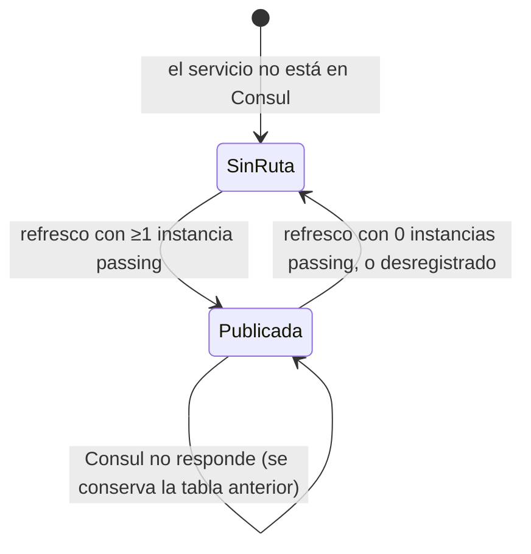

# Modelo — Gateway

El gateway **no tiene dominio de negocio**: no guarda datos ni toma decisiones de negocio. Su único "modelo" es la **tabla de rutas** que arma a partir de Consul. Esta página la describe con el mismo formato que un dominio, para que se entienda qué invariantes protege.

## Lenguaje propio
| Término | Significado aquí |
|---|---|
| Servicio | Un nombre registrado en el catálogo de Consul (p. ej. `delivery-calendar`). No es necesariamente "un MS": identity también lo es |
| Instancia sana | Una entrada de `Health.Service(nombre, passingOnly: true)`: sus health checks en Consul están en `passing` |
| Ruta (`RouteConfig`) | `{nombre}-route`: el patrón `/api/{nombre}/{**catch-all}` y sus transforms |
| Cluster (`ClusterConfig`) | `{nombre}-cluster`: el conjunto de instancias sanas de un servicio |
| Destination (`DestinationConfig`) | Una instancia: `http://{Address}:{Port}`, con el `Service.ID` de Consul como clave |
| Snapshot (`ConsulProxyConfig`) | La tabla completa (rutas + clusters) en un momento. Es inmutable y se reemplaza entera |
| Change token | La señal con que YARP se entera de que hay un snapshot nuevo |

## "Agregado": el snapshot de configuración
- **Representa:** la tabla de rutas vigente que YARP lee en cada request.
- **Clase:** `ConsulProxyConfig` (privada, dentro de `ApiGateway.App/Config/ConsulYarpConfigProvider.cs`), expuesta por `ConsulYarpConfigProvider.GetConfig()`.
- **Invariantes:**
  - Hay **una ruta y un cluster por servicio con al menos una instancia sana**. Un servicio sin instancias sanas no aparece.
  - `consul` nunca tiene ruta (ni siquiera se le consulta el health).
  - Cada destination usa **`http://`** (Consul no guarda el esquema; el gateway lo fija).
  - El snapshot es **inmutable**: cada refresco crea uno nuevo, lo publica y **cancela el token del anterior**. Cancelar el del nuevo dejaría a YARP congelado en el primer snapshot.
  - Si el refresco falla en cualquier punto, **no se publica nada**: queda el snapshot anterior completo (nunca uno a medias).
- **Inicial:** al construirse, el provider arranca con un snapshot vacío y lanza el primer refresco inmediatamente (`TimeSpan.Zero`).

## Diagrama de clases
```mermaid
classDiagram
  class ConsulYarpConfigProvider {
    -TimeSpan RefreshInterval = 30s
    -Timer _timer
    -ConsulProxyConfig _config
    +GetConfig() IProxyConfig
    ~RefreshAsync() Task
    -SwapConfig(routes, clusters)
    -BuildHttpClientConfig() HttpClientConfig?
  }
  class ConsulProxyConfig {
    +IReadOnlyList~RouteConfig~ Routes
    +IReadOnlyList~ClusterConfig~ Clusters
    +IChangeToken ChangeToken
    +SignalChange()
  }
  class RouteConfig {
    +RouteId = "{name}-route"
    +ClusterId = "{name}-cluster"
    +Match.Path = "/api/{name}/{**catch-all}"
    +Transforms = PathRemovePrefix, PathPrefix
  }
  class ClusterConfig {
    +ClusterId = "{name}-cluster"
    +Destinations
    +HttpClient (Development: DangerousAcceptAnyServerCertificate)
  }
  class DestinationConfig {
    +Address = "http://{Address}:{Port}"
  }
  ConsulYarpConfigProvider --> ConsulProxyConfig : publica
  ConsulProxyConfig "1" *-- "*" RouteConfig
  ConsulProxyConfig "1" *-- "*" ClusterConfig
  ClusterConfig "1" *-- "1..*" DestinationConfig
  RouteConfig ..> ClusterConfig : ClusterId
```

## Ciclo de vida de la ruta de un servicio

- Mientras no hay ruta, YARP no matchea y la request termina en **404**.
- Los cambios se ven **en el siguiente refresco** (hasta 30 s después), no al instante.

## Reglas
| Regla | Dónde se aplica | Qué pasa si no se cumple |
|---|---|---|
| Solo instancias passing reciben tráfico | `RefreshAsync` (`passingOnly: true`) | — |
| Sin instancias sanas → sin ruta | `RefreshAsync` (`Response.Length == 0` → `continue` + warning) | La request da 404 en vez de colgarse |
| Una caída de Consul no tumba el gateway | `try/catch` en `RefreshAsync` | Log de error, sigue la tabla anterior |
| La dirección de Consul es obligatoria y válida | `DependencyInjection.AddConsulServiceDiscovery` | `InvalidOperationException` al arrancar |
| El provider se registra antes de `AddReverseProxy()` | `DependencyInjection.AddReverseProxyWithConsul` | YARP usaría el provider por defecto (appsettings) y no habría rutas |
| Aceptar cualquier certificado solo en Development | `BuildHttpClientConfig` | Fuera de Development, `HttpClient = null` (validación normal) |

## Datos que son copia de otro servicio
| Dato | Origen | Cómo se mantiene |
|---|---|---|
| Nombres de servicio, dirección y puerto de cada instancia sana | Consul (catálogo + health) | Polling cada 30 s; se guarda solo en memoria |
