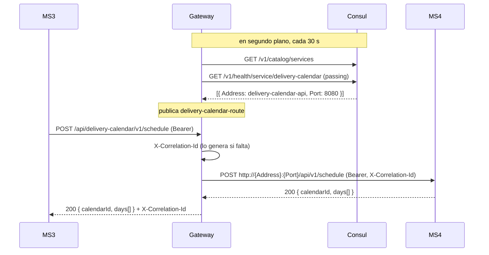
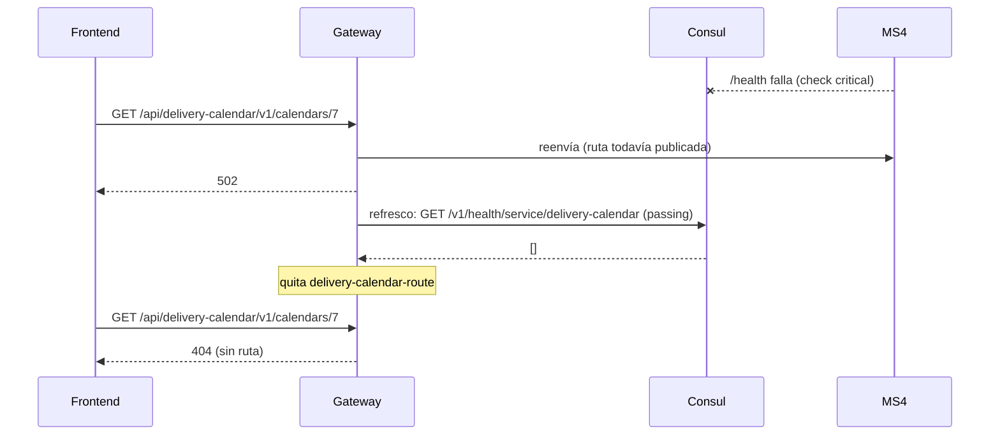
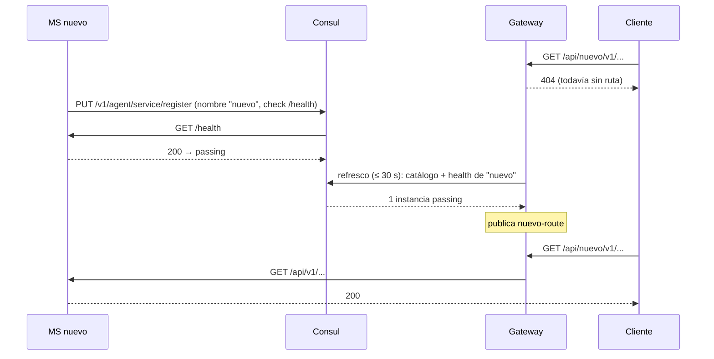

# Flujos — Gateway

Todos los flujos cruzan fronteras: el gateway solo existe entre un llamador, Consul y un servicio.

## F1 — Una request atraviesa el gateway (MS3 → Gateway → MS4)
- **Actor:** cualquier cliente; el ejemplo es MS3 creando un calendario en MS4.
- **Disparador:** `POST http://gateway:8080/api/delivery-calendar/v1/schedule`.
- **Precondición:** MS4 está registrado en Consul como `delivery-calendar` con al menos una instancia passing, y ya pasó un refresco desde que lo está.
- **Camino feliz:**
  1. `UseCorrelationId` agrega `X-Correlation-Id` si no viene.
  2. YARP matchea `delivery-calendar-route`, quita `/api/delivery-calendar` y agrega `/api` → `/api/v1/schedule`.
  3. Elige una instancia de `delivery-calendar-cluster` y reenvía la request con todos sus headers (incluido el `Bearer`).
  4. MS4 valida el JWT y responde; el gateway devuelve la respuesta tal cual, más el `X-Correlation-Id`.
- **Errores:**
  | Situación | Resultado |
  |---|---|
  | Token ausente o inválido | 401/403 **de MS4** (el gateway no lo mira) |
  | MS4 sin instancias passing | 404 del gateway (F2) |
  | La instancia cayó después del último refresco | 502 |
- **Idempotencia / reintentos:** el gateway no reintenta. Si el llamador reintenta, la idempotencia es la del endpoint de destino.

La dirección exacta es la que el servicio registra en Consul; el diagrama la abrevia.

## F2 — El servicio de destino deja de estar sano → 404
- **Actor:** Consul (sus health checks) y el timer del gateway.
- **Disparador:** el `/health` de un servicio empieza a fallar, el contenedor se detiene o el servicio se desregistra.
- **Camino:**
  1. Consul marca la instancia como `critical` según el intervalo de su propio check.
  2. En el siguiente refresco (≤ 30 s), `Health.Service(..., passingOnly: true)` devuelve 0 instancias → warning en el log y **sin ruta**.
  3. Las requests a `/api/{servicio}/**` reciben **404** inmediato del gateway, en vez de quedar colgadas.
  4. Cuando la instancia vuelve a `passing`, el siguiente refresco republica la ruta.
- **Ventana ciega:** entre que la instancia cae y el siguiente refresco, la ruta sigue publicada y las requests terminan en **502** (no hay health checks activos ni pasivos en YARP).
- **Para el llamador:** un 404 puede significar "endpoint inexistente" o "servicio caído". El cuerpo vacío del gateway es la única pista.

## F3 — Aparece un servicio nuevo → ruta en ≤ 30 s
- **Actor:** el equipo de un MS nuevo (o una instancia nueva de uno existente).
- **Disparador:** el servicio se auto-registra en Consul con `ServiceRegistration__ServiceName` y un health check.
- **Camino feliz:**
  1. El servicio se registra; Consul lo marca `passing` cuando su check responde.
  2. En el siguiente refresco el gateway lo ve en el catálogo y publica `/api/{nombre}/**`. **Sin tocar el gateway ni reiniciarlo.**
  3. Una instancia adicional del mismo nombre se suma como otra destination del mismo cluster.
- **Requisitos para el servicio** (los impone el gateway):
  - Usar rutas internas `/api/...` (el gateway re-agrega `/api`).
  - Elegir el nombre en Consul sabiendo que **es** el prefijo público.
  - Registrar una dirección resoluble desde el contenedor del gateway (`nur-tricenter-net`).
- **Efecto visible al levantar el stack:** las rutas aparecen de a poco. Por eso `start-stack.*` reintenta el login de identity contra el gateway antes de crear la service account de MS4.

