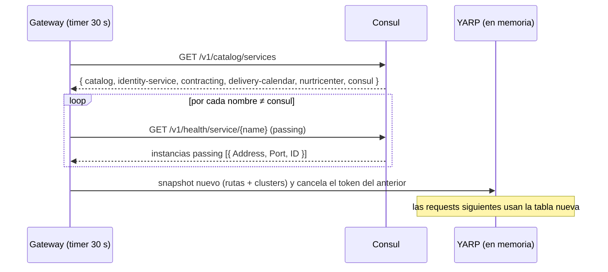

# Integraciones síncronas — Gateway

El gateway tiene dos tipos de tráfico saliente: su **dependencia real** (la API HTTP de Consul, que consulta por su cuenta) y el **reenvío** de las requests que recibe (proxy). En `service.yaml → sync_calls` solo figura Consul: el reenvío no es una llamada propia del gateway sino la mitad de cada llamada que otro servicio declara con `via: gateway`.

## Resumen
| Destino | Método y ruta | Vía | Auth | Para qué |
|---|---|---|---|---|
| Consul | `GET /v1/catalog/services` | directo (`http://nur-tricenter-consul:8500`) | ninguna | Nombres de los servicios registrados |
| Consul | `GET /v1/health/service/{name}` con `passing` | directo | ninguna | Instancias sanas (dirección y puerto) de cada servicio |
| Cada servicio con ruta | el método recibido, `/api/**` | directo a `http://{Address}:{Port}` | la del llamador (se reenvía) | Proxy de `/api/{servicio}/**` |

## Gateway → Consul: descubrimiento
- **Componente:** `ApiGateway.App/Config/ConsulYarpConfigProvider.cs` (implementa `IProxyConfigProvider` de YARP). Cliente: `IConsulClient` registrado como singleton en `DependencyInjection.AddConsulServiceDiscovery`.
- **Dirección:** `ServiceRegistration:ServiceDiscoveryAddress` (en compose, `http://nur-tricenter-consul:8500`; en desarrollo, `http://localhost:8500`). Sin token ACL.
- **Frecuencia:** un `Timer` con primer disparo inmediato y luego **cada 30 s**. No usa blocking queries ni watches de Consul.
- **Qué hace en cada refresco:**
  1. `Catalog.Services()` → lista de nombres (sin información de salud).
  2. Por cada nombre distinto de `consul`: `Health.Service(name, tag: null, passingOnly: true)`. Son **N + 1 llamadas** por refresco.
  3. Arma rutas y clusters con las instancias passing y publica el snapshot nuevo (ver [domain.md](./domain.md)).
- **Por qué es síncrono (polling) y no un evento:** Consul no publica en RabbitMQ y la tabla de rutas tiene que estar en memoria para cada request. El costo es la latencia: un cambio tarda hasta 30 s en verse.
- **Si falla:**
  | Situación | Resultado |
  |---|---|
  | Consul caído, timeout, DNS, respuesta inválida | Se loguea `Failed to refresh the YARP configuration from Consul; keeping the previous route table.` y **sigue la tabla anterior** completa |
  | Consul caído **al arrancar** | La tabla queda vacía (todas las rutas dan 404) hasta el primer refresco que funcione |
  | Un servicio con 0 instancias passing | Warning `Service {ServiceName} has no healthy instances; its route will not be published.` y sin ruta → 404 |
  | Clave de configuración ausente o inválida | No arranca (`InvalidOperationException`) |
- **Sin Consul (tests):** `IConsulClient` es inyectable; `ConsulYarpConfigProviderTests` lo reemplaza con Moq y llama a `RefreshAsync()` (interno, visible para el proyecto de tests) para no depender del timer.

## Gateway → servicios: reenvío (proxy)
- **Componente:** YARP (`MapReverseProxy`), con las rutas y clusters que publica el provider.
- **Destino:** `http://{Service.Address}:{Service.Port}` tal como se registró en Consul. El esquema es **siempre** `http`.
- **Autenticación:** el gateway no agrega ni quita credenciales. Si el llamador mandó `Authorization: Bearer …`, llega al servicio.
- **Timeouts, reintentos y health checks de YARP:** no se configuran. Se usan los valores por defecto de YARP (sin reintentos, sin health checks activos ni pasivos). La única protección contra instancias caídas es el filtro `passing` de Consul, con su retraso de hasta 30 s.
- **Certificados:** en Development el cluster lleva `DangerousAcceptAnyServerCertificate = true`; fuera de Development, validación normal. Como el destino siempre es `http://`, hoy esta opción no tiene efecto (ver gaps).

