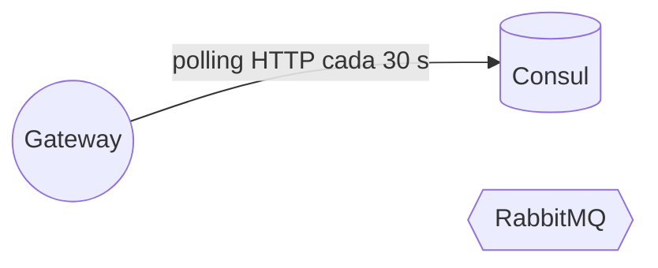

# Mensajería — Gateway

## Eventos publicados
**Ninguno.** El gateway no tiene dominio propio: no hay hechos de negocio que anunciar.

## Eventos consumidos
**Ninguno.** No referencia ningún cliente de RabbitMQ ni el kernel `Nur.Tricenter.Integration`, y la topología de `nur-tricenter-local/topology/rabbitmq-definitions.json` no declara colas para él.

## Colas declaradas que no se consumen
Ninguna.

## Garantías de entrega
No aplica. La única información que el gateway recibe de otro componente (la lista de servicios sanos) llega por **polling HTTP a Consul**, no por mensajes: ver [integrations.md](./integrations.md).

Lo más parecido a una garantía transversal es el `X-Correlation-Id`: el gateway asegura que toda request que entra por él lo lleve. Que ese id se use para correlacionar logs o eventos depende de cada servicio; el gateway no lo loguea.

## Diagrama

Sin conexión con RabbitMQ.
