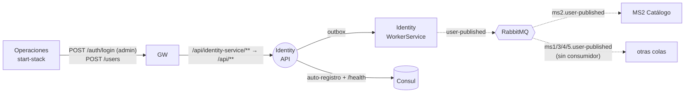

# Identity — Emisor de tokens de la plataforma

> **Owner:** sin owner asignado (los commits iniciales son de Robert Perez Lino, owner de MS2) · **Repo:** [Nur-tricenter/nur-tricenter-identity](https://github.com/Nur-tricenter/nur-tricenter-identity) · **Estado de la ficha:** complete

## Propósito
Identity convierte un usuario y una contraseña en un **JWT con los permisos (scopes) de esa cuenta**. Es el único emisor de tokens de la plataforma: los demás servicios no guardan contraseñas, solo validan la firma del token y miran sus scopes. Sin identity nadie puede llamar a los endpoints protegidos de MS2 y MS4, ni las service accounts de MS3 y MS4 pueden obtener su token.

## Responsabilidades
- Guardar las cuentas (`Users`) con su contraseña hasheada con **BCrypt** y sus scopes (`UserScopes`).
- **Login**: verificar la credencial y emitir un JWT HS256 (iss `nur-tricenter-identity`, aud `nur-tricenter-clients`, 3600 s) con los scopes en **un solo claim `scope` separado por espacios**.
- **Expandir el comodín `platform:*`** al iniciar sesión: la cuenta que lo tiene recibe la lista concreta de todos los scopes de la plataforma (kernel `Nur.Tricenter.Access`).
- Crear cuentas nuevas (`POST /api/v1/users`), que es como se crean las service accounts `ms3-service` y `ms4-service`.
- Sembrar el **administrador por defecto** (`DefaultUser:*`) con `platform:*`, desde el WorkerService.
- Publicar `UserPublished` (exchange `user-published`) por **outbox** cada vez que se crea una cuenta.

## Lo que NO hace
- **No autoriza** los endpoints de otros servicios: cada servicio valida el JWT con la misma clave y aplica sus propias policies (`Nur.Tricenter.Security`). El gateway tampoco valida.
- No sabe qué paciente es una cuenta: no existe relación entre el `sub` del token y el `PatientId` de MS1 (gap X-08).
- No tiene roles (los scopes `identity.role:*` existen en el kernel, pero no hay tabla ni endpoint de roles).
- No gestiona el ciclo de vida de una cuenta: no hay endpoints para listar usuarios, cambiar scopes, desactivar ni cambiar la contraseña.
- No emite refresh tokens ni revoca tokens: un JWT vale hasta que vence.
- **No consume eventos** ni llama por HTTP a ningún otro servicio.

## Actores y vecinos
| Actor / servicio | Dirección | Mecanismo | Para qué |
|---|---|---|---|
| MS4 Calendario, MS3 Contratación | — | — | They no longer log in (MS4#12, MS3#11: no outbound HTTP); `ms4-service` / `ms3-service` remain only for the demo console's security view |
| Operaciones (`start-stack.*`, personas con Postman/Swagger) | entrante | REST vía gateway | Login del `admin`; crear `ms3-service` y `ms4-service` |
| Consul | entrante | HTTP `/health` cada 10 s | Health check de la instancia registrada |
| Consul | saliente | Auto-registro como `identity-service` | Que el gateway lo encuentre |
| RabbitMQ | saliente | Evento (outbox) | `user-published` (y `user-updated`, cableado pero nunca disparado) |
| MS2 Catálogo | saliente | Evento → `ms2.user-published` | MS2 proyecta los autores de planes (`PlanAuthors`) |
| MS1, MS3, MS4, MS5 | saliente | Evento → `ms*.user-published` / `ms*.user-updated` | Colas declaradas en la topología, **sin consumidor** |

## Mapa de comunicación

Todas las llamadas entrantes pasan por el gateway con el prefijo `/api/identity-service`.

## Stack y despliegue
- **.NET 8** (lo fijan los kernels), ASP.NET Core **Controllers**, EF Core 9 + Npgsql (PostgreSQL), MediatR 12.4.1, `Joseco.DDD.Core`, `Joseco.Outbox.EFCore`, `Joseco.Communication.External.RabbitMQ` 1.1.0, `BCrypt.Net-Next`, Consul, Swashbuckle (solo en Development).
- **Kernels** `Nur.Tricenter.*` **1.2.0** (identity#2; los `Joseco.*` siguen en 1.1.0): `Security` (validación JWT + policies), `Access` (nombres de scopes y expansión de `platform:*`), `Integration` (contratos `UserPublished`/`UserChanged`) y `Observability` (Serilog + OpenTelemetry, nombre de servicio `Nur.Identity`).
- **Proyectos:** `Identity.App` (HTTP), `Identity.Application` (agregado `User`, eventos y handlers; no hay proyecto Domain aparte), `Identity.Infrastructure` (EF, outbox, BCrypt, Consul, seed) e `Identity.WorkerService` (outbox → RabbitMQ y seed del admin). **No hay proyecto de tests.**
- **Procesos en plataforma** (`identity.compose.yml`):

| Proceso | Qué hace |
|---|---|
| `identity-api` | API HTTP en el puerto 8080; se registra en Consul como `identity-service` |
| `identity-workerservice` | Drena el outbox a RabbitMQ, declara la cola `identity.default` y siembra el admin. No se registra en Consul |
| `identity-migrate` | Job one-shot (`Identity.App.dll --migrate`) que aplica las migraciones antes de que arranquen los otros dos |

- **BD:** `nur_tricenter_identity` en el Postgres compartido (tablas `Users`, `UserScopes` y `outbox.outboxMessage`).
- **Hay también un compose standalone** (`docker-compose.yml`) con su propio Postgres, la API en el puerto host 7081 y sin Consul.
- El `include` de `identity.compose.yml` en `nur-tricenter-local/compose/docker-compose.yml` se había perdido; volvió en nur-tricenter-local#7 (ver [gaps.md](./gaps.md), identity-gap-03).

## Índice de la ficha
- [domain.md](./domain.md): modelo de dominio, estados e invariantes
- [api.md](./api.md): endpoints expuestos y forma del token
- [integrations.md](./integrations.md): llamadas síncronas salientes (ninguna)
- [messaging.md](./messaging.md): eventos publicados
- [flows.md](./flows.md): casos de uso de punta a punta
- [gaps.md](./gaps.md): deuda, inconsistencias y dependencias
- [service.yaml](./service.yaml): datos estructurados
