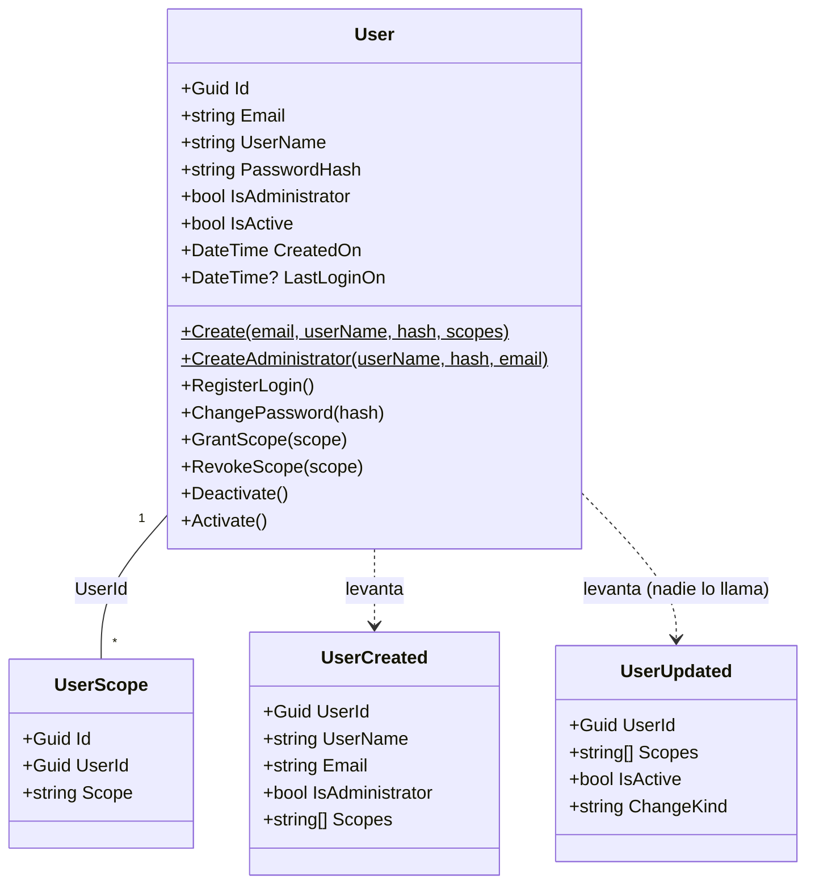
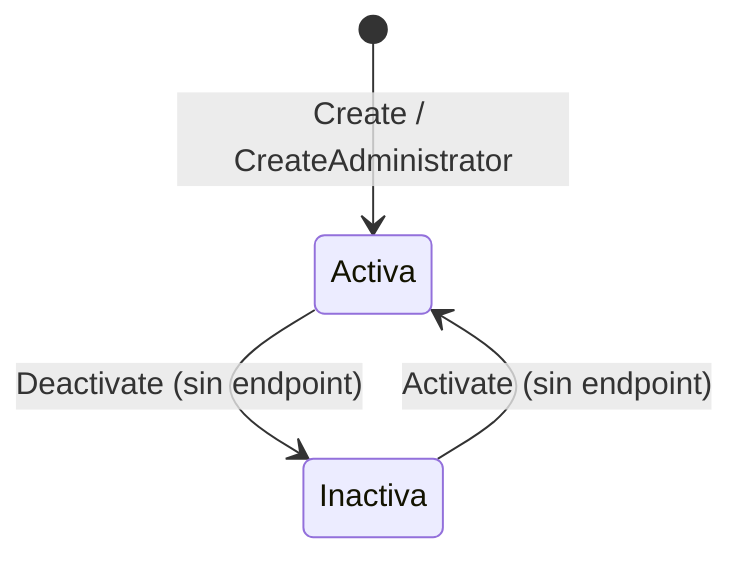

# Modelo de dominio — Identity

## Lenguaje ubicuo
| Término | Significado aquí |
|---|---|
| Cuenta (`User`) | Una identidad que puede iniciar sesión: una persona (el `admin`) o una **service account** (`ms3-service`, `ms4-service`). No hay distinción técnica entre ambas |
| Scope | Permiso con formato `{servicio}.{recurso}:{acción}` (p. ej. `catalog.mealPlan:read`). Los nombres viven en el kernel `Nur.Tricenter.Access` |
| `platform:*` | Comodín de **administrador de la plataforma**. Se guarda tal cual en `UserScopes` y se expande al iniciar sesión en los 27 scopes concretos de `Permission.PermissionsList` |
| `identity:*` | Comodín propio de identity. **No se expande** (`PlatformPermissions.Expand` solo reconoce `platform:*`), no se puede pedir por HTTP y en la práctica solo aparece como **nombre de claim** que marca al administrador en el token (`"identity:*": "true"`) |
| Administrador (`IsAdministrator`) | Bandera de la cuenta. Solo la tiene la cuenta creada por el seed (`User.CreateAdministrator`). No es un rol |
| Service account | Cuenta técnica para llamadas servicio → servicio, con mínimo privilegio. Se crea con `POST /api/v1/users` |
| Cuenta activa (`IsActive`) | Una cuenta desactivada conserva sus scopes pero no puede iniciar sesión. Hoy ningún endpoint desactiva cuentas |

## Agregados

### User (raíz)
- **Representa:** una cuenta que puede autenticarse.
- **Invariantes:**
  - Toda cuenta tiene email y hash de contraseña no vacíos (`User.Create`, `User.CreateAdministrator` lanzan `ArgumentException`). No existe un "hash por defecto".
  - `UserName` y `Email` son **únicos** (índices `IX_Users_UserName`, `IX_Users_Email`). La comparación es la de Postgres, sensible a mayúsculas.
  - Crear una cuenta **siempre** levanta `UserCreated` desde el constructor: una cuenta no puede existir sin su evento.
  - Los eventos llevan los scopes **ya expandidos**: ningún consumidor recibe el comodín.
- **Entidades asociadas:** `UserScope` (tabla `UserScopes`, una fila por scope, índice único `UserId + Scope`, borrado en cascada). No es una colección del agregado: el login la lee directamente.
- **Archivos:** `src/Identity.Application/Domain/User.cs`, `src/Identity.Infrastructure/Persistence/IdentityDbContext.cs`

### Métodos del agregado y quién los usa
| Método | Qué hace | Evento | ¿Lo llama algún endpoint? |
|---|---|---|---|
| `Create` | Cuenta normal (`IsAdministrator = false`) | `UserCreated` | Sí, `POST /users` |
| `CreateAdministrator` | Cuenta admin con `platform:*` | `UserCreated` | No, solo el seed del WorkerService |
| `RegisterLogin` | Actualiza `LastLoginOn` | ninguno (a propósito) | Sí, en cada login |
| `ChangePassword` | Reemplaza el hash | ninguno | Solo para re-hashear si cambió el work factor de BCrypt |
| `GrantScope` / `RevokeScope` | Cambia la lista en memoria `_scopes` | `UserUpdated` (`scopes`) | **No** |
| `Deactivate` / `Activate` | Cambia `IsActive` | `UserUpdated` (`deactivated` / `activated`) | **No** |

`GrantScope`/`RevokeScope` además solo tocan la lista en memoria del agregado, que **no está mapeada en EF**: aunque se llamaran, no cambiarían las filas de `UserScopes`, que es lo que lee el login.

## Diagrama de clases

## Máquina de estados de `User`

En la práctica toda cuenta está **siempre activa**: no hay forma de desactivarla sin tocar la BD.

## Reglas de negocio
| Regla | Dónde se aplica | Error si se viola |
|---|---|---|
| Login con un único mensaje de falla (usuario inexistente, contraseña mala o cuenta inactiva) | `LoginService.LoginAsync` | 401, mismo cuerpo siempre |
| Si el usuario no existe, igual se verifica un hash ficticio para que el tiempo de respuesta no delate qué falló | `LoginService` (`DummyHash`) | — |
| Se puede iniciar sesión con el `UserName` **o** con el `Email` | `LoginService` | — |
| Contraseñas con BCrypt (work factor `DefaultUser:WorkFactor`, 11 por defecto, acotado a 4–31); se re-hashea en el login si cambió el costo | `BcryptPasswordHasher`, `LoginService` | — |
| Crear cuenta exige `userName`, `password` y `email` no vacíos | `UserCreationService.CreateAsync` | 400 `{ detail }` |
| `identity:*` no se puede pedir por HTTP | `UserCreationService` | 400 `{ detail }` |
| `UserName` o `Email` ya usados | `UserCreationService` (consulta previa) + índices únicos | 409 `{ detail }` |
| ⚠ `platform:*` **sí** se puede pedir por HTTP y se guarda expandido | `UserCreationService` (no lo filtra) | — (ver identity-gap-01) |
| Los scopes pedidos no se validan contra el catálogo del kernel: cualquier texto se acepta | `UserCreationService` | — |
| El seed nunca resetea la contraseña de un admin existente (idempotente por `UserName`) | `DefaultUserInitializer.Initialize` | — |
| Seed habilitado sin contraseña → el WorkerService no arranca | `DefaultUserInitializer` | `InvalidOperationException` |
| La cuenta, sus scopes y la fila del outbox se guardan en **una sola transacción** | `UnitOfWork.CommitAsync` | — |

### Cómo se guardan los scopes
- **Admin del seed:** una sola fila `platform:*`. Se expande en cada login (si el kernel agrega scopes, el admin los recibe sin migrar datos).
- **Cuenta creada por HTTP:** se guarda **la lista ya expandida**. Si alguien pide `platform:*`, se guardan las 27 filas concretas de ese momento y la cuenta queda con `IsAdministrator = false`.

## Datos que son copia de otro servicio
Ninguno. Identity no consume eventos ni guarda datos de otros servicios. La única dependencia "de datos" es el **vocabulario de scopes** del kernel `Nur.Tricenter.Access` 1.1.0 (`Permission.PermissionsList`, `PlatformPermissions.Expand`), que se compila con el servicio: un scope nuevo en el kernel requiere actualizar el paquete y redesplegar identity para que el admin lo reciba.
