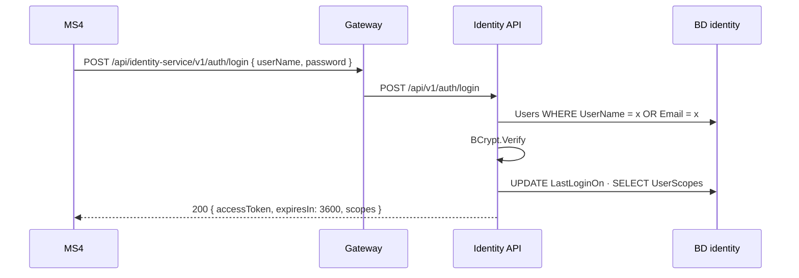
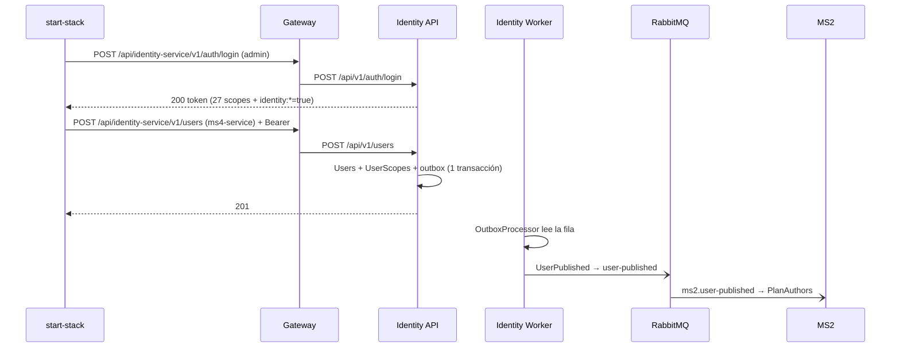

# Flujos — Identity

Los flujos F1, F2 y F3 cruzan fronteras de servicio. F4 muestra el riesgo más importante.

## F1 — Una service account obtiene su token (MS4/MS3 → Identity)
- **Actor:** MS4 (`ms4-service`) o MS3 (`ms3-service`).
- **Disparador:** `POST /api/identity-service/v1/auth/login` a través del gateway.
- **Precondición:** la cuenta fue creada por F3.
- **Camino feliz:**
  1. Busca la cuenta por `UserName` **o** `Email`.
  2. Verifica la contraseña con BCrypt; si el costo cambió, re-hashea.
  3. Comprueba que esté activa, registra `LastLoginOn` y lee sus filas de `UserScopes`.
  4. Expande `platform:*` si lo tiene y firma el JWT (HS256, 3600 s).
- **Errores:**
  | Situación | Resultado |
  |---|---|
  | Usuario inexistente, contraseña mala, cuenta inactiva | 401 idéntico (tiempo de respuesta equiparado) |
  | Identity no registrado en Consul | 404 del gateway |
- **Reintentos:** cada login emite un token nuevo; el cliente (MS4) lo cachea hasta 60 s antes de `expiresIn`.

## F2 — Un servicio valida el token sin hablar con identity
- **Actor:** MS2, MS3 o MS4 al recibir una request.
- **Camino feliz:** `AddSecurity` valida firma (clave compartida), `iss`, `aud` y vencimiento; la policy del endpoint busca el scope dentro del claim `scope` partido por espacios.
- **Por qué importa:** identity **no está en el camino caliente**. Si se cae, los tokens vigentes siguen sirviendo. La contracara: un token no se puede revocar antes de que venza.
- Diagrama: ver [integrations.md](./integrations.md).

## F3 — Alta de service accounts al levantar el stack (Operaciones → Identity ⇢ MS2)
- **Actor:** `nur-tricenter-local/scripts/start-stack.*`.
- **Precondición:** el WorkerService ya sembró el `admin` (`DefaultUser__Enabled=true`) con `platform:*`.
- **Camino feliz:**
  1. Login del `admin` (reintenta hasta 24 veces mientras el gateway descubre a identity).
  2. `POST /users` con `ms4-service` (`catalog.mealPlan:read`) y `ms3-service` (`deliveryCalendar.calendar:create`, `deliveryCalendar.productionOrder:read`).
  3. Cada alta guarda la cuenta, sus scopes y `UserCreated` en el outbox en una transacción.
  4. El worker publica `UserPublished` en `user-published`; MS2 lo proyecta en `PlanAuthors`.
- **Errores:** 409 si la cuenta ya existe (el script lo trata como "ya creada"); 400 si falta un campo o se pide `identity:*`.
- **Idempotencia:** por `userName`/`email` (409), no por request.

## F4 — Escalada de privilegios con `platform:*` (riesgo, no caso de uso)
- **Actor:** cualquier cuenta con `identity.user:manage`.
- **Qué pasa:** `POST /users` rechaza `identity:*` pero **acepta `platform:*`**. La cuenta nueva se guarda con los 27 scopes concretos, incluido `identity.user:manage` y todos los de MS2/MS4.
- **Resultado:** un administrador de plataforma de hecho (aunque `IsAdministrator = false`), creado con una sola llamada. Detalle en [gaps.md](./gaps.md) (identity-gap-01).

## F5 — Seed del administrador (WorkerService)
- **Disparador:** arranque de `identity-workerservice` con `DefaultUser__Enabled=true`.
- **Camino feliz:** si no existe una cuenta con ese `UserName`, la crea con `platform:*` y publica `UserPublished` (con `IsAdministrator = true`).
- **Idempotencia:** si ya existe, no toca la contraseña. Sin `DefaultUser__Password` el worker no arranca.
- **Ojo:** la API recibe las mismas variables `DefaultUser__*` en los compose, pero **no las usa**: solo el worker siembra.
