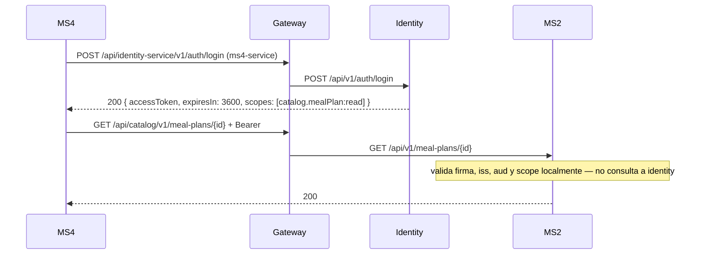

# Integraciones síncronas — Identity

## Resumen
Este servicio **no hace llamadas síncronas salientes** a otros microservicios: no tiene `HttpClient` hacia MS1–MS5 ni hacia el gateway (`sync_calls: []` en [service.yaml](./service.yaml)). Es una hoja del grafo REST: solo recibe llamadas.

Lo único que sale por HTTP es infraestructura, no negocio:

| Destino | Qué | Código | Si falla |
|---|---|---|---|
| Consul (`ServiceRegistration:ServiceDiscoveryAddress`) | Auto-registro como `identity-service` (host y puerto fijos por configuración) con un check HTTP a `/health` | `src/Identity.Infrastructure/Consul/ServiceRegistration.cs` | 3 intentos con backoff (500 ms, 1 s). Si no logra registrarse, **solo deja un warning** y sigue sirviendo: el gateway no lo encuentra (404 en `/api/identity-service/**`), pero el servicio no se cae |

El WorkerService habla con RabbitMQ (ver [messaging.md](./messaging.md)) y con Postgres; no se registra en Consul.

## Quién depende de identity (llamadas entrantes)
Aunque identity no llama a nadie, **casi todos dependen de él de forma síncrona**:

| Servicio | Llamada | Código del cliente | Si identity no responde |
|---|---|---|---|
| ~~MS4~~, ~~MS3~~ | ~~login as `ms4-service` / `ms3-service`~~ | removed in MS4#12 / MS3#11 (their token handlers and `Identity` options were deleted) | Nothing: MS3 and MS4 make no outbound HTTP any more. The accounts still exist in identity for the demo console |
| `nur-tricenter-local/scripts/start-stack.*` | Login del `admin` y `POST /api/identity-service/v1/users` para crear `ms4-service` y `ms3-service` (409 = ya existe) | scripts | El script reintenta el login 24 veces (el gateway tarda ~30 s en ver a identity en Consul) y luego aborta |

La **validación** del token, en cambio, no necesita a identity: cada servicio la hace localmente con la clave compartida. Si identity se cae, los tokens ya emitidos siguen sirviendo hasta que vencen (3600 s).

> **Historical diagram.** The flow below (MS4 logs in as `ms4-service` and calls MS2) was removed in MS4#12: MS4 no longer calls MS2 or identity. It shows how a service account would authenticate.

