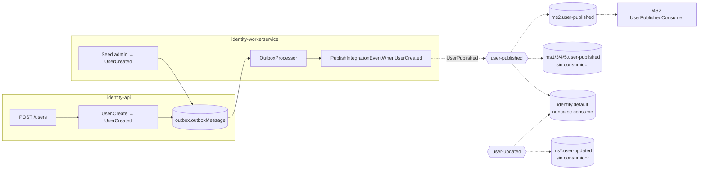

# Mensajería — Identity

## Eventos publicados
| Exchange | Contrato (kernel) | EventType | Se dispara cuando | Outbox |
|---|---|---|---|---|
| `user-published` | `UserPublished` | `User.Published` | Se crea una cuenta: `POST /api/v1/users` o el seed del admin en el WorkerService | sí |
| `user-updated` | `UserChanged` | `User.Changed` | `User.GrantScope/RevokeScope/Deactivate/Activate`. **Ningún endpoint ni proceso llama a esos métodos, así que hoy nunca se publica** | sí (cableado) |

Contratos: `Nur.Tricenter.Integration.Messages.Identity` (kernel 1.2.0).
- `UserPublished`: `UserId, UserName, Email, IsAdministrator, Scopes` (scopes **expandidos**: para el admin, los 27 concretos). Nunca lleva hash ni contraseña.
- `UserChanged`: `UserId, UserName, Email, Scopes, IsActive, ChangeKind` (`scopes` | `deactivated` | `activated` | `profile`).
- `Source = "identity"`; `CorrelationId` = trace id de la request que creó la cuenta (`OutboxTracingService`).

## Eventos consumidos
**Ninguno.** Identity es un productor puro: no registra consumidores ni tiene inbox (`RabbitMqExtensions.AddIdentityRabbitMq`).

## Quién escucha lo que publica
| Cola | Consumidor | Estado |
|---|---|---|
| `ms2.user-published` | MS2 `UserPublishedConsumer` → proyección `PlanAuthors` | **único consumidor real** |
| `ms1/ms3/ms4/ms5.user-published` | — | declaradas en la topología, sin consumidor (X-06) |
| `ms1..ms5.user-updated` | — | declaradas, sin consumidor; además el exchange nunca recibe mensajes |
| `identity.default` | — | la declara **el propio worker de identity**, durable, ligada a los dos exchanges y **nunca se consume a propósito** ("registro completo de lo publicado"). No figura en `rabbitmq-definitions.json` ni en [`contracts/events.yaml`](../../contracts/events.yaml) y crece sin límite (identity-gap-07) |

## Garantías de entrega
- **Publicación:** transactional outbox. `UnitOfWork.CommitAsync` drena los eventos de dominio del agregado → `SaveInOutboxWhen*` escribe la fila en `outbox.outboxMessage` → todo se guarda en la misma transacción que la cuenta. El **WorkerService** corre `OutboxProcessor<DomainEvent>` (`AddOutboxBackgroundService`) y los handlers `PublishIntegrationEventWhenUser*` traducen a contrato y publican. La API nunca drena el outbox (dos drenadores publicarían todo dos veces).
- **Declaración de exchanges:** a diferencia de lo que dice la doc de plataforma, identity **sí declara** su topología: el publisher usa `declareDestination: true` y `DefaultQueueRegistrar` declara los exchanges (`fanout`, no durables, iguales a la topología para evitar `406 PRECONDITION_FAILED`) y la cola `identity.default`.
- **Reintentos:** `RabbitMqSettings__MaxRetryAttempts=3`, base 500 ms. `DefaultQueueRegistrar` reintenta cada 10 s si el broker no está.
- **Trazabilidad:** `OutboxTracingService` estampa `TraceId`/`SpanId`/`CorrelationId` en la fila; el `CorrelationId` viaja dentro del mensaje (la librería no admite headers). API y worker reportan con el mismo nombre de servicio `Nur.Identity`.
- **Broker en 5672 obligatorio:** `Joseco.Communication.External.RabbitMQ` 1.1.0 ignora `RabbitMqSettings:Port`.

## Diagrama

