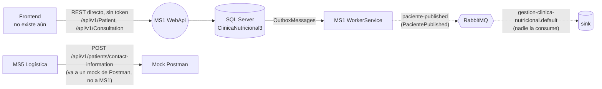

# MS1 — Clínica nutricional

> **Owner:** Diego Cabrera (@Juandcode) · **Repo:** [Juandcode/ClinicaNutricionalMicroservicio1](https://github.com/Juandcode/ClinicaNutricionalMicroservicio1) · **Estado de la ficha:** draft

> ⚠ **Repo fuera de la org; no integrado a la plataforma hoy.** El código vive en una cuenta personal, no en `Nur-tricenter`. No se registra en Consul, no está detrás del gateway, no valida JWT, usa su propio SQL Server y el `ms1.compose.yml` que espera `nur-tricenter-local` no existe. Ningún otro servicio lo llama de verdad. Esta ficha documenta **lo que hace el código** (rama `main`, 2026-10-24) y, por separado, [lo que la plataforma espera de MS1](#lo-que-la-plataforma-espera-de-ms1).

## Propósito
MS1 es la parte **clínica** del negocio: registra al paciente, toma su consulta inicial (peso, altura, antecedentes, hábitos alimenticios), la aprueba, le asigna un plan alimenticio y hace el seguimiento con evaluaciones de control. Sin MS1 no hay paciente registrado ni historia clínica que justifique el plan que después se contrata y se entrega.

## Responsabilidades
- Registrar pacientes (`CI`, nombre, apellido) y publicar el hecho (`paciente-published`).
- Registrar la **consulta inicial** de un paciente con sus antecedentes y hábitos, y aprobarla.
- Asignar a un paciente un **plan alimenticio** propio de la clínica (duración 15/30 días, vencimiento, comidas).
- Agendar el próximo control y registrar **evaluaciones** sobre el plan.

## Lo que NO hace
- No define recetas ni planes del catálogo → **MS2**. El `PlanAlimenticio` de MS1 es un concepto propio y **no referencia** al plan de MS2 (el README del repo dice que valida el plan contra MS2, pero el código no lo hace).
- No gestiona contratos ni pagos → **MS3**.
- No arma calendarios de entrega → **MS4**.
- No entrega ni guarda datos de contacto para logística → **MS5** los pide, pero MS1 no tiene teléfono ni el endpoint que MS5 espera.
- No autentica ni autoriza → **identity**; hoy MS1 tampoco valida tokens.
- **No consume eventos** de ningún otro servicio.

## Actores y vecinos
Estado real del código. Las relaciones que la plataforma espera y no existen están en la sección siguiente.

| Actor / servicio | Dirección | Mecanismo | Para qué |
|---|---|---|---|
| Frontend (paciente, recepción, nutricionista) | entrante | REST directo, sin token | Previsto por el README. **No hay frontend**; hoy solo Swagger y los tests |
| SQL Server (`localhost\SQLEXPRESS`) | saliente | EF Core | BD propia `ClinicaNutricional3` |
| RabbitMQ | saliente | Evento vía outbox | `paciente-published` (contrato local `PacientePublished`) |

## Mapa de comunicación

## Lo que la plataforma espera de MS1
Otros repos ya asumen un MS1 que todavía no coincide con este código:

| Quién | Qué espera | Estado en el código de MS1 |
|---|---|---|
| **MS5** (`ClinicService`) | `POST /api/v1/patients/contact-information` con un array de `patientId` (texto) → `[{ patientId, phoneNumber, fullName }]`. Hoy, **directo y sin token**, contra un mock de Postman | **No existe.** Además `Paciente` no tiene teléfono |
| **MS3** (modo simulación) | `GET /api/v1/patients/{id}` → `{ patientId, fullName, clinicalStatus }`, contra `ExternalServices:SimulationMockBaseUrl` o 3 pacientes en memoria | Existe `GET /api/v1/Patient/{id}`, pero devuelve la entidad `Paciente` (`id`, `ci`, `nombre`, `apellido`, `consultaIniciales`) y un id inexistente da **500**, no 404 |
| **nur-tricenter-local** | `ms1-clinica-nutricional/ms1.compose.yml`, proyectos `src/ClinicaNutricional.Api` y `src/ClinicaNutricional.WorkerService`, contenedores `nur-tricenter-clinica-nutricional-api`/`-workerservice`, ruta `/api/clinica-nutricional/v1/...` en el gateway (o sea, nombre Consul `clinica-nutricional`) | Nada de eso existe: los proyectos están en la raíz con otros nombres y no hay registro en Consul (X-12) |
| **Topología RabbitMQ** | 7 colas `ms1.*`: `food-published`, `food-nutritional-info-updated`, `recipe-published`, `recipe-updated`, `meal-plan-published`, `user-published`, `user-updated` | Ninguna se consume |
| **Topología RabbitMQ** | — (no declara ningún exchange de MS1) | MS1 publica en `paciente-published`, que la topología no conoce |
| **Seguridad (X-08)** | Mapeo del `sub` del token de identity al `PatientId`, para la autorización por objeto | `Paciente` no guarda ningún id de usuario de identity |
| **Kernel `Nur.Tricenter.Access`** | Scopes de MS1 | No hay scopes de MS1 en el kernel, y MS1 no exige ninguno |

## Stack y despliegue
- **.NET 10** (`net10.0`), ASP.NET Core con **Controllers**, MediatR 12.5 (CQRS), EF Core 9 + **SQL Server**, Joseco (DDD.Core, Outbox.EFCore, Communication.External.RabbitMQ 1.1.0), NSwag (Swagger UI), Serilog en el worker. Paquetes centralizados en `Directory.Packages.props`.
- **Proyectos (en la raíz del repo):** `GestionClinicaNutricional.Domain`, `.Application`, `.Infrastructure`, `.WorkerService`, `GestionClinicaNutricionalService.WebApi`, más `Tests` (NUnit + FakeItEasy) e `IntegrationTests` (xUnit + `WebApplicationFactory`, contra el SQL Server local).
- **Kernels de la plataforma:** versiones fijadas en `Directory.Packages.props` (1.0.9) pero **sin referenciar**: las referencias a `Nur.Tricenter.Observability` están comentadas y no se usan `Access`, `Security` ni `Integration`.
- **BD:** SQL Server `localhost\SQLEXPRESS` con `Trusted_Connection`, **cableado en el código**. `AddDbContext` apunta a `ClinicaNutricional`, pero `DatabaseContext.OnConfiguring` lo pisa con `ClinicaNutricional3`; las connection strings de `appsettings.json` no se leen.
- **Procesos:** la WebApi (`http://localhost:5290` / `https://localhost:7040` en `launchSettings.json`) y el WorkerService (procesa el outbox, publica en RabbitMQ y declara una cola sumidero).
- **Consul / gateway:** no se registra; sin prefijo de gateway.
- **Docker:** `docker-compose.yml` propio con la imagen `logfile1995/gestionclinicanutricional:latest` en `3001:80`. No hay compose de plataforma.
- **Swagger** siempre activo (`/swagger`) y `UseHttpsRedirection`. No hay `/health`.

## Índice de la ficha
- [domain.md](./domain.md): modelo de dominio, estados e invariantes
- [api.md](./api.md): endpoints expuestos
- [integrations.md](./integrations.md): llamadas síncronas salientes (ninguna) y lo que otros esperan
- [messaging.md](./messaging.md): eventos publicados y consumidos
- [flows.md](./flows.md): casos de uso de punta a punta
- [gaps.md](./gaps.md): deuda, inconsistencias y dependencias
- [service.yaml](./service.yaml): datos estructurados (los usa la app visual)
