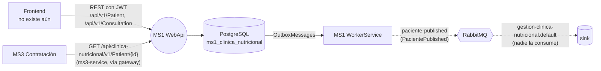

# MS1 — Clínica nutricional

> **Owner:** Diego Cabrera (@Juandcode) · **Repo:** [Nur-tricenter/ms1-gestion-clinica-nutricional](https://github.com/Nur-tricenter/ms1-gestion-clinica-nutricional) (desde 2026-10-31; antes [Juandcode/ClinicaNutricionalMicroservicio1](https://github.com/Juandcode/ClinicaNutricionalMicroservicio1)) · **Estado de la ficha:** draft

> ✅ **Integrado a la plataforma desde el 2026-10-31** ([MS1#1](https://github.com/Nur-tricenter/ms1-gestion-clinica-nutricional/pull/1) y [nur-tricenter-local#8](https://github.com/Nur-tricenter/nur-tricenter-local/pull/8), mergeados). Corre en el stack local junto a MS2–MS5: PostgreSQL propio (`ms1_clinica_nutricional`), job `--migrate`, JWT de identity en todas las rutas salvo `/health`, registro en Consul como `clinica-nutricional` (gateway: `/api/clinica-nutricional/v1/...`) y `ms1.compose.yml`. **Pendiente:** no hay scopes de MS1 en `Nur.Tricenter.Access` (se exige "token válido", no un permiso), nadie consume `paciente-published` y falta el vínculo `sub` → paciente (X-08). Esta ficha documenta **lo que hace el código** (rama `main`, 2026-10-31).

## Propósito
MS1 es la parte **clínica** del negocio: registra al paciente, toma su consulta inicial (peso, altura, antecedentes, hábitos alimenticios), la aprueba, le asigna un plan alimenticio y hace el seguimiento con evaluaciones de control. Sin MS1 no hay paciente registrado ni historia clínica que justifique el plan que después se contrata y se entrega.

## Responsabilidades
- Registrar pacientes (`CI`, nombre, apellido) y publicar el hecho (`paciente-published`).
- Registrar la **consulta inicial** de un paciente con sus antecedentes y hábitos, y aprobarla.
- Asignar a un paciente un **plan alimenticio** propio de la clínica (duración 15/30 días, vencimiento, comidas).
- Agendar el próximo control y registrar **evaluaciones** sobre el plan.

## Lo que NO hace
- No define recetas ni planes del catálogo → **MS2**. El `PlanAlimenticio` de MS1 es un concepto propio y **no referencia** al plan de MS2 (el README del repo dice que valida el plan contra MS2, pero el código no lo hace).
- No gestiona contratos ni pagos → **MS3**.
- No arma calendarios de entrega → **MS4**.
- No entrega datos de contacto a logística directamente → el teléfono lo lee **MS3** de `GET /Patient/{id}` y lo manda a **MS5** en `PackageValidated.PatientPhone`.
- No autentica ni autoriza → **identity**; hoy MS1 tampoco valida tokens.
- **No consume eventos** de ningún otro servicio.

## Actores y vecinos
Estado real del código. Las relaciones que la plataforma espera y no existen están en la sección siguiente.

| Actor / servicio | Dirección | Mecanismo | Para qué |
|---|---|---|---|
| Frontend (paciente, recepción, nutricionista) | entrante | REST con JWT (por el gateway: `/api/clinica-nutricional/v1/...`) | Previsto por el README. **No hay frontend**; hoy solo Swagger y los tests |
| PostgreSQL | saliente | EF Core (Npgsql) | BD propia `ms1_clinica_nutricional` en el Postgres compartido de la plataforma |
| RabbitMQ | saliente | Evento vía outbox | `paciente-published` (contrato local `PacientePublished`) |

## Mapa de comunicación

## Lo que la plataforma toma de MS1
Estado al 2026-10-31:

| Quién | Qué espera | Estado en el código de MS1 |
|---|---|---|
| **MS5** (`ClinicService`, ya retirado) | Antes llamaba a `POST /api/v1/patients/contact-information` contra un mock de Postman | MS5#4 quitó la llamada: el nombre y el teléfono le llegan en `package-validated`. El endpoint **existe** en MS1 desde MS1#1 (arreglo de ids → `[{ patientId, phoneNumber, fullName }]`, omite los inexistentes) y nadie lo llama |
| **MS3** | `GET /api/clinica-nutricional/v1/Patient/{id}` por el gateway, como `ms3-service` (con `Clinic__BaseUrl`; sin ella usa 3 pacientes simulados) | **Funciona** desde MS3#8: lee `id`, `nombre`, `apellido` y `telefono` de la entidad `Paciente`. Un id inexistente da **404** desde MS1#2 (antes 500) |
| **nur-tricenter-local** | `ms1-clinica-nutricional/ms1.compose.yml`, proyectos `src/ClinicaNutricional.Api` y `src/ClinicaNutricional.WorkerService`, contenedores `nur-tricenter-clinica-nutricional-api`/`-workerservice`, ruta `/api/clinica-nutricional/v1/...` en el gateway (o sea, nombre Consul `clinica-nutricional`) | **Resuelto** (MS1#1 y local#8): `ms1.compose.yml` en la raíz del repo `ms1-gestion-clinica-nutricional`, contenedores `nur-tricenter-clinica-nutricional-{migrate,api,workerservice}`, registro en Consul y `start-stack` compila los proyectos reales (`GestionClinicaNutricional*`) |
| **Topología RabbitMQ** | 7 colas `ms1.*`: `food-published`, `food-nutritional-info-updated`, `recipe-published`, `recipe-updated`, `meal-plan-published`, `user-published`, `user-updated` | Ninguna se consume |
| **Topología RabbitMQ** | — (no declara ningún exchange de MS1) | MS1 publica en `paciente-published`, que la topología no conoce |
| **Seguridad (X-08)** | Mapeo del `sub` del token de identity al `PatientId`, para la autorización por objeto | `Paciente` no guarda ningún id de usuario de identity |
| **Kernel `Nur.Tricenter.Access`** | Scopes de MS1 | No hay scopes de MS1 en el kernel: MS1 solo exige un token válido (`AddSecurity` sin permisos + política de fallback "autenticado") |

## Stack y despliegue
- **.NET 10** (`net10.0`), ASP.NET Core con **Controllers**, MediatR 12.5 (CQRS), EF Core 9 + **PostgreSQL** (Npgsql), Joseco (DDD.Core, Outbox.EFCore, Communication.External.RabbitMQ 1.1.0), NSwag (Swagger UI), Serilog en el worker. Paquetes centralizados en `Directory.Packages.props`.
- **Proyectos (en la raíz del repo):** `GestionClinicaNutricional.Domain`, `.Application`, `.Infrastructure`, `.WorkerService`, `GestionClinicaNutricionalService.WebApi`, más `Tests` (NUnit + FakeItEasy) e `IntegrationTests` (xUnit + `WebApplicationFactory`, contra un Postgres local; la factory firma su propio JWT).
- **Kernels de la plataforma:** 1.4.0 en `Directory.Packages.props`. Solo `Nur.Tricenter.Security` está referenciado (arrastra `Access`); `Integration` y `Observability` están fijados pero sin referenciar. El feed de GitHub Packages se configura en `NuGet.config` (`NUGET_USERNAME`/`NUGET_TOKEN`).
- **BD:** PostgreSQL, `ConnectionStrings:DefaultConnection` (por defecto el Postgres de `nur-tricenter-local` en `localhost:5433`, BD `ms1_clinica_nutricional`). Migración única `InitialCreate` (reemplazó las 27 de SQL Server); el esquema se aplica con el job `dotnet GestionClinicaNutricionalService.WebApi.dll --migrate`. Las fechas se guardan en UTC (Npgsql rechaza `DateTime` locales).
- **Procesos:** la WebApi (`http://localhost:5290` / `https://localhost:7040` en `launchSettings.json`) y el WorkerService (procesa el outbox, publica en RabbitMQ y declara una cola sumidero).
- **Consul / gateway:** con `ServiceRegistration__ServiceDiscoveryAddress` se registra como `clinica-nutricional` y el gateway lo publica en `/api/clinica-nutricional/**`. `/health` prueba Postgres.
- **Docker:** `ms1.compose.yml` (platform: migrate + API + worker, binarios montados de `bin/Debug/net10.0`), `docker-compose.yml` standalone (con su Postgres y RabbitMQ, puerto `3001:80`) y `dockerfile` con targets `api` y `worker` (el token de NuGet entra como secreto de BuildKit).
- **Swagger** activo por defecto (`OpenApi:Enabled`; la plataforma lo apaga) y `UseHttpsRedirection` configurable (`HttpsRedirection:Enabled`). `/health` es anónimo.

## Índice de la ficha
- [domain.md](./domain.md): modelo de dominio, estados e invariantes
- [api.md](./api.md): endpoints expuestos
- [integrations.md](./integrations.md): llamadas síncronas salientes (ninguna) y lo que otros esperan
- [messaging.md](./messaging.md): eventos publicados y consumidos
- [flows.md](./flows.md): casos de uso de punta a punta
- [gaps.md](./gaps.md): deuda, inconsistencias y dependencias
- [service.yaml](./service.yaml): datos estructurados (los usa la app visual)
