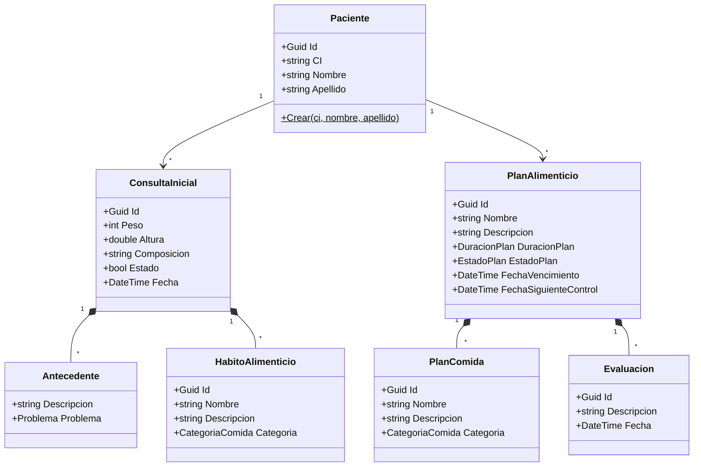
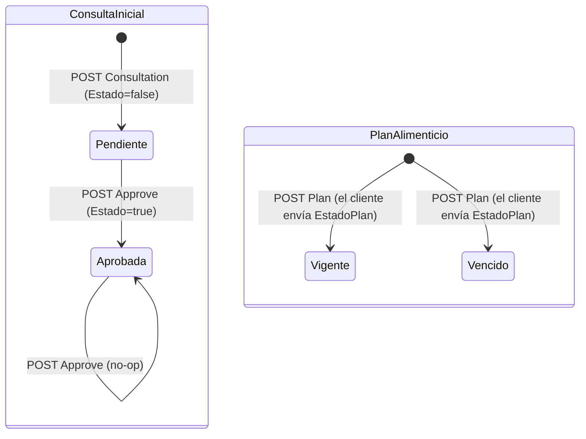

# Modelo de dominio — MS1

El modelo es **anémico**: entidades con setters públicos y casi sin métodos. Las pocas reglas que existen están en constructores de value objects que no siempre se usan, y el resto de la lógica vive en los handlers y repositorios. Todo en `GestionClinicaNutricional.Domain/`.

## Lenguaje ubicuo
| Término | Significado aquí |
|---|---|
| Paciente (`Paciente`) | Persona registrada en la clínica: `CI`, `Nombre`, `Apellido`. `Telefono` es opcional (desde MS1#1); no tiene dirección ni usuario de identity |
| Consulta inicial (`ConsultaInicial`) | Primera atención: peso, altura, composición corporal, antecedentes y hábitos alimenticios. Un paciente puede tener varias |
| Aprobar consulta | Poner `ConsultaInicial.Estado = true` (recepción) |
| Antecedente (`Antecedente`) | Descripción + `Problema` (`BajoPeso`, `SobrePeso`). Se guarda como JSON dentro de la consulta |
| Hábito alimenticio (`HabitoAlimenticio`) | Nombre, descripción y `CategoriaComida` de un hábito declarado en la consulta |
| Plan alimenticio (`PlanAlimenticio`) | Plan **de la clínica** para un paciente: nombre, descripción, `DuracionPlan`, `EstadoPlan`, vencimiento, próximo control y comidas. **No es** el plan del catálogo de MS2 |
| Plan de comida (`PlanComida`) | Una comida del plan: nombre, descripción y `CategoriaComida` |
| Evaluación (`Evaluacion`) | Control de seguimiento sobre un plan: descripción y fecha |
| Duración (`DuracionPlan`) | `MedioMes = 15`, `Mes = 30` (los mismos valores que usa MS4) |
| Categoría de comida (`CategoriaComida`) | `Vegetariana`, `Vegana`, `SinGluten`, `SinLactosa`, `Hipocalorica`, `Hipercalorica`, `Diabetica`, `Omnivora` |

## Agregados

### Paciente (raíz)
- **Representa:** al paciente de la clínica.
- **Creación:** `Paciente.Crear(ci, nombre, apellido)` levanta el evento de dominio `PacienteCreated`. Es el **único** método de fábrica del dominio.
- **Invariantes:** ninguna validada. No hay unicidad de `CI` ni en el código ni en la BD.
- **Relaciones:** `ConsultaIniciales` (1..N) y `PlanAlimenticios` (1..N, ignorado en el JSON).
- **Archivo:** `Paciente.cs`.

### ConsultaInicial (raíz)
- **Representa:** una consulta inicial de un paciente.
- **Estado:** `Estado` booleano (`false` = pendiente, `true` = aprobada). `Fecha` = `DateTime.Now` al crear (hora local).
- **Contiene:** `Antecedentes` (owned, JSON) y `HabitoAlimenticios` (tabla propia).
- **Invariantes:** ninguna. Se puede aprobar varias veces y nada depende de que esté aprobada.

### PlanAlimenticio (raíz)
- **Representa:** el plan alimenticio que la clínica asigna a un paciente.
- **Estados:** `EstadoPlan` = `Vigente` | `Vencido`. **Lo envía el cliente** al crear y nada lo recalcula con `FechaVencimiento`.
- **Contiene:** `PlanComidas` y `Evaluaciones`.
- **Invariantes:** ninguna. No exige una consulta aprobada ni valida fechas.

### Evaluacion (entidad dentro de PlanAlimenticio)
- Hereda de `Entity` (no es raíz), pero se crea y se lista directamente por `IPlanAlimenticioRepository` (`AddEvaluacion`, `GetEvaluaciones`). `Fecha` = `DateTime.Now`.

### Value objects con validación (records)
- `Antecedente`: descripción no vacía y `Problema` válido (lanza `ArgumentException`).
- `TipoComida`: valida longitudes y categoría, pero **no se usa** (está comentado en `HabitoAlimenticio`).

## Diagrama de clases

## Estados

No hay transiciones de `EstadoPlan` después de crear el plan.

## Reglas de negocio
| Regla | Dónde se aplica | Error si se viola |
|---|---|---|
| El antecedente tiene descripción y un `Problema` válido | Constructor de `Antecedente` | `ArgumentException` → 500 (no hay manejador) |
| `DuracionPlan` ∈ {15, 30} | Enum `DuracionPlan` | Sin validación explícita: el binder de JSON acepta cualquier entero en un enum |
| La entidad referida existe | Repositorios (`GetByIdAsync`, `ApproveConsulta`, `ProgramarProximoControl`) | `NullReferenceException` → 500 |

Reglas que **no** existen y que el negocio probablemente espera (ver gaps): `CI` único, plan solo con consulta aprobada, estado del plan derivado del vencimiento, próximo control posterior a hoy.

## Evento de dominio
`PacienteCreated(PacienteId, CI, Nombre, Apellido)` (`Events/PacienteCreated.cs`). Se despacha con MediatR dentro de `UnitOfWork.CommitAsync`, antes de `SaveChangesAsync`, y `SaveInOutboxWhenPacienteCreated` lo guarda en `OutboxMessages` en la misma transacción. `Paciente.Crear` asigna el `Id` antes de armar el evento y lo pasa en el orden del constructor `(pacienteId, ci, nombre, apellido)` (corregido en MS1#1); ver [messaging.md](./messaging.md).

## Datos que son copia de otro servicio
Ninguno. MS1 no consume eventos ni llama a otros servicios.
