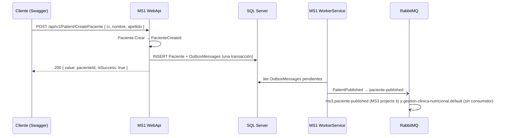

# Flujos — MS1

Los flujos siguen el recorrido clínico de un paciente. Solo F1 cruza la frontera del servicio (vía RabbitMQ); F5 describe lo que otros servicios esperan y hoy no ocurre.

## F1 — Registrar un paciente (Frontend → MS1 ⇢ RabbitMQ)
- **Actor:** recepción (previsto; hoy Swagger o tests).
- **Disparador:** `POST /api/v1/Patient/CreatePaciente`.
- **Precondición:** ninguna.
- **Camino feliz:**
  1. `Paciente.Crear` crea la entidad y levanta `PacienteCreated`.
  2. `UnitOfWork.CommitAsync` despacha el evento: `SaveInOutboxWhenPacienteCreated` lo guarda en `OutboxMessages`.
  3. Se guardan paciente y outbox en la misma transacción. Responde el `Id`.
  4. El WorkerService lee el outbox y publica el contrato del kernel `PatientPublished` (con el teléfono) en `paciente-published`. MS3 lo consume y guarda una copia local.
- **Errores:** ninguno de negocio; fallos de BD → 500.
- **Idempotencia:** ninguna. Repetir el request crea otro paciente (no hay unicidad de `CI`).
- **Evento:** sale con el `PacienteId` real y los campos en su sitio (corregido en MS1#1, ms1-gap-04), as the kernel `PatientPublished` since MS1#3 (adds `Phone`). Verificado en RabbitMQ: un solo mensaje por paciente. Only creation publishes (no update use case).



## F2 — Consulta inicial y aprobación (Frontend → MS1)
- **Actor:** paciente (crea la consulta) y recepción (la aprueba).
- **Disparadores:** `POST /api/v1/Consultation/{pacienteId}/Consultation`, luego `POST /api/v1/Consultation/{consultaId}/Approve`.
- **Camino feliz:**
  1. Crea la `ConsultaInicial` con antecedentes (JSON) y hábitos (tabla propia), `Estado = false`.
  2. La aprobación pone `Estado = true`.
- **Errores:**
  | Situación | Resultado |
  |---|---|
  | Paciente inexistente | 500 (clave foránea) |
  | Antecedente sin descripción o `problema` inválido | 500 (`ArgumentException`) |
  | Consulta inexistente al aprobar | 500 (`NullReferenceException`) |
- **Idempotencia:** crear no es idempotente; aprobar sí.
- **Consulta:** `GET /api/v1/Consultation/{pacienteId}/Consultations` devuelve el historial.

## F3 — Asignar un plan alimenticio y agendar el control (Frontend → MS1)
- **Actor:** nutricionista.
- **Disparadores:** `POST /api/v1/Patient/{pacienteId}/Plan`, luego `PATCH /api/v1/Patient/{planAlimenticioId}/SchedulePlan`.
- **Camino feliz:** crea el `PlanAlimenticio` (duración 15/30, estado, vencimiento, comidas) y después fija `FechaSiguienteControl`.
- **Lo que no se verifica:** que haya una consulta aprobada, que el plan exista en MS2 (el README dice que sí; el código no) ni que las fechas sean coherentes.
- **Errores:** paciente o plan inexistente → 500.

## F4 — Evaluaciones de control (Frontend → MS1)
- **Actor:** nutricionista.
- **Disparadores:** `POST /api/v1/Patient/{planAlimenticioId}/CreateControlEvaluacion` y `GET /api/v1/Patient/{planAlimenticioId}/ControlEvaluationHistory`.
- **Camino feliz:** agrega una `Evaluacion` con la fecha actual del servidor y lista el historial del plan.
- **Errores:** plan inexistente → 500 al crear; lista vacía al consultar.

## F5 — Lo que la plataforma toma de MS1
- **MS3** keeps a local copy of the patient (`ClinicPatients`, from `paciente-published`) and uses it to create a contract, label and release the package; the phone that travels to MS5 in `PackageValidated.PatientPhone` comes from there (MS3#9, MS3#11). It no longer calls MS1 (before MS3#11 it did `GET /api/v1/Patient/{id}` with `ms3-service`; that endpoint still answers 404 for an unknown id, MS1#2).
- **MS5** ya no pide nada a MS1 (MS5#4): `POST /api/v1/patients/contact-information` existe pero nadie lo llama.
- **MS3 consumes `paciente-published`** (MS5 does not). No backfill: patients created before MS1#3 are not projected.

```mermaid
sequenceDiagram
  participant MS3
  participant MS1
  participant MS5
  MS1-)MS3: PatientPublished (paciente-published → ms3.paciente-published)
  MS3->>MS3: upsert ClinicPatients (name, phone)
  MS3-)MS5: package-validated { PatientName, PatientPhone }
  Note over MS1,MS5: MS5 no llama a MS1; recibe el nombre y el teléfono en el evento
```
