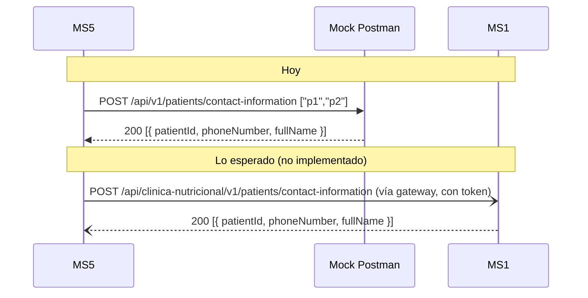

# Integraciones síncronas — MS1

## Resumen
**Este servicio no hace llamadas síncronas salientes.** No hay `HttpClient`, adaptadores HTTP ni service account. Sus únicas dependencias son la BD (SQL Server local) y RabbitMQ (ver [messaging.md](./messaging.md)).

| Destino | Método y ruta | Vía | Auth | Para qué |
|---|---|---|---|---|
| — | — | — | — | — |

## Lo que el README del repo dice y el código no hace
El README lista `GET /api/v1/catalog/plans/{id}` en MS2, "consumido internamente por MS1" para validar que el plan exista antes de asignarlo. **No existe esa llamada**: `CreatePlanAlimenticioHandler` crea el plan sin consultar a nadie, y el `PlanAlimenticio` de MS1 no guarda ningún id de plan de MS2. Además, esa ruta tampoco existe en MS2 (MS4 usa `GET /api/catalog/v1/meal-plans/{id}`). Ver gaps.

## Llamadas entrantes que otros servicios esperan (y no llegan)
Nadie llama hoy al MS1 real. Lo que los demás repos tienen programado:

### MS5 → "ClinicService" (MS1): datos de contacto
- **Ruta que MS5 llama:** `POST /api/v1/patients/contact-information`, cuerpo `["patientId", …]` (texto), respuesta `[{ "patientId", "phoneNumber", "fullName" }]`.
- **Cómo:** directo (no por el gateway), sin token, contra `ClinicService__BaseUrl`, que en `nurtricenter.compose.yml` apunta a un **mock de Postman**.
- **Cuándo:** en `POST /api/v1/packages/deliveries` (respaldo manual) y en la consulta de ruta del repartidor. Si falta un paciente, MS5 rechaza el lote.
- **En MS1:** no existe el endpoint y `Paciente` no tiene teléfono. Ver ms1-gap-03 y X-04.

### MS3 → MS1 (simulación): datos del paciente
- **Ruta que MS3 llama:** `GET /api/v1/patients/{id}` → `{ patientId, fullName, clinicalStatus }`, solo si `ExternalServices:SimulationMockBaseUrl` está configurado; si no, usa 3 pacientes en memoria. Lo usa `CreateContractCommandHandler` para rechazar contratos de pacientes inexistentes.
- **En MS1:** existe `GET /api/v1/Patient/{id}`, pero con otra forma (`id`, `ci`, `nombre`, `apellido`, `consultaIniciales`), sin `clinicalStatus` y con 500 si no existe.

