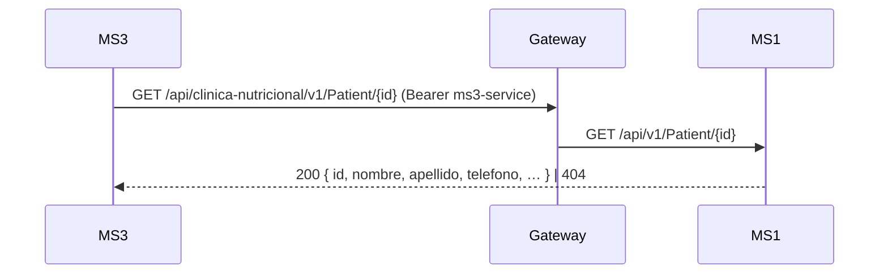

# Integraciones síncronas — MS1

## Resumen
**Este servicio no hace llamadas síncronas salientes.** No hay `HttpClient`, adaptadores HTTP ni service account. Sus únicas dependencias son la BD (SQL Server local) y RabbitMQ (ver [messaging.md](./messaging.md)).

| Destino | Método y ruta | Vía | Auth | Para qué |
|---|---|---|---|---|
| — | — | — | — | — |

## Lo que el README del repo dice y el código no hace
El README lista `GET /api/v1/catalog/plans/{id}` en MS2, "consumido internamente por MS1" para validar que el plan exista antes de asignarlo. **No existe esa llamada**: `CreatePlanAlimenticioHandler` crea el plan sin consultar a nadie, y el `PlanAlimenticio` de MS1 no guarda ningún id de plan de MS2. Además, esa ruta tampoco existe en MS2 (MS4 usa `GET /api/catalog/v1/meal-plans/{id}`). Ver gaps.

## Llamadas entrantes
Estado al 2026-10-31.

### MS3 → MS1: datos del paciente (en uso)
- **Ruta:** `GET /api/clinica-nutricional/v1/Patient/{id}` por el gateway, con el JWT de `ms3-service` (MS1 solo exige un token válido, sin scopes). Se activa con `Clinic__BaseUrl` en MS3; sin ella MS3 usa 3 pacientes simulados.
- **Qué lee MS3:** `nombre` + `apellido` (nombre completo para la etiqueta) y `telefono`, que viaja a MS5 en `PackageValidated.PatientPhone`.
- **Errores:** `404` (desde MS1#2) → MS3 responde `PATIENT_NOT_FOUND`. Otro fallo en el alta del contrato → 500; al liberar un paquete, el evento sale con teléfono nulo.

### MS5 → MS1: retirado
MS5 ya no llama a `POST /api/v1/patients/contact-information` (MS5#4). El endpoint existe en MS1 desde MS1#1 (con JWT) y nadie lo usa. Ver ms1-gap-03.
