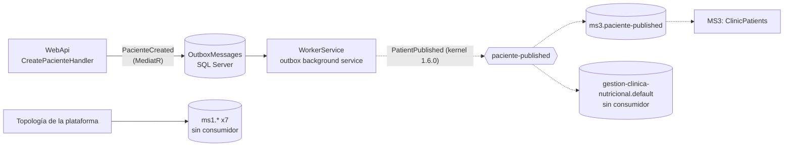

# Mensajería — MS1

## Eventos publicados
| Exchange | Contrato | EventType | Se dispara cuando | Outbox |
|---|---|---|---|---|
| `paciente-published` | `PatientPublished` (kernel `Nur.Tricenter.Integration.Messages.Clinic`, 1.6.0) | `Patient.Published` | Se registra un paciente (`POST …/CreatePaciente`) | sí |

The exchange and the queue `ms3.paciente-published` are in the platform topology (nur-tricenter-local); MS1's worker also declares the exchange itself. **MS3 consumes it** (`ms3.paciente-published`, `PatientPublishedConsumer`) into its `ClinicPatients` projection, which replaced MS3's REST call `GET /Patient/{id}`.

### Contrato (MS1#3)
`PatientPublished : IntegrationMessageContract` comes from the kernel (`Nur.Tricenter.Integration` 1.6.0); MS1 **deleted** its local `PacientePublished` (`Application/Contracts/PacientePublished.cs`) and now references the kernel package. It is a **full snapshot**: consumers upsert by `PatientId`.

| Campo | Origen |
|---|---|
| `Id`, `CreatedAt`, `CorrelationId`, `Source`, `EventType` | Kernel envelope. `Source` = `gestion-clinica-nutricional`; `CorrelationId` = el del mensaje de outbox; `EventType` = `Patient.Published` (the old local contract had none) |
| `PatientId` | `PacienteCreated.PacienteId` |
| `DocumentNumber` | `PacienteCreated.CI` |
| `FirstName`, `LastName` | `PacienteCreated.Nombre`, `PacienteCreated.Apellido` |
| `Phone` (`string?`) | `PacienteCreated.Telefono` (new, optional; `null` when the clinic has none) |

`PacienteCreated` gained an optional `telefono` constructor argument so outbox rows written before it existed still deserialize (the missing member becomes `null`). It keeps a single full constructor on purpose: a parameterless one reintroduces silent field mix-ups.

**Only creation publishes:** MS1 has no patient-update use case, so a patient changed later is not re-published. If one is added, it should publish the same `PatientPublished` (the consumer upserts). **No backfill:** a patient created before MS1#3 was deployed has no message, so MS3 does not know it (X-15).

### Payload (corregido en MS1#1, 2026-10-31; sigue vigente con el contrato del kernel de MS1#3)
> Verificado en RabbitMQ con un paciente real: el mensaje lleva el `PacienteId` del paciente y `CI`/`Nombre`/`Apellido` en su campo, y llegó **un solo** mensaje (la posible doble publicación no se reprodujo). Lo de abajo es el defecto original, que ya no ocurre.

1. **Campos cruzados.** `Paciente.Crear` llama `new PacienteCreated(paciente.Id, nombre, apellido, ci)`, pero el constructor es `(pacienteId, ci, nombre, apellido)`. Resultado: `CI` lleva el nombre, `Nombre` lleva el apellido y `Apellido` lleva el CI.
2. **`PacienteId` vacío.** El evento se crea dentro de `Crear`, antes de que EF Core asigne el `Id` (al hacer `AddAsync`). Sale `00000000-0000-0000-0000-000000000000`.
3. **Probable doble publicación.** El worker registra `PublishIntegrationEventWhenPacienteCreated` dos veces: por el escaneo de MediatR (`AddApplication`) y otra vez a mano (`AddIntegrationMessaging`). MediatR invoca cada registro, así que cada mensaje de outbox se publicaría dos veces. No verificado en ejecución.

Ver ms1-gap-04.

## Eventos consumidos
**Ninguno.** No hay consumidores ni `IIntegrationMessageConsumer` en el código.

## Colas declaradas que no se consumen
La topología crea 7 colas para MS1 que nadie lee y acumulan mensajes (gap transversal X-06):
`ms1.food-published`, `ms1.food-nutritional-info-updated`, `ms1.recipe-published`, `ms1.recipe-updated`, `ms1.meal-plan-published`, `ms1.user-published`, `ms1.user-updated`.

`ms1.user-published` sería el candidato natural para guardar el id de usuario de identity junto al paciente (X-08).

## Garantías de entrega
- **Publicación:** outbox transaccional de Joseco. `UnitOfWork.CommitAsync` despacha `PacienteCreated` con MediatR, `SaveInOutboxWhenPacienteCreated` lo agrega a `OutboxMessages` y todo se guarda en un único `SaveChangesAsync`. El WorkerService (`AddOutboxBackgroundService<DomainEvent>`) lee la tabla y publica con `IExternalPublisher.PublishAsync(message, "paciente-published", declareDestination: true)`.
- **Topología propia:** `DefaultQueueRegistrar` (worker) declara el exchange `paciente-published` (fanout, no durable) y la cola sumidero **`gestion-clinica-nutricional.default`** (durable), y las enlaza. Reintenta cada 10 s si RabbitMQ no está. Nadie consume esa cola. The platform topology declares the same exchange plus `ms3.paciente-published` (the real consumer).
- **Configuración:** el worker lee `RabbitMqSettings` (host `localhost`, sin puerto, por lo que usa 5672). La sección `Joseco:Communication:External:RabbitMQ` de la WebApi no se usa.
- **Consumo:** no aplica.
- **Trazabilidad:** solo Serilog con `Enrich.WithSpan()` en el worker. La observabilidad del kernel (`Nur.Tricenter.Observability`) está comentada.

## Diagrama

