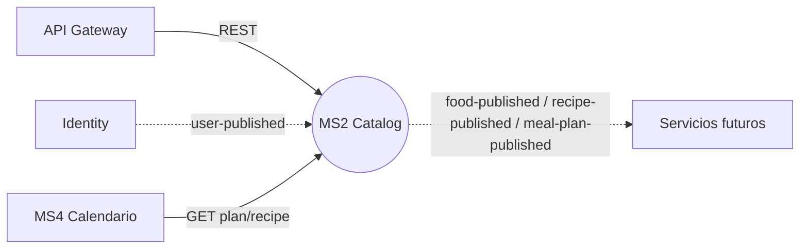

# MS2 — Catálogo de planes y recetas (Catalog)

> **Owner:** Robert Perez Lino · **Repo:** [Nur-tricenter/ms2-plans-and-recipes-catalog](https://github.com/Nur-tricenter/ms2-plans-and-recipes-catalog) · **Estado de la ficha:** complete

## Propósito
Gestiona el catálogo de alimentos (ingredientes), recetas y planes de comida de la plataforma. Es la fuente de verdad del contenido nutricional que consumen los demás servicios (producción, catering, delivery). Publica eventos cuando se crean o modifican alimentos, recetas y planes para que el resto del sistema se mantenga sincronizado.

## Responsabilidades
- CRUD de alimentos con datos nutricionales por 100 unidades y unidad de medida.
- CRUD de recetas con ingredientes y cálculo de info nutricional.
- Creación y composición de planes de comida (días, meal times, asignación de recetas).
- Proyección del read model a partir de eventos de Identity (PlanAuthors).
- Publicación de eventos de integración (FoodPublished, RecipePublished, MealPlanPublished, etc.).

## Lo que NO hace
- No gestiona usuarios ni autenticación (eso es Identity).
- No orquesta compras ni pedidos (eso sería Orders, no implementado en esta variante).
- No gestiona stock ni reservas (Inventory, no implementado).
- No gestiona entregas ni rutas (MS4/MS5).

## Actores y vecinos
| Actor / servicio | Dirección | Mecanismo | Para qué |
|---|---|---|---|
| Frontend / gateway | entrante | REST vía gateway | CRUD de foods, recipes, meal-plans |
| Identity | entrante (evento) | RabbitMQ `user-published` | Proyectar PlanAuthors en read model |
| MS4 (calendario) | saliente (consultado por MS4) | REST vía gateway | MS4 consulta composición del plan y recetas |
| Servicios futuros (producción, catering, delivery) | saliente (evento) | RabbitMQ (fanout) | Consumen foods/recipes/meal-plans publicados |

## Mapa de comunicación

## Stack y despliegue
- .NET 8, Clean Architecture + DDD, CQRS (MediatR), EF Core 9, PostgreSQL (schemas write/read/outbox).
- RabbitMQ (Joseco.Communication.External.RabbitMQ) con Outbox (Joseco.Outbox.EFCore) e Inbox idempotente.
- Consul (service name `catalog-service`), API Gateway YARP.
- Workers: `catalog-workerservice` (outbox + consumer).

## Índice de la ficha
- [domain.md](./domain.md)
- [api.md](./api.md)
- [integrations.md](./integrations.md)
- [messaging.md](./messaging.md)
- [flows.md](./flows.md)
- [gaps.md](./gaps.md)
- [service.yaml](./service.yaml)
