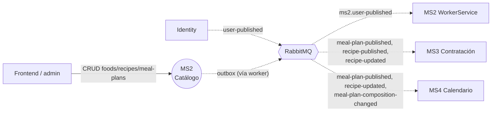

# MS2 — Catálogo de planes y recetas

> **Owner:** Robert Perez Lino (@RobertPls) · **Repo:** [Nur-tricenter/ms2-plans-and-recipes-catalog](https://github.com/Nur-tricenter/ms2-plans-and-recipes-catalog) · **Estado de la ficha:** complete

## Propósito

MS2 es la **fuente de verdad del contenido nutricional** de la plataforma: alimentos (ingredientes con sus facts nutricionales), recetas compuestas a partir de esos alimentos y planes de comida que organizan recetas en días y tiempos de comida. Sin MS2 nadie sabe qué se cocina ni con qué ingredientes, y los demás servicios (calendario, producción, catering) no tienen qué proyectar.

Es además el **primer consumidor** de la plataforma: proyecta los eventos `user-published` de identity en un read model local `PlanAuthors`, ejerciendo la mitad receptora del patrón de mensajería.

## Responsabilidades

- CRUD de alimentos con datos nutricionales por unidad de medida y categoría; búsqueda por categoría.
- CRUD de recetas con nombre, instrucciones e ingredientes (alimento + porción); cálculo de info nutricional total a partir de los ingredientes.
- Creación y composición de planes de comida: duración 15 o 30 días, generación automática de los `PlanDay`, tiempos de comida (desayuno, media mañana, almuerzo, merienda, cena) por día y asignación de recetas con raciones.
- Publicar los hechos del dominio (`food-published`, `food-nutritional-info-updated`, `recipe-published`, `recipe-updated`, `meal-plan-published`, `meal-plan-composition-changed`) mediante outbox transaccional.
- Proyectar el read model `PlanAuthors` a partir de `user-published` (inbox idempotente).
- Publish the full composition of a plan (`meal-plan-composition-changed`: days → meal times → recipes with name and rations) every time it changes; MS4 projects it to resolve each day's menu. The same composition is still exposed over REST (`GET /meal-plans/{id}`) for the frontend, but no service calls it any more.

## Lo que NO hace

- No gestiona usuarios ni autenticación → **identity**. Solo valida JWT y lee el autor del plan del claim `sub`.
- No orquesta contratos ni pagos → **MS3** (que avisa a MS4 con el evento `contract-activated` cuando el contrato está pago).
- No gestiona calendarios ni entregas → **MS4** (que proyecta la composición del plan desde `meal-plan-composition-changed`).
- No arma rutas ni repartidores → **MS5**.
- No sabe quién es el paciente más allá de la referencia de autor de un plan → **MS1/identity**.
- **It calls no other service over HTTP, and since MS4#12 no service calls MS2 over HTTP either**: it is an event producer plus a REST API for the frontend. All its integration is asynchronous (events).
- No publica eventos para todos los cambios del dominio: solo 8 de los 13 eventos de dominio se traducen a contratos de integración (ver [gaps.md](./gaps.md)).

## Actores y vecinos

| Actor / servicio | Dirección | Mecanismo | Para qué |
|---|---|---|---|
| Frontend / admin | entrante | REST vía gateway | CRUD de foods, recipes y meal-plans |
| MS4 Calendario | saliente | Evento RabbitMQ `meal-plan-composition-changed` (cola `ms4.meal-plan-composition-changed`) | Full snapshot of the plan so MS4 projects the menu of day N (`PlanDayMenus`); it no longer calls `GET /meal-plans/{id}` |
| Identity | entrante | Evento RabbitMQ `user-published` | Proyectar `PlanAuthors` (read model) |
| MS1 / MS3 / MS4 / MS5 | saliente | Evento RabbitMQ (fanout) | Los 5 exchanges originales tienen cola para los cuatro, pero hoy solo consumen MS3 (`meal-plan-published`, `recipe-published`, `recipe-updated`) y MS4 (`meal-plan-published`, `recipe-updated`; plus `meal-plan-composition-changed`, which has only MS4's queue) |
| Consul | saliente | Auto-registro + `/health` | Que el gateway lo encuentre |
| Operaciones | — | CLI / configuración (no REST) | Migraciones (`dotnet Catalog.App.dll --migrate` o `Migrations__ApplyOnStartup=true`) y seed (`Seed__Enabled=true`) |

## Mapa de comunicación

All REST calls enter through the gateway (`/api/catalog/**` to reach MS2) and come from the frontend; between services there is only messaging.

## Stack y despliegue

- **.NET 8**, Clean Architecture + DDD, CQRS con MediatR, EF Core 9 + PostgreSQL (un solo DB, tres schemas: `write`, `read`, `outbox`).
- **RabbitMQ** vía `Joseco.Communication.External.RabbitMQ` 1.1.0, con **outbox transaccional** (`Joseco.Outbox.EFCore`) e **inbox idempotente**.
- **Kernels** `Nur.Tricenter.Access`, `.Security`, `.Integration` y `.Observability` en **1.6.0** (`Directory.Packages.props`, MS2#6; 1.6.0 adds `MealPlanCompositionChanged`).
- **Consul** (en la plataforma se registra como `catalog`; el default del código es `catalog-service`), **API Gateway YARP**.
- **Procesos:** `catalog-api` (puerto 8080, se registra en Consul) y `catalog-workerservice` (outbox drain + publishers + consumidor de `user-published` + registrar de `catalog.default`; **no** se registra en Consul).
- **Migraciones:** el default (`appsettings.json`) es `Migrations:ApplyOnStartup=false` y migrar con `dotnet Catalog.App.dll --migrate` (one-shot, aplica `DomainDbContext` y `StoredDbContext`). En la **plataforma** no hay contenedor de migración: `catalog-api` migra al arrancar (`Migrations__ApplyOnStartup=true` en `catalog.compose.yml`) y además `nur-tricenter-local/scripts/start-stack.*` corre `Catalog.App.dll --migrate` desde el host contra `localhost:5433` (idempotente). En **standalone** lo hace el servicio one-shot `webapi-migrate`.
- **Modo standalone:** `docker-compose.yml` con Postgres propio (BD `catalog`, puerto host 5433, API en 8082, seed apagado); **plataforma:** `catalog.compose.yml` incluido por `nur-tricenter-local` (BD `ms2-plans-and-recipes-catalog` en el Postgres compartido, `Seed__Enabled=true`).

## Índice de la ficha

- [domain.md](./domain.md): modelo de dominio, agregados e invariantes
- [api.md](./api.md): endpoints expuestos
- [integrations.md](./integrations.md): llamadas síncronas (ninguna saliente)
- [messaging.md](./messaging.md): eventos publicados y consumidos
- [flows.md](./flows.md): casos de uso de punta a punta
- [gaps.md](./gaps.md): deuda, inconsistencias doc ↔ código
- [service.yaml](./service.yaml): datos estructurados