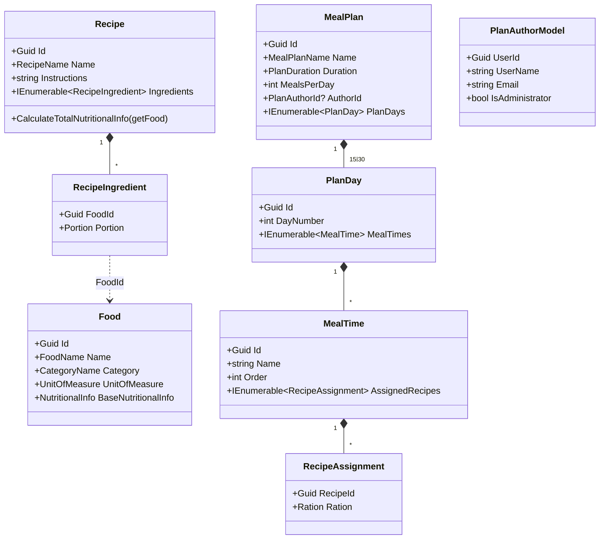

# Modelo de dominio — MS2

## Lenguaje ubicuo

| Término | Significado aquí |
|---|---|
| Alimento (`Food`) | Ingrediente del catálogo con categoría, facts nutricionales por unidad y unidad de medida. Es un agregado raíz. |
| Receta (`Recipe`) | Preparación compuesta por ingredientes (alimento + porción). Calcula su info nutricional total a partir de ellos. |
| Ingrediente (`RecipeIngredient`) | Par (Food + `Portion`) dentro de una receta. No es un agregado; vive dentro de `Recipe`. |
| Plan de comida (`MealPlan`) | Plan de 15 o 30 días. Cada día se identifica por **número de día** (`DayNumber`), no por fecha. |
| Día del plan (`PlanDay`) | Un día del plan con su número y sus tiempos de comida. |
| Tiempo de comida (`MealTime`) | Desayuno, media mañana, almuerzo, merienda o cena dentro de un día. |
| Asignación (`RecipeAssignment`) | Receta asignada a un tiempo de comida con una ración. |
| Autor (`PlanAuthorId`) | Cuenta (de identity) que posee el plan. Nullable solo para los planes sembrados. |
| `PlanAuthors` | Read model local proyectado desde `user-published`: quién es el autor de cada plan sin llamar a identity. |
| Porción (`Portion`) | Cantidad de un ingrediente dentro de una receta (decimal, > 0). |
| Ración (`Ration`) | Cantidad de una receta dentro de un tiempo de comida (entero, > 0). |

## Agregados

### Food (raíz)
- **Representa:** un alimento/ingrediente del catálogo.
- **Invariantes:**
  - `Name` (`FoodName`) no vacío y ≤ 100 caracteres.
  - `Category` (`CategoryName`) no vacío y ≤ 50 caracteres.
  - `BaseNutritionalInfo` (`NutritionalInfo`) con cantidad (`Quantity`) > 0.
  - `UnitOfMeasure` debe ser uno de los 8 valores del enum.
- **Eventos de dominio:** `FoodCreated`, `FoodUpdated`, `FoodNutritionalInfoUpdated`.
- **Archivo:** `src/Catalog.Domain/Model/Food/Food.cs`

### Recipe (raíz)
- **Representa:** una receta con instrucciones e ingredientes.
- **Invariantes:**
  - Instrucciones no vacías (`BussinessRuleValidationException` si lo son).
  - `Name` (`RecipeName`) no vacío y ≤ 200 caracteres.
  - No se puede agregar el mismo alimento dos veces a una receta (`BussinessRuleValidationException`).
  - No se puede quitar un ingrediente que no existe (`BussinessRuleValidationException`).
  - La info nutricional total se calcula desde los ingredientes usando los facts del alimento y la porción; los ingredientes de 0 raciones no aplican (eso es del lado de MS4).
- **Eventos de dominio:** `RecipeCreated`, `RecipeUpdated`, `IngredientAddedToRecipe`, `IngredientRemovedFromRecipe`.
- **Archivo:** `src/Catalog.Domain/Model/Recipe/Recipe.cs`

### MealPlan (raíz)
- **Representa:** un plan de comida de 15 o 30 días.
- **Invariantes:**
  - `Duration` (`PlanDuration`) solo `FIFTEEN_DAYS` (15) o `THIRTY_DAYS` (30); cualquier otro valor lanza `BussinessRuleValidationException`.
  - Al crearse genera exactamente N `PlanDay` con `DayNumber` 1..N.
  - `MealsPerDay` es un entero sin validación de rango en el dominio (se acepta tal cual).
  - `Name` (`MealPlanName`) no vacío y ≤ 200 caracteres.
  - Un `PlanDay` solo puede tener un tiempo de comida por `Order` (clave `(DayNumber, Order)` implícita en la colección).
  - Una receta no se puede asignar dos veces al mismo tiempo de comida.
  - El `AuthorId` es nullable solo para planes sembrados; un plan creado por API siempre tiene autor (lo exige el comando).
- **Eventos de dominio:** `MealPlanCreated`, `MealPlanUpdated`, `MealTimeAddedToPlan`, `RecipeAssignedToMealTime`, `RecipeRemovedFromMealTime`.
- **Archivo:** `src/Catalog.Domain/Model/MealPlan/MealPlan.cs`

## Entidades internas

- `PlanDay` (`src/Catalog.Domain/Model/MealPlan/PlanDay.cs`): día del plan con `DayNumber` y colección de `MealTime`.
- `MealTime` (`src/Catalog.Domain/Model/MealPlan/MealTime.cs`): tiempo de comida con `Name`, `Order` y asignaciones de recetas.
- `RecipeAssignment` (`src/Catalog.Domain/Model/MealPlan/RecipeAssignment.cs`): value object con `RecipeId` + `Ration`.
- `RecipeIngredient` (dentro de `Recipe`): alimento + porción.

## Value objects

| Value object | Regla |
|---|---|
| `FoodName` | no vacío, ≤ 100 |
| `CategoryName` | no vacío, ≤ 50 |
| `RecipeName`, `MealPlanName` | no vacío, ≤ 200 |
| `NutritionalInfo` | `Quantity` > 0; calorías, proteína, carbs y grasa como decimales |
| `UnitOfMeasure` | enum: Gram, Kilogram, Milliliter, Liter, Unit, Cup, Tablespoon, Teaspoon |
| `PlanDuration` | solo `FIFTEEN_DAYS` / `THIRTY_DAYS` |
| `DurationType` | enum: `FIFTEEN_DAYS`, `THIRTY_DAYS` |
| `Portion` | `Quantity` > 0 (decimal) |
| `Ration` | `Quantity` > 0 (int) |
| `MealTimeType` | enum: Breakfast=1, MidMorning=2, Lunch=3, Snack=4, Dinner=5 |
| `PlanAuthorId` | rechaza `Guid.Empty`; nullable en el agregado para planes sembrados |
| `CategoryName` | no vacío, ≤ 50 |

## Máquina de estados

No hay máquina de estados explícita: los agregados no tienen estados (`Food`/`Recipe`/`MealPlan` no tienen enum de estado). Las transiciones son operaciones incrementales (agregar/quitar ingrediente, asignar/quitar receta, agregar tiempo de comida). No hay estados terminales ni bloqueos por fecha.

## Reglas de negocio

| Regla | Dónde se aplica | Error si se viola |
|---|---|---|
| El autor de un plan se lee del claim `sub` del JWT, nunca del body | `MealPlanController.Create` | 400 si el token no trae `sub` válido (author = `Guid.Empty`) |
| Instrucciones de receta no vacías | `Recipe` constructor y `Update` | `BussinessRuleValidationException` → 400 |
| No duplicar ingrediente en una receta | `Recipe.AddIngredient` | `BussinessRuleValidationException` → 400 |
| No quitar ingrediente inexistente | `Recipe.RemoveIngredient` | `BussinessRuleValidationException` → 400 |
| Duración válida (15 o 30) | VO `PlanDuration` | `BussinessRuleValidationException` → 400 |
| Día del plan existente al agregar meal time | `MealPlan.AddMealTimeToDay` | `BussinessRuleValidationException` → 400 |
| Meal time existente al asignar receta | `MealPlan.AssignRecipeToMealTime` | `BussinessRuleValidationException` → 400 |
| No duplicar receta en un meal time | `MealTime.AssignRecipe` | `BussinessRuleValidationException` → 400 |
| No quitar receta no asignada | `MealTime.RemoveRecipe` | `BussinessRuleValidationException` → 400 |
| Un solo meal time por `Order` en un día | `PlanDay.AddMealTime` | `BussinessRuleValidationException` → 400 |
| `NutritionalInfo.Quantity` > 0 | VO `NutritionalInfo` | `BussinessRuleValidationException` → 400 |
| `Portion.Quantity` > 0 y `Ration.Quantity` > 0 | VOs `Portion`/`Ration` | `BussinessRuleValidationException` → 400 |
| Nombre de receta/plan no vacío y ≤ 200 | VOs `RecipeName`/`MealPlanName` | `BussinessRuleValidationException` → 400 |
| Nombre de alimento no vacío y ≤ 100; categoría ≤ 50 | VOs `FoodName`/`CategoryName` | `BussinessRuleValidationException` → 400 |
| `UnitOfMeasure` válido (1..8) | handler (chequeo `Enum.IsDefined`) | `Result.Fail` → 400 |
| Un alimento debe existir para agregarlo a una receta | `AddIngredientHandler` | `Result.Fail` → 400 |
| Un plan/receta/alimento debe existir para leerlo | handlers de query | `Result.Fail` → 404 |

## Diagrama de clases

## Datos que son copia de otro servicio

| Dato | Origen | Cómo se mantiene |
|---|---|---|
| `PlanAuthors` (`UserId`, `UserName`, `Email`, `IsAdministrator`) | identity, evento `user-published` | Upsert al recibir el evento (inbox idempotente). `PlanCount` es propiedad del catálogo y no se resetea al refrescar |
| `AuthorId` del plan | identity, claim `sub` del JWT | Se toma del token al crear el plan; el nombre del autor **no** se copia (se lee de `PlanAuthors`) |

No hay otra proyección de datos ajenos: MS2 no consume eventos de otros servicios además de `user-published`. Los alimentos, recetas y planes son datos propios.

## Convenciones de implementación

- El agregado `Food` no tiene método `UpdateNutritionalInfo` invocado por ningún caso de uso hoy (ver [gaps.md](./gaps.md)).
- Los eventos de dominio se guardan en el outbox en la misma transacción que el cambio (`SaveChanges`); el worker los drena, proyecta al read model y publica los contratos de integración.
- El read model (`StoredDbContext`) se proyecta a partir de los eventos de dominio; una migración aplica ambos contextos (`DomainDbContext` y `StoredDbContext`).