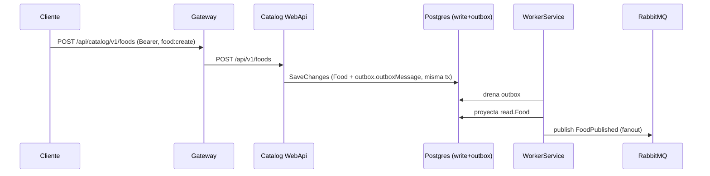
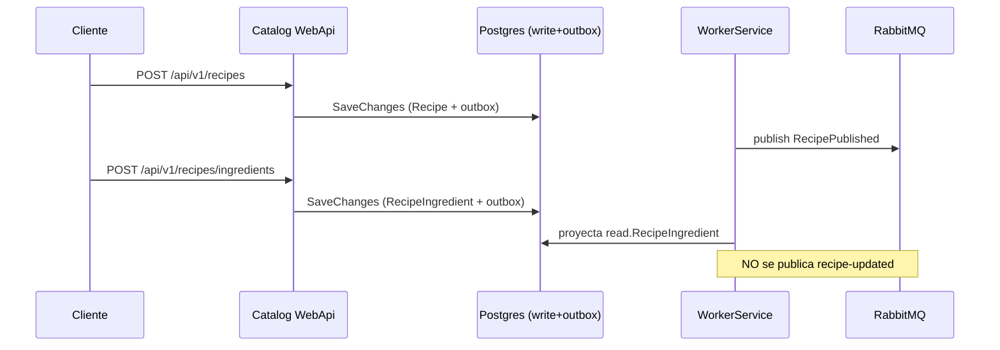
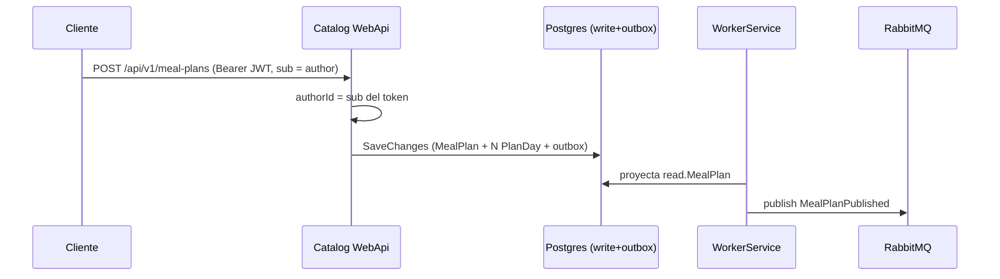
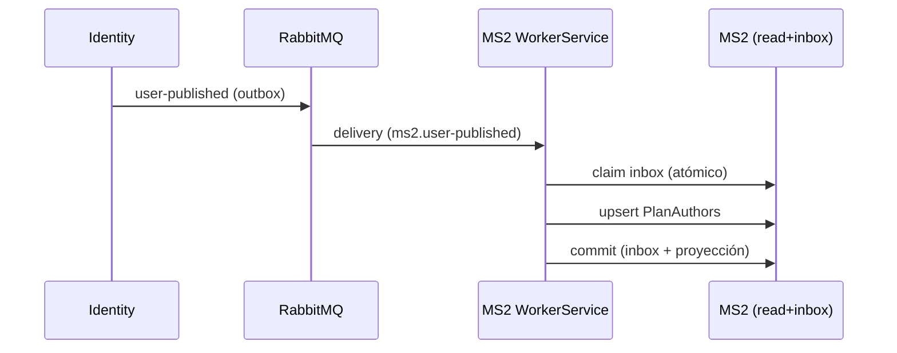
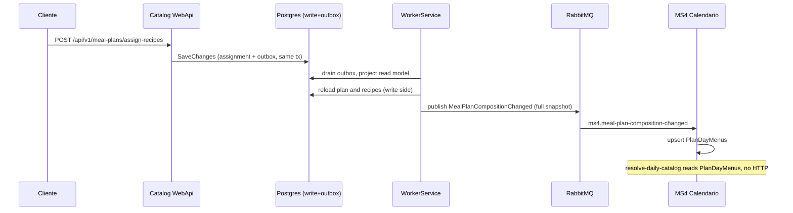

# Flujos — MS2

El orden sigue el ciclo de vida del catálogo. F4 y F5 cruzan la frontera del servicio (by messaging: there is no REST between services).

## F1 — Crear un alimento → `food-published`

- **Actor:** frontend/admin.
- **Disparador:** `POST /api/v1/foods`.
- **Camino feliz:**
  1. Se valida `UnitOfMeasure`, `Quantity > 0` y los value objects (`FoodName`, `CategoryName`, `NutritionalInfo`).
  2. Se crea el agregado `Food` (id nuevo) y se registra el evento de dominio `FoodCreated`.
  3. `SaveChanges` persiste `Food` en `write.Food` y el evento en `outbox.outboxMessage` (misma transacción).
  4. El worker drena el outbox: proyecta `Food` al read model (`read.Food`) y publica `FoodPublished` (fanout).
- **Errores:** 400 si falla la validación; 500 si la BD falla.
- **Idempotencia:** no. Cada llamada crea un alimento nuevo.

## F2 — Crear una receta y agregar ingredientes

- **Actor:** frontend/admin.
- **Disparadores:** `POST /api/v1/recipes`, `POST /api/v1/recipes/ingredients`.
- **Camino feliz:**
  1. Se crea la receta con nombre e instrucciones → evento `RecipeCreated` → outbox → publica `recipe-published` (con `RecipeId`, `Name`, `Instructions`; **sin ingredientes**).
  2. Se agregan ingredientes (alimento + porción) uno o varios → evento `IngredientAddedToRecipe` → outbox → se proyecta al read model (`read.Recipe`, `read.RecipeIngredient`).
  3. **No se publica** `recipe-updated` por este camino (ver [gaps.md](./gaps.md)).
- **Errores:** 400 si la receta/alimento no existe, el ingrediente está duplicado, la porción ≤ 0 o la lista está vacía.
- **Idempotencia:** no para alta/baja de ingredientes (el segundo intento falla con 400).

## F3 — Crear un plan de comida → `meal-plan-published`

- **Actor:** frontend/admin autenticado.
- **Disparador:** `POST /api/v1/meal-plans`.
- **Camino feliz:**
  1. El controller toma el `AuthorId` del claim `sub` del token (nunca del body).
  2. Se crea el `MealPlan` con duración 15/30 y se generan los N `PlanDay` (`DayNumber` 1..N).
  3. Se registra `MealPlanCreated` → outbox.
  4. El worker proyecta el plan al read model y publica `meal-plan-published` con `PlanId`, `Name`, `DurationType`, `TotalDays`, `MealsPerDay`.
- **Errores:** 400 si la duración es inválida, el nombre vacío o el token no trae `sub` válido.
- **Idempotencia:** no.
- **Composición posterior:** los meal times y las asignaciones de recetas se agregan con `POST /meal-plans/meal-times` y `POST /meal-plans/assign-recipes` (y se quitan con `DELETE …/recipes/{recipeId}`), que disparan `MealTimeAddedToPlan`, `RecipeAssignedToMealTime` y `RecipeRemovedFromMealTime`. Each one is projected to the read model **and** published as `meal-plan-composition-changed`, a full snapshot of the plan (F5).

## F4 — Identity crea un usuario → `PlanAuthors` (MS2 como consumidor)

- **Actor:** identity, al publicar un usuario.
- **Disparador:** evento `user-published` en RabbitMQ.
- **Camino feliz:**
  1. Identity publica `UserPublished` (outbox propio).
  2. MS2 worker recibe en `ms2.user-published`.
  3. `TracingConsumer` re-adjunta el span del publisher.
  4. `IdempotentConsumer` reclama el mensaje en `read.InboxMessages` (PK = id del mensaje).
  5. `UserPublishedConsumer` hace upsert de `PlanAuthors` (insert o `Refresh` de nombre/email/flag admin; `PlanCount` se conserva).
  6. El commit (inbox + proyección) es atómico.
- **Idempotencia:** sí. Un mensaje re-entregado se salta por el inbox; además el handler es upsert.
- **Consistencia:** eventual. La copia puede ir unos segundos atrás.

## F5 — A composition change reaches MS4 (MS2 → MS4, asynchronous)

- **Actor:** authenticated frontend/admin (composes the plan); MS4 as the consumer.
- **Disparador:** `POST /meal-plans/meal-times`, `POST /meal-plans/assign-recipes` or `DELETE /meal-plans/{mealPlanId}/meal-times/{mealTimeId}/recipes/{recipeId}`.
- **Camino feliz (MS2 side):**
  1. The command saves the change in `write.*` and the domain event (`MealTimeAddedToPlan`, `RecipeAssignedToMealTime` or `RecipeRemovedFromMealTime`) in `outbox.outboxMessage`, in the same transaction.
  2. The worker drains the row, projects it to the read model and calls `PublishIntegrationEventWhenMealPlanCompositionChanged`.
  3. The publisher reloads the plan **from the write side** (with its recipe names) and builds `MealPlanCompositionChanged`: every day, meal time and recipe with its rations.
  4. It publishes to the `meal-plan-composition-changed` exchange (fanout), which routes to `ms4.meal-plan-composition-changed`.
- **MS4 side:** `MealPlanCompositionChangedConsumer` upserts one `PlanDayMenus` row per day (an older snapshot, by `CreatedAt`, never overwrites a newer one). The `resolve-daily-catalog` job reads the menus from there: **no HTTP call to MS2, no service account.**
- **Errores:** if the plan no longer exists when the row is drained, a warning is logged and nothing is published. A publish failure leaves the row pending and it is retried (at-least-once).
- **Idempotencia:** yes, by nature: the message is a full snapshot, so a redelivery or an out-of-order message converges on the latest by `CreatedAt`.
- **Consistencia:** eventual. **One message per change** (many while a plan is being composed, ms2-gap-13) and **no backfill**: a plan composed before the deploy has no menu in MS4 until it is touched again (X-15).

## F6 — Drenaje del outbox y proyección (interna)

- **Actor:** `catalog-workerservice`.
- **Disparador:** fila en `outbox.outboxMessage` (produced by F1/F2/F3 and by the composition changes of F5).
- **Camino feliz:**
  1. `OutboxProcessor<DomainEvent>` lee la fila.
  2. MediatR despacha `OutboxMessage<T>` al handler de proyección (`Project*`), que actualiza `StoredDbContext`.
  3. Si existe handler de publicación (`PublishIntegrationEvent*`), publica el contrato a RabbitMQ (fanout).
  4. La fila se marca procesada.
- **Idempotencia:** el outbox es at-least-once; reintentar no pierde ni inventa eventos. Los handlers de publicación son idempotentes por naturaleza (publican el mismo contrato).
- **Si falla:** la fila queda pendiente y se reintenta en el siguiente ciclo; no se pierde el evento.