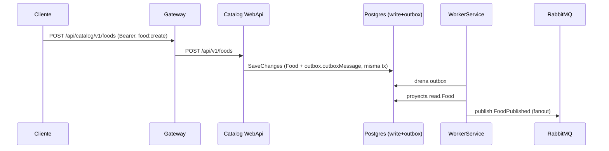
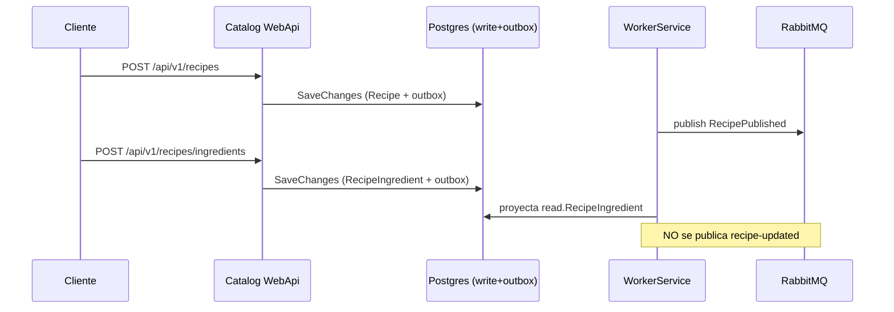
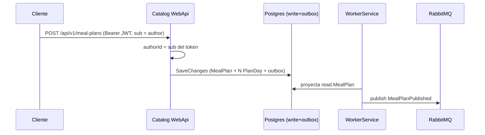
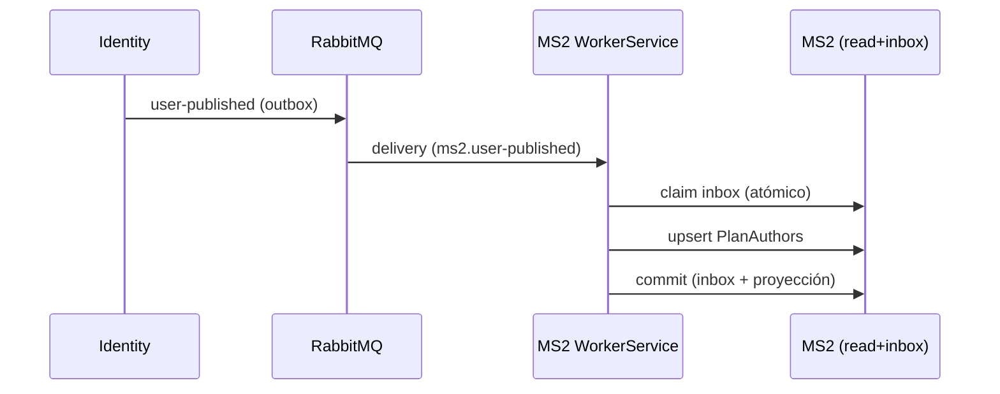
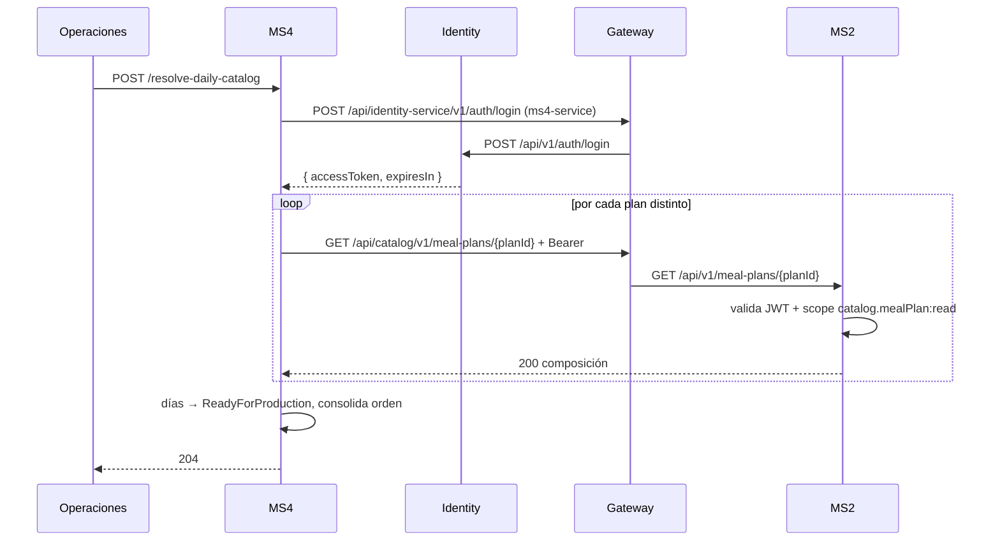

# Flujos — MS2

El orden sigue el ciclo de vida del catálogo. F4 y F5 cruzan la frontera del servicio.

## F1 — Crear un alimento → `food-published`

- **Actor:** frontend/admin.
- **Disparador:** `POST /api/v1/foods`.
- **Camino feliz:**
  1. Se valida `UnitOfMeasure`, `Quantity > 0` y los value objects (`FoodName`, `CategoryName`, `NutritionalInfo`).
  2. Se crea el agregado `Food` (id nuevo) y se registra el evento de dominio `FoodCreated`.
  3. `SaveChanges` persiste `Food` en `write.Food` y el evento en `outbox.outboxMessage` (misma transacción).
  4. El worker drena el outbox: proyecta `Food` al read model (`read.Food`) y publica `FoodPublished` (fanout).
- **Errores:** 400 si falla la validación; 500 si la BD falla.
- **Idempotencia:** no. Cada llamada crea un alimento nuevo.

## F2 — Crear una receta y agregar ingredientes

- **Actor:** frontend/admin.
- **Disparadores:** `POST /api/v1/recipes`, `POST /api/v1/recipes/ingredients`.
- **Camino feliz:**
  1. Se crea la receta con nombre e instrucciones → evento `RecipeCreated` → outbox → publica `recipe-published` (con `RecipeId`, `Name`, `Instructions`; **sin ingredientes**).
  2. Se agregan ingredientes (alimento + porción) uno o varios → evento `IngredientAddedToRecipe` → outbox → se proyecta al read model (`read.Recipe`, `read.RecipeIngredient`).
  3. **No se publica** `recipe-updated` por este camino (ver [gaps.md](./gaps.md)).
- **Errores:** 400 si la receta/alimento no existe, el ingrediente está duplicado, la porción ≤ 0 o la lista está vacía.
- **Idempotencia:** no para alta/baja de ingredientes (el segundo intento falla con 400).

## F3 — Crear un plan de comida → `meal-plan-published`

- **Actor:** frontend/admin autenticado.
- **Disparador:** `POST /api/v1/meal-plans`.
- **Camino feliz:**
  1. El controller toma el `AuthorId` del claim `sub` del token (nunca del body).
  2. Se crea el `MealPlan` con duración 15/30 y se generan los N `PlanDay` (`DayNumber` 1..N).
  3. Se registra `MealPlanCreated` → outbox.
  4. El worker proyecta el plan al read model y publica `meal-plan-published` con `PlanId`, `Name`, `DurationType`, `TotalDays`, `MealsPerDay`.
- **Errores:** 400 si la duración es inválida, el nombre vacío o el token no trae `sub` válido.
- **Idempotencia:** no.
- **Composición posterior:** los meal times y las asignaciones de recetas se agregan con `POST /meal-plans/meal-times` y `POST /meal-plans/assign-recipes`, que disparan `MealTimeAddedToPlan` y `RecipeAssignedToMealTime` (internos, proyectados al read model, sin evento de integración).

## F4 — Identity crea un usuario → `PlanAuthors` (MS2 como consumidor)

- **Actor:** identity, al publicar un usuario.
- **Disparador:** evento `user-published` en RabbitMQ.
- **Camino feliz:**
  1. Identity publica `UserPublished` (outbox propio).
  2. MS2 worker recibe en `ms2.user-published`.
  3. `TracingConsumer` re-adjunta el span del publisher.
  4. `IdempotentConsumer` reclama el mensaje en `read.InboxMessages` (PK = id del mensaje).
  5. `UserPublishedConsumer` hace upsert de `PlanAuthors` (insert o `Refresh` de nombre/email/flag admin; `PlanCount` se conserva).
  6. El commit (inbox + proyección) es atómico.
- **Idempotencia:** sí. Un mensaje re-entregado se salta por el inbox; además el handler es upsert.
- **Consistencia:** eventual. La copia puede ir unos segundos atrás.

## F5 — MS4 resuelve el menú de mañana (MS4 → MS2, cross-boundary)

- **Actor:** operaciones (disparo manual; no hay cron).
- **Disparador:** `POST /resolve-daily-catalog` en MS4 (fuera del alcance de MS2, pero MS2 es el proveedor).
- **Camino feliz (lado MS2):**
  1. MS4 pide a identity un token de la service account `ms4-service` (scope `catalog.mealPlan:read`).
  2. Por cada plan distinto entre los días `Scheduled` de mañana, MS4 llama `GET /api/catalog/v1/meal-plans/{planId}`.
  3. MS2 valida el JWT y el scope, y devuelve la composición completa desde el read model (plan → días → tiempos de comida → recetas con ración → ingredientes con porción).
  4. MS4 selecciona el `PlanDay` cuyo `DayNumber` coincide con el del `DeliveryDay`, aplana los tiempos de comida y las recetas en `MenuItem` y descarta las de 0 raciones.
- **Si falla:** MS4 omite el día (queda en `Scheduled`) y sigue con el resto; se recupera re-ejecutando el job (idempotente).
- **Por qué no se resuelve bajo demanda:** MS4 resuelve **antes** de que MS3 consulte `active-tomorrow`, así una caída de MS2 no tumba la consulta de MS3.

## F6 — Drenaje del outbox y proyección (interna)

- **Actor:** `catalog-workerservice`.
- **Disparador:** fila en `outbox.outboxMessage` (producida por F1/F2/F3).
- **Camino feliz:**
  1. `OutboxProcessor<DomainEvent>` lee la fila.
  2. MediatR despacha `OutboxMessage<T>` al handler de proyección (`Project*`), que actualiza `StoredDbContext`.
  3. Si existe handler de publicación (`PublishIntegrationEvent*`), publica el contrato a RabbitMQ (fanout).
  4. La fila se marca procesada.
- **Idempotencia:** el outbox es at-least-once; reintentar no pierde ni inventa eventos. Los handlers de publicación son idempotentes por naturaleza (publican el mismo contrato).
- **Si falla:** la fila queda pendiente y se reintenta en el siguiente ciclo; no se pierde el evento.