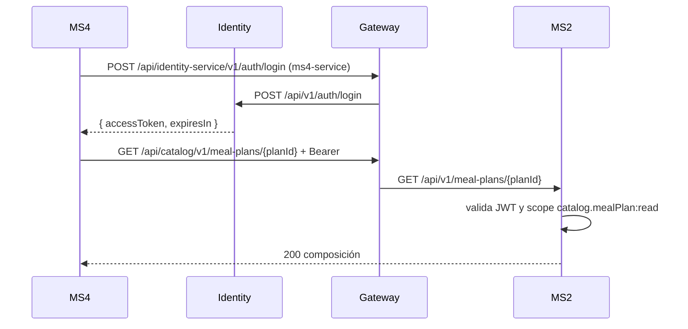

# Integraciones síncronas — MS2

## Resumen

**MS2 no realiza llamadas HTTP salientes a otros microservicios.** No tiene `HttpClient`, adaptadores de infraestructura remota ni service accounts propias. Toda su integración con el resto de la plataforma es **asíncrona** (eventos vía outbox) o **entrante** (otros servicios lo consultan).

| Destino | Método y ruta | Vía | Auth | Para qué |
|---|---|---|---|---|
| _(ninguno)_ | — | — | — | — |

Por eso `sync_calls: []` en [service.yaml](./service.yaml).

## Llamadas entrantes relevantes

### MS4 → MS2: composición del plan (la única integración síncrona que toca a MS2)

- **Endpoint consumido:** `GET /api/v1/meal-plans/{mealPlanId}` (scope `catalog.mealPlan:read`).
- **Llamador:** MS4, desde el job diario de catálogo (`resolve-daily-catalog`), **una vez por plan distinto** entre los días `Scheduled` de mañana.
- **Identidad:** service account `ms4-service` (scope `catalog.mealPlan:read`). MS4 hace `POST /api/identity-service/v1/auth/login` para obtener el token, lo cachea hasta 60 s antes de vencer y reintenta el login una vez si MS2 responde 401.
- **Qué recibe MS4:** la composición completa (plan → días → tiempos de comida → recetas con ración → ingredientes con porción). MS4 se queda con el `PlanDay` cuyo `DayNumber` coincide con el del `DeliveryDay` y aplana los tiempos de comida y las recetas en `MenuItem`, descartando las de 0 raciones.
- **Por qué es síncrono:** MS4 necesita la composición **actual** del plan en un momento preciso (la noche anterior). Mantener una réplica completa por eventos sería más complejo, y `meal-plan-published` no trae la composición.
- **Por qué no se llama bajo demanda:** se resuelve **antes** de que MS3 consulte `active-tomorrow`. Así una caída de MS2 no afecta la consulta de MS3.
- **Si falla:**
  | Respuesta de MS2 | Resultado en MS4 |
  |---|---|
  | 404 (plan inexistente) o día sin recetas | El día se omite y queda en `Scheduled` |
  | 401/403 (service account mal configurada) o 5xx | Los días afectados quedan en `Scheduled` |
  | Transitorios | Reintentos del resilience handler (ServiceDefaults de MS4) |
  | **Recuperación** | Volver a correr el job (es idempotente). |

- **Caché:** MS4 cachea una entrada por plan durante una corrida del job (muchos pacientes comparten pocos planes).

### Frontend / admin

El frontend consume todos los endpoints de foods, recipes y meal-plans vía gateway con el token del usuario (scopes `catalog.*:read/create/edit`). No hay llamadas salientes de MS2.

### Consul y observabilidad

- MS2 se **auto-registra** en Consul al arrancar (en la plataforma como **`catalog`**, por `ServiceRegistration__ServiceName` en `catalog.compose.yml`; el default del código es `catalog-service`, ver ms2-gap-09) con un check HTTP anónimo a `/health`.
- No hay llamada de MS2 a Consul más allá del registro; el gateway descubre las instancias.

## Flujo de autenticación (entrante)

## Manejo de fallas (lado MS2)

Como MS2 no llama a nadie, su única responsabilidad ante fallas es **responder bien**:
- Validación de negocio → `400` con `ApiResponse.Fail`.
- Entidad no encontrada → `404`.
- Token inválido o sin scope → `401`/`403` (lo resuelve el kernel de seguridad).
- Excepción dentro de un handler → **no** llega como `500`: cada handler la captura y devuelve `Result.Fail(ex.Message)`, que el controller traduce a `400` (comandos y listados) o `404` (lecturas por id y `PUT /foods`). Solo una excepción fuera del handler da `500` plano (no hay middleware global). Ver ms2-gap-11.
- BD caída → por lo anterior, `GET /meal-plans/{id}` responde **`404`** y MS4 no puede distinguirlo de "plan inexistente" (el efecto en MS4 es el mismo: el día queda en `Scheduled`). RabbitMQ caído no afecta a la API (publica el worker); el outbox no se drena hasta que el worker recupere la conexión, y el registrar de `catalog.default` reintenta cada 10 s.

## Notas

- **`catalog.default`** es una cola pasiva (durable, nunca consumida) que acumula el historial completo de todo lo publicado. No es una integración; es un sink de auditoría.
- El gateway **no valida tokens**: MS2 valida el JWT y exige un scope por endpoint (`Nur.Tricenter.Security.AddSecurity` + `CatalogPermission`).