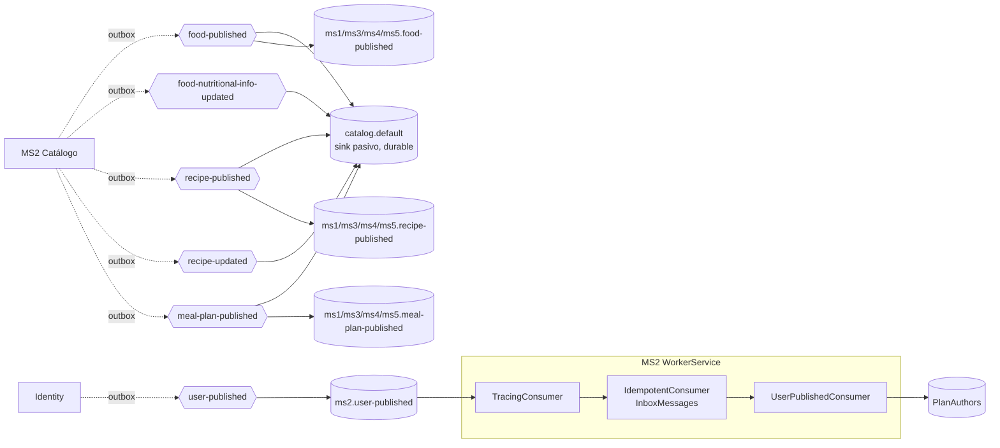

# Mensajería — MS2

## Eventos publicados

MS2 publica **5 contratos de integración** mediante outbox transaccional. Todos los exchanges son `fanout`, no durables, y deben coincidir con `Joseco.Communication.External.RabbitMQ` 1.1.0 (si no, RabbitMQ devuelve `406 PRECONDITION_FAILED`).

| Exchange | Contrato | `EventType` | Trigger real en el código | Outbox |
|---|---|---|---|---|
| `food-published` | `FoodPublished` | `Food.Published` | Se crea un alimento (`POST /foods` → `FoodCreated`) | sí |
| `food-nutritional-info-updated` | `FoodNutritionalInfoUpdated` | `Food.NutritionalInfoUpdated` | Se invoca `Food.UpdateNutritionalInfo` (método de dominio **sin invocador hoy**; `PUT /foods` dispara `FoodUpdated`, que no se publica) | sí (cableado, inalcanzable) |
| `recipe-published` | `RecipePublished` | `Recipe.Published` | Se crea una receta (`POST /recipes` → `RecipeCreated`) | sí |
| `recipe-updated` | `RecipeUpdated` | `Recipe.Updated` | Se invoca `Recipe.Update` (método sin endpoint) → `RecipeUpdated`. El alta/baja de ingredientes dispara `IngredientAddedToRecipe`/`IngredientRemovedFromRecipe`, que **no** se traducen a este contrato | sí (cableado, inalcanzable vía API) |
| `meal-plan-published` | `MealPlanPublished` | `MealPlan.Published` | Se crea un plan (`POST /meal-plans` → `MealPlanCreated`) | sí |

Payloads (según `contracts/events.yaml` y el código):
- `FoodPublished`: `FoodId, Name, Category, Quantity, Calories, Protein, Fat, Carbs, UnitOfMeasure` (`UnitOfMeasure` como string del enum).
- `FoodNutritionalInfoUpdated`: `FoodId, PreviousCalories, PreviousProtein, PreviousFat, PreviousCarbs, NewCalories, NewProtein, NewFat, NewCarbs`.
- `RecipePublished` / `RecipeUpdated`: `RecipeId, Name, Instructions`. **No incluyen ingredientes** (decisión de modelado pendiente).
- `MealPlanPublished`: `PlanId, Name, DurationType, TotalDays, MealsPerDay` (`DurationType` como string del enum, p. ej. `FIFTEEN_DAYS`). **No incluye composición.**

Quién consume hoy (topología: `ms1/ms3/ms4/ms5.<exchange>` para los 5 exchanges): **MS3** (`ms3.meal-plan-published`, `ms3.recipe-published`, `ms3.recipe-updated`) y **MS4** (`ms4.meal-plan-published`, `ms4.recipe-updated`). Las demás colas existen pero ningún servicio las lee. El publisher llama `PublishAsync(..., declareDestination: true)`, así que también declara su exchange (fanout, no durable) al publicar.

Cadena del outbox:
```
Command → DomainDbContext.SaveChanges()
        → domain event → outbox.outboxMessage   (misma transacción)
        → WorkerService: OutboxProcessor<DomainEvent>
        → Project* handlers → StoredDbContext.SaveChanges()
        → PublishIntegrationEvent* → RabbitMQ
```
La cadena tiene tres eslabones y ningún framework la impone: MediatR descubre handlers por convención. `OutboxChainCoverageTests` asegura que cada evento de dominio tenga su `SaveInOutbox` y su proyección.

## Eventos consumidos

| Cola | Exchange | Contrato | Handler | Efecto | Idempotente |
|---|---|---|---|---|---|
| `ms2.user-published` | `user-published` | `UserPublished` | `UserPublishedConsumer` (Tracing → Idempotent → proyección) | Upsert `PlanAuthors` (read model) | sí (inbox) |

Pipeline de cada mensaje:
```
RabbitMQ delivery
  → TracingConsumer<UserPublished, …>   re-adjunta el span del publisher
       → IdempotentConsumer<UserPublished, …>   reclama el mensaje en el inbox
            → UserPublishedConsumer   proyecta (upsert)
```

- **`InboxMessage`** (`read.InboxMessages`) es el claim atómico: la PK es el id del mensaje del publisher, así que una redelivery colisiona en el insert y se salta el handler.
- **El claim se commitea antes del trabajo**: un crash entre reclamar y completar pierde el efecto de ese mensaje (la fila existe, así que la redelivery se salta). Para una proyección es recuperable re-reproduciendo el exchange; para un efecto no idempotente este decorador es la herramienta equivocada.
- **`UserPublishedConsumer` hace upsert**: la redelivery no duplica fila ni falla. Las filas se conservan (nunca se borran) para que un duplicado tardío siga rechazándose.
- **No hay transacción ni outbox** en la proyección: es un read model, no la verdad de negocio.
- **`UserPublishedConsumer` no llama a `SaveChanges`**: el `IdempotentConsumer` es dueño del commit para que el claim del inbox y la proyección aterricen en la misma transacción (inbox atómico).

## Colas declaradas que no se consumen

- `ms2.user-updated` (exchange `user-updated`, contrato `UserChanged`): **declarada en la topología pero sin handler en MS2.** MS2 no proyecta cambios de usuario (solo el alta inicial). Acumula mensajes sin leer (gap transversal X-06).
- `catalog.default`: cola **pasiva y durable** declarada por el propio worker (`DefaultQueueRegistrar`), enlazada a los 5 exchanges del catálogo. Es el **registro completo** de todo lo publicado; nunca se consume. No convertirla en `AddRabbitMqConsumer` (competing consumers destruirían el registro).

## Garantías de entrega

- **Outbox transaccional:** el cambio de dominio y el evento se guardan en la misma transacción (`DomainDbContext` + `outbox.outboxMessage`). Un worker drena y publica; si falla, reintenta. Garantía **at-least-once**.
- **Inbox idempotente:** tabla `InboxMessages` con clave en el `Id` del mensaje. Un mensaje re-entregado no hace nada.
- **Reintentos del outbox:** configurables (`RabbitMqSettings__MaxRetryAttempts = 3`, `RetryBaseDelayMilliseconds = 500`).
- **Trazabilidad:** `OutboxTracingService` estampa la fila del outbox con el trace ambient; `TracingConsumer` re-adjunta el span del publisher en el consumo. OpenTelemetry vía `Nur.Tricenter.Observability`.
- **Topología:** MS2 **no declara** exchanges ni colas ajenas. Vienen de `nur-tricenter-local/topology/rabbitmq-definitions.json`. El worker solo declara `catalog.default` (sink pasivo) y los exchanges como `fanout` no durables para poder enlazarla.
- **Proceso:** el consumo corre en `catalog-workerservice` (no se registra en Consul). La API (`catalog-api`) no necesita el broker al arrancar.

## Detalles técnicos aprendidos

- El worker es un **productor puro** para RabbitMQ salvo el consumidor de `user-published`: `AddRabbitMqConsumer` arrancaría un hosted service que conecta al broker en el boot, así que solo se registra el consumidor que de verdad existe.
- `Joseco.Communication.External.RabbitMQ` 1.1.0 **ignora el puerto configurado**: el broker tiene que estar en 5672. El worker y el registrar abren la conexión con `Port = settings.Port > 0 ? settings.Port : 5672`.
- Los decoradores reciben el **consumidor concreto** (`IdempotentConsumer<T, TInner>`), nunca `IIntegrationMessageConsumer<T>`: Joseco registra el pipeline bajo esa interfaz, así que inyectarla genera un ciclo de DI.
- Npgsql solo escribe `DateTimeOffset` en UTC: los modelos del inbox normalizan con `ToUniversalTime()`.
- El outbox persiste los eventos con un converter de Newtonsoft con `TypeNameHandling.All`; por eso los records de dominio tienen **un único constructor parametrizado** (un constructor sin parámetros haría que Newtonsoft construyera el evento con todas las propiedades get-only en su valor por defecto, truncando el payload en silencio). Ver `Test/UnitTest/Domain/Events/DomainEventOutboxSerializationTests`.

## Diagrama


