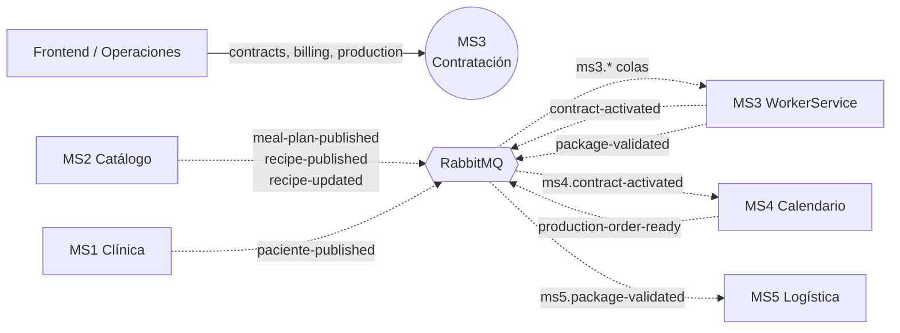

# MS3 — Contratación y producción

> **Owner:** Luis Jesus Ferrufino (@JesusFerru) · **Repo:** [Nur-tricenter/ms3-contract-and-production](https://github.com/Nur-tricenter/ms3-contract-and-production) · **Estado de la ficha:** complete

## Propósito
MS3 es donde un paciente **compra** un plan nutricional y donde la cocina **produce** lo que hay que entregar cada día. Registra el contrato y su cobro, y cuando el pago se confirma avisa a MS4 con el evento `contract-activated` para que cree el calendario de entregas. Cada noche toma la orden de producción que MS4 publicó (`production-order-ready`), la convierte en recetas y raciones a cocinar y lleva cada paquete por armado, etiquetado y control de calidad hasta liberarlo a logística.

## Responsabilidades
- Crear el **contrato** de un paciente con un plan, cobrarlo (factura) y cancelarlo.
- Cobrar los **controles de seguimiento** de pacientes sin contrato activo.
- Announce the paid contract with the **`contract-activated` event** (MS4 creates the delivery calendar), without the payment depending on MS4 being up (outbox, not atomic: `ms3-gap-11`).
- Armar la **orden de producción diaria**: recetas y raciones totales de un día, a partir del menú de la orden que MS4 publicó (`production-order-ready`).
- Llevar cada **paquete** por su flujo: crear, armar, etiquetar, validar (control de calidad).
- Avisar a logística que un paquete está listo (**evento `package-validated`**).
- Mantener **copias locales** (proyecciones) de lo que necesita de otros servicios: planes y recetas de MS2 (`CatalogPlans`, `CatalogRecipes`), pacientes de MS1 (`ClinicPatients`) y las entregas del día siguiente de MS4 (`ScheduledDeliveries`).

## Lo que NO hace
- No define planes ni recetas → **MS2**. MS3 guarda una copia (`CatalogPlans`, `CatalogRecipes`).
- No genera ni modifica el calendario de entregas → **MS4**. MS3 solo avisa que un contrato se pagó y proyecta la orden de producción que MS4 publica.
- No arma rutas ni asigna repartidores → **MS5**.
- No gestiona pacientes → **MS1**. MS3 guarda una copia (`ClinicPatients`) alimentada por el evento `paciente-published`; no llama a MS1. Standalone usa 3 simulados.
- No emite ni valida tokens: **no valida JWT** (sus endpoints son anónimos, ver [gaps](./gaps.md)). Tampoco usa tokens: no hace llamadas salientes (la service account `ms3-service` ya no la usa nadie).

## Actores y vecinos
| Actor / servicio | Dirección | Mecanismo | Para qué |
|---|---|---|---|
| Frontend (paciente) | entrante | REST vía gateway | Contratar un plan, pagar, ver la factura, cancelar |
| Operaciones / cocina | entrante | REST vía gateway | Orden diaria, crear/armar/etiquetar/validar paquetes |
| MS4 Calendario | saliente | Evento RabbitMQ | `contract-activated` al pagar un contrato |
| MS4 Calendario | entrante | Evento RabbitMQ | `production-order-ready`: la orden del día siguiente, con menú |
| MS1 Clínica | entrante | Evento RabbitMQ | `paciente-published`: datos del paciente |
| MS2 Catálogo | entrante | Evento RabbitMQ | `meal-plan-published`, `recipe-published`, `recipe-updated` |
| MS5 Logística | saliente | Evento RabbitMQ | `package-validated` |
| Consul | saliente | Auto-registro + `/health` | Que el gateway lo encuentre como `contracting` |

## Mapa de comunicación

The only REST left is the frontend/operations calling MS3 through the gateway (`/api/contracting/**`). **MS3 makes no REST call to any service.**

## Stack y despliegue
- **.NET 8** (`net8.0`), FastEndpoints 5.35.0, MediatR 12.4.1, EF Core 8.0.11 + PostgreSQL (Npgsql 8.0.11), Joseco.DDD.Core 1.0.2, RabbitMQ con Joseco.Communication.External.RabbitMQ 1.1.0, Consul 1.7.14.7. Capas Core / Application / Infrastructure / Api, con DDD y CQRS.
- **No referencia ningún paquete `Nur.Tricenter.*`** (ni `Access`, ni `Security`, ni `Integration`): los contratos de mensajes son copias locales (`ms3-gap-05`; includes the new `ContractActivated`, `ProductionOrderReady` and `PatientPublished`, same wire shape as kernel 1.6.0) y no hay validación de JWT (`ms3-gap-01`).
- **Dos modos con el mismo código** (cambia solo la configuración):

| | Standalone | Plataforma (`nur-tricenter-local`) |
|---|---|---|
| Arranque | `docker compose up --build` en la raíz del repo | `contracting.compose.yml` incluido en el stack |
| BD | Postgres propio (`nur_tricenter_contracting`) | misma BD en el Postgres compartido |
| RabbitMQ | el suyo, con `topology/` | el de la plataforma |
| Consul | apagado | se registra como `contracting` |
| MS4 and patients (MS1) | simulated calendars and 3 simulated patients (`Projections__Enabled` off); `contract-activated` stays pending without a broker | proyecciones `ScheduledDeliveries` y `ClinicPatients` filled by events (`Projections__Enabled=true`); no HTTP |

- **Procesos en plataforma:** `contracting-api` (puerto 8080, se registra en Consul) y `contracting-workerservice` (relay del outbox + consumidores; no se registra en Consul).
- **Pruebas:** unitarias, de integración (SQLite en memoria, sin broker) y de contrato (Pact). El detalle y los casos de uso están en `docs/` del repo.

## Índice de la ficha
- [domain.md](./domain.md): modelo de dominio, estados e invariantes
- [api.md](./api.md): endpoints expuestos
- [integrations.md](./integrations.md): llamadas síncronas salientes
- [messaging.md](./messaging.md): eventos publicados y consumidos
- [flows.md](./flows.md): casos de uso de punta a punta
- [gaps.md](./gaps.md): deuda, inconsistencias y dependencias
- [service.yaml](./service.yaml): datos estructurados
