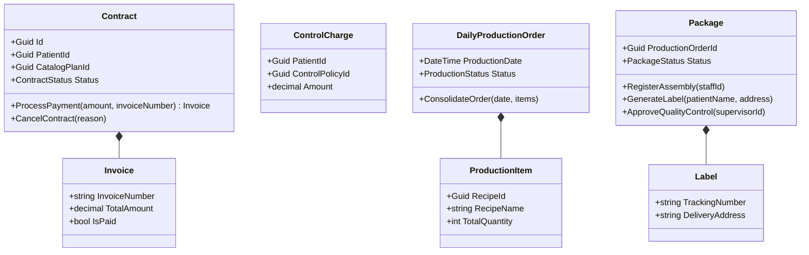
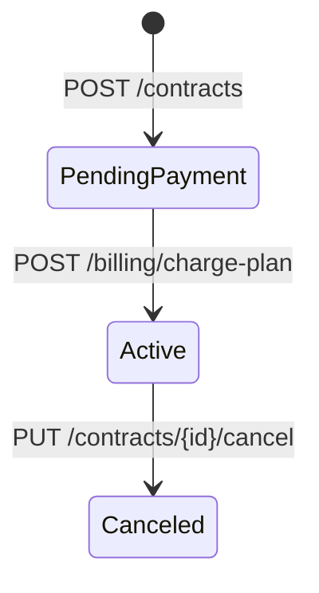
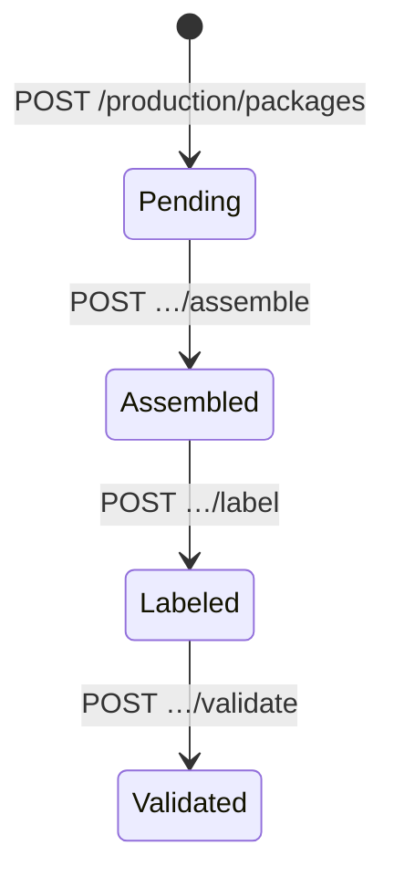

# Modelo de dominio — MS3

## Lenguaje ubicuo
| Término | Significado aquí |
|---|---|
| Contrato (`Contract`) | Compra de un plan por un paciente. Nace `PendingPayment` y se activa al pagar |
| Factura (`Invoice`) | Cobro de un contrato. Se crea al pagar y nace pagada |
| Cobro de control (`ControlCharge`) | Cobro de un control de seguimiento a un paciente **sin** contrato activo |
| Plan (`CatalogPlanId`) | Id del plan de MS2. MS3 no lo define, solo lo referencia |
| Orden de producción diaria (`DailyProductionOrder`) | Recetas y raciones totales que la cocina debe producir para una fecha. **No es** la `ProductionOrder` de MS4: MS4 consolida *qué entregas hay*, MS3 las convierte en *qué cocinar* |
| Ítem de producción (`ProductionItem`) | Una receta con la cantidad total de raciones del día |
| Paquete (`Package`) | Una entrega física de un paciente, que pasa por armado, etiqueta y control de calidad |
| Etiqueta (`Label`) | Número de seguimiento (`NTR-…`), nombre del paciente y dirección de entrega |
| Validación de calidad (`QualityValidation`) | Quién (supervisor) y cuándo aprobó el paquete |
| Fila del outbox (`OutgoingIntegrationEvent`) | Mensaje saliente pendiente de entregar a MS4 o MS5 |
| `packId` (MS4) | Id del día de entrega en MS4. En MS3 se traduce a un GUID derivado (`000000xx-0000-0000-0000-000000000000`) |

## Agregados

### Contract (raíz)
- **Representa:** la compra de un plan por un paciente.
- **Invariantes:**
  - `PatientId` y `CatalogPlanId` no pueden ser vacíos.
  - Solo se paga desde `PendingPayment`; solo se cancela desde `Active`, con un motivo. Un contrato sin pagar no se puede cancelar.
  - Pagar crea la `Invoice`, marca el contrato `Active` y levanta `ContractActivatedDomainEvent`.
- **Entidades internas:** `Invoice` (monto > 0, número no vacío, no se paga dos veces).
- **Estados:** `PendingPayment` → `Active` → `Canceled`.
- **Archivo:** `Nurtricenter.MS3.Core/Aggregates/Contract.cs`

### ControlCharge (raíz)
- **Representa:** el cobro de un control a un paciente sin contrato activo.
- **Invariantes:** paciente, política y número de factura no vacíos; monto > 0.
- **Archivo:** `Nurtricenter.MS3.Core/Aggregates/ControlCharge.cs`

### DailyProductionOrder (raíz)
- **Representa:** lo que la cocina produce un día.
- **Invariantes:** fecha no por defecto; lista de ítems **no vacía**. Una por fecha.
- **Value objects:** `ProductionItem` (receta, nombre, cantidad total).
- **Estados:** `Consolidated` → `InPreparation` → `Completed`.
- **Archivo:** `Nurtricenter.MS3.Core/Aggregates/DailyProductionOrder.cs`

### Package (raíz)
- **Representa:** una entrega física en producción.
- **Invariantes:** orden, paciente y plan no vacíos; el flujo es estrictamente secuencial.
- **Value objects:** `Label`, `QualityValidation`.
- **Estados:** `Pending` → `Assembled` → `Labeled` → `Validated`.
- **Archivo:** `Nurtricenter.MS3.Core/Aggregates/Package.cs`

### OutgoingIntegrationEvent (outbox)
- **Representa:** un mensaje a MS4 o MS5, guardado justo después del cambio que lo originó. **No** en la misma transacción: el handler hace dos `CommitAsync` seguidos (`ms3-gap-11`).
- **Estados:** `Simulated` (pendiente; el nombre viene de cuando solo se simulaba) → `Published` | `Rejected` | `Unroutable`.
- **Archivo:** `Nurtricenter.MS3.Core/Simulations/OutgoingIntegrationEvent.cs`

## Diagrama de clases

## Máquinas de estado

## Reglas de negocio
| Regla | Dónde se aplica | Error si se viola |
|---|---|---|
| Solo se paga un contrato `PendingPayment` | `Contract.ProcessPayment` | `InvalidOperationException` → **500** (ver [gaps](./gaps.md)) |
| Solo se cancela un contrato `Active`, con motivo | `Contract.CancelContract` | `InvalidOperationException` / `ArgumentException` → 500 |
| El paciente y el plan deben existir al contratar | `CreateContractCommandHandler` | 404 `PATIENT_NOT_FOUND` / `PLAN_NOT_FOUND` |
| Un control solo se cobra a quien no tiene contrato activo | `ProcessControlChargeCommandHandler` | 409 `ACTIVE_CONTRACT` |
| El flujo del paquete es secuencial | `Package.RegisterAssembly` / `GenerateLabel` / `ApproveQualityControl` | `InvalidOperationException` → 500 |
| La orden diaria no puede estar vacía | `DailyProductionOrder.ConsolidateOrder` + `GetDailyOrderQueryHandler` | 422 `NO_RECIPES` (el handler lo detecta antes del dominio) |
| El cobro no depende de MS4 | Outbox: fila `CreateSchedule` guardada en un segundo `CommitAsync` tras el pago (no atómico, `ms3-gap-11`) | MS4 caído: la fila queda pendiente y se reintenta |

## Datos que son copia de otro servicio
| Dato | De | Cómo se mantiene |
|---|---|---|
| `CatalogPlans` (id, nombre, tipo, días, comidas por día) | MS2 | Eventos `meal-plan-published` (upsert). Sin precio: `MealPlanPublished` no lo trae, así que el costo proyectado es 0 |
| `CatalogRecipes` (id, nombre, instrucciones) | MS2 | Eventos `recipe-published` y `recipe-updated` (upsert) |
| `InboxMessages` | — | Un registro por mensaje procesado, para ignorar duplicados |
| Pacientes | MS1 | **Simulados** (3 fijos). No hay proyección real todavía |
