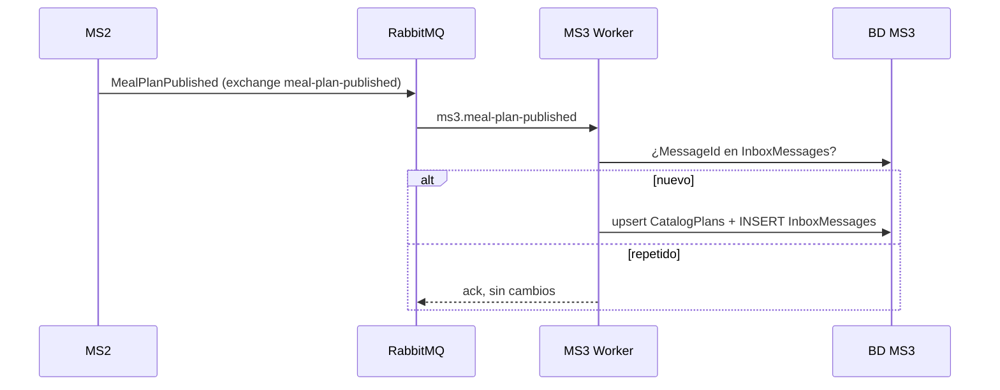
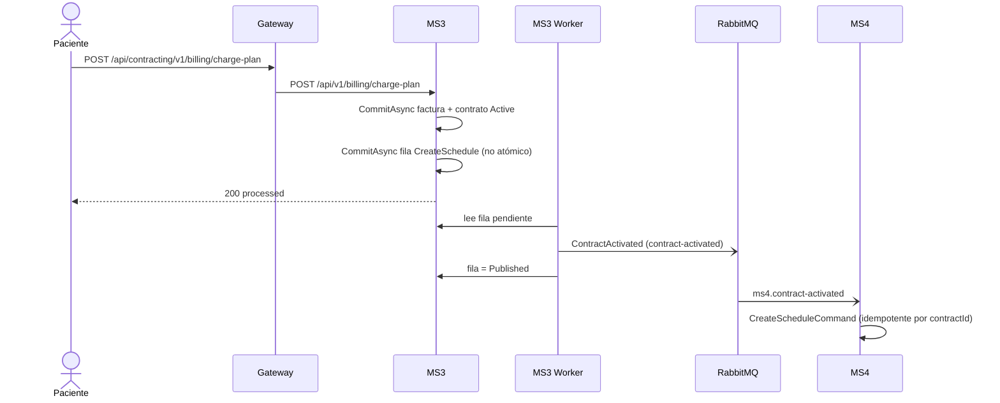
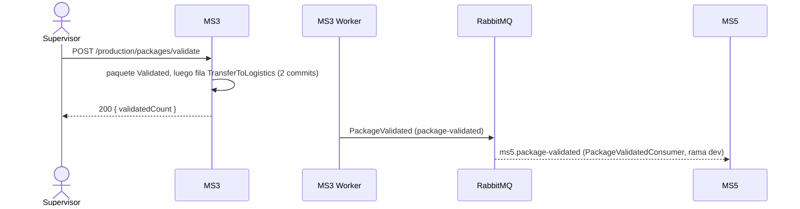

# Flujos — MS3

Los flujos siguen la vida de un contrato, de la compra a la liberación del paquete. F1 a F4 cruzan fronteras de servicio. Probados en Docker con los servicios reales el 2026-10-24.

## F1 — Un plan de MS2 queda disponible para contratar (MS2 → MS3)
- **Actor:** MS2, al sembrar o crear un plan.
- **Disparador:** evento `meal-plan-published` (y `recipe-published`).
- **Precondición:** MS3 y RabbitMQ arriba.
- **Camino feliz:**
  1. MS2 publica `MealPlanPublished` en su exchange; la topología lo copia a `ms3.meal-plan-published`.
  2. `IdempotentConsumer` busca el `MessageId` en `InboxMessages`; si no está, ejecuta el handler.
  3. El handler hace upsert en `CatalogPlans` y el consumidor guarda el `MessageId`, todo en una transacción.
- **Errores:**
  | Situación | Resultado |
  |---|---|
  | Mismo `Id` entregado dos veces | La segunda se ignora (`Skipping … already in the inbox`) |
  | Mismo `PlanId` con un `Id` nuevo | Actualiza la copia |
  | El handler falla | Joseco reintenta 3 veces y manda el mensaje a la cola de error |
- **Idempotencia:** por `MessageId` (inbox) y upsert por `PlanId`.



## F2 — Contratar y pagar un plan → evento `contract-activated` → calendario en MS4 (MS3 → MS4)
- **Actor:** paciente desde el frontend.
- **Disparador:** `POST /contracts` y luego `POST /billing/charge-plan`.
- **Precondición:** el plan existe en `CatalogPlans` (F1) o en la simulación; el paciente existe en `ClinicPatients` (projection of MS1's `paciente-published`; standalone, one of the 3 simulated). A patient MS1 published before the deploy is unknown (no backfill, X-15).
- **Camino feliz:**
  1. `POST /contracts` crea el contrato `PendingPayment` (201).
  2. `POST /billing/charge-plan` crea la factura, activa el contrato y guarda en el outbox la fila `CreateSchedule` con `durationDays` (días del plan) y `startDate` (día siguiente). Responde 200.
  3. The worker (`OutboxRelay`) takes the row and publishes `ContractActivated` `{ ContractId, PatientId, CatalogPlanId, DurationDays, StartDate }` to `contract-activated`, with the row id as the message id. MS3 marks the row `Published`.
  4. MS4 consumes it from `ms4.contract-activated` and sends `CreateScheduleCommand`: it creates the `Active` calendar with N `Pending` days (idempotent by `ContractId`).
- **Errores:**
  | Situación | Resultado |
  |---|---|
  | Plan o paciente desconocido | 404 al contratar |
  | MS4 rejects the data (duration ≠ 15/30, or a duration that contradicts the plan) | MS4 logs it and acknowledges the message; MS3 does not learn about it: the contract **stays active and paid** without a calendar (`ms3-gap-06`) |
  | Payload without `durationDays` (unknown plan) | Row `Rejected`, never published; same result for the contract |
  | Broker or MS4 down | Row pending (the payment answered 200 anyway); retried every 5 s, or MS4 consumes it when it is back, and it completes on its own |
  | Pagar dos veces | 500 la segunda vez (el dominio lo prohíbe, pero no se mapea) |
  | El API cae entre guardar el pago y guardar la fila | Contrato pagado sin fila `CreateSchedule`: el calendario nunca se pide (`ms3-gap-11`) |
- **Idempotencia / reintentos:** the message id is the outbox row id, so a redelivery after a lost ack is dropped by MS4's inbox, and `CreateScheduleCommand` is idempotent by `contractId`: neither creates a second calendar.



## F3 — Producir: la orden diaria sale de la orden que MS4 publicó (`production-order-ready`)
- **Actor:** cocina / operaciones.
- **Disparador:** `GET /production/daily-order?productionDate=`
- **Precondición:** MS4 corrió `resolve-daily-catalog` para esa fecha (los días tienen dirección) y MS3 ya recibió el `ProductionOrderReady` de esa fecha (`ScheduledDeliveries`).
- **Camino feliz:**
  1. MS3 busca una orden ya creada para la fecha; si existe, la devuelve.
  2. Si no, lee las entregas de esa fecha de su proyección `ScheduledDeliveries` (no llama a MS4).
  3. Por cada entrega suma las raciones de cada receta de su `menu`, con el nombre que vino en el evento.
  4. Crea la `DailyProductionOrder` y devuelve las recetas con su total de porciones.
- **Errores:**
  | Situación | Resultado |
  |---|---|
  | No `ProductionOrderReady` received for that date (job not run, no addresses, or the event has not arrived yet) | 404 `NO_CALENDARS` |
  | Las entregas no traen `menu` y el plan no tiene estructura simulada | 422 `NO_RECIPES`, sin crear la orden |
  | MS4 caído | no effect: MS3 answers from the last order MS4 published (no "MS4 outage" error exists any more) |
- **Idempotencia:** por fecha; llamar de nuevo devuelve la misma orden.
- **Note:** every `resolve-daily-catalog` run publishes a new full snapshot; MS3 replaces its rows for that date (an older snapshot is ignored), so a day made ready later enters the projection, but not an order MS3 already created for the date (`ms3-gap-14`).

```mermaid
sequenceDiagram
  actor K as Cocina
  participant MS3
  participant MQ as RabbitMQ
  participant MS4
  MS4-)MQ: ProductionOrderReady (production-order-ready), after resolve-daily-catalog
  MQ-)MS3: ms3.production-order-ready -> replaces ScheduledDeliveries of the date
  K->>MS3: GET /production/daily-order?productionDate=2026-10-25
  alt ya existe la orden
    MS3-->>K: 200 (la guardada)
  else
    MS3->>MS3: lee ScheduledDeliveries (address, lat, long, menu[…])
    MS3->>MS3: suma raciones por receta; crea DailyProductionOrder
    MS3-->>K: 200 { recipesSummary[…] }
  end
```

## F4 — Paquete validado → logística (MS3 → MS5)
- **Actor:** supervisor de calidad.
- **Disparador:** `POST /production/packages/validate`
- **Precondición:** el paquete pasó `assemble` y `label`.
- **Camino feliz:**
  1. MS3 recorre los paquetes de la orden y llama a `ApproveQualityControl` en cada uno.
  2. Por cada uno guarda el paquete y, en un segundo `CommitAsync`, la fila `TransferToLogistics` con dirección, tracking y coordenadas (estas, de las entregas de mañana proyectadas en `ScheduledDeliveries`) y el teléfono del paciente (de `ClinicPatients`).
  3. El worker publica `PackageValidated` en el exchange `package-validated`; llega a `ms5.package-validated`.
- **Errores:**
  | Situación | Resultado |
  |---|---|
  | `batchValidated` falso o conteo distinto | 400 |
  | Un paquete no está `Labeled` | 500; los paquetes anteriores del lote ya quedaron validados |
  | RabbitMQ caído | La fila queda pendiente y se publica sola al volver |
  | El API cae entre guardar el paquete y guardar la fila | Paquete `Validated` sin evento: MS5 nunca se entera (`ms3-gap-11`) |
  | MS5 sin desplegar su consumidor | El mensaje espera en la cola. `PackageValidatedConsumer` existe en la rama `dev` de MS5, aún no en `main` (X-10) |
- **Idempotencia:** el `Id` del mensaje es el de la fila; un consumidor debe descartar repetidos.



## F5 — Cobrar un control sin contrato (frontend → MS3)
- **Actor:** paciente sin contrato activo.
- **Disparador:** `POST /billing/charge-control`
- **Camino feliz:** MS3 comprueba que el paciente no tenga un contrato `Active`, crea el `ControlCharge` y responde 201. No involucra a otros servicios.
- **Errores:** 409 `ACTIVE_CONTRACT` si tiene contrato activo.
