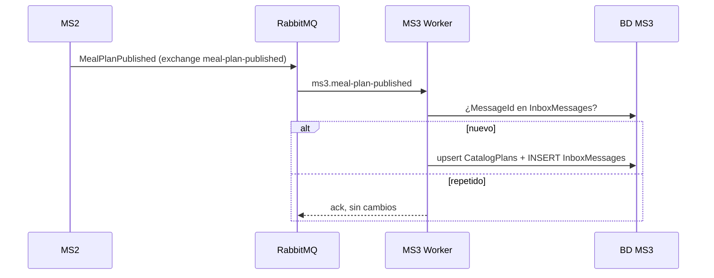
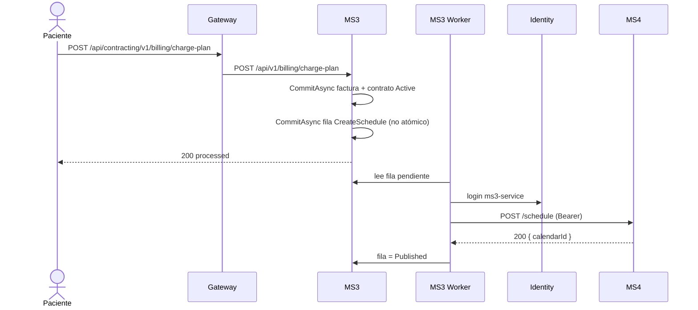
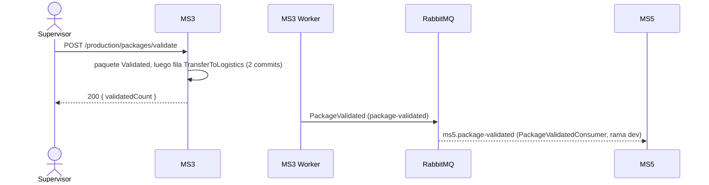

# Flujos — MS3

Los flujos siguen la vida de un contrato, de la compra a la liberación del paquete. F1 a F4 cruzan fronteras de servicio. Probados en Docker con los servicios reales el 2026-10-24.

## F1 — Un plan de MS2 queda disponible para contratar (MS2 → MS3)
- **Actor:** MS2, al sembrar o crear un plan.
- **Disparador:** evento `meal-plan-published` (y `recipe-published`).
- **Precondición:** MS3 y RabbitMQ arriba.
- **Camino feliz:**
  1. MS2 publica `MealPlanPublished` en su exchange; la topología lo copia a `ms3.meal-plan-published`.
  2. `IdempotentConsumer` busca el `MessageId` en `InboxMessages`; si no está, ejecuta el handler.
  3. El handler hace upsert en `CatalogPlans` y el consumidor guarda el `MessageId`, todo en una transacción.
- **Errores:**
  | Situación | Resultado |
  |---|---|
  | Mismo `Id` entregado dos veces | La segunda se ignora (`Skipping … already in the inbox`) |
  | Mismo `PlanId` con un `Id` nuevo | Actualiza la copia |
  | El handler falla | Joseco reintenta 3 veces y manda el mensaje a la cola de error |
- **Idempotencia:** por `MessageId` (inbox) y upsert por `PlanId`.



## F2 — Contratar y pagar un plan → calendario en MS4 (MS3 → MS4)
- **Actor:** paciente desde el frontend.
- **Disparador:** `POST /contracts` y luego `POST /billing/charge-plan`.
- **Precondición:** el plan existe en `CatalogPlans` (F1) o en la simulación; el paciente existe en MS1 (o es uno de los 3 simulados si `Clinic__BaseUrl` no está configurado).
- **Camino feliz:**
  1. `POST /contracts` crea el contrato `PendingPayment` (201).
  2. `POST /billing/charge-plan` crea la factura, activa el contrato y guarda en el outbox la fila `CreateSchedule` con `durationDays` (días del plan) y `startDate` (día siguiente). Responde 200.
  3. El worker toma la fila, inicia sesión como `ms3-service` y llama a `POST /schedule` de MS4 con `{ contractId, patientId, planId, duration, startDate }`.
  4. MS4 crea el calendario `Active` con N días `Pending`. MS3 marca la fila `Published`.
- **Errores:**
  | Situación | Resultado |
  |---|---|
  | Plan o paciente desconocido | 404 al contratar |
  | MS4 responde 400/422 (duración ≠ 15/30) | Fila `Rejected`; el contrato **queda activo y pagado** sin calendario |
  | MS4 o identity caídos | Fila pendiente; el pago respondió 200 igual; se reintenta cada 5 s y se completa solo |
  | Pagar dos veces | 500 la segunda vez (el dominio lo prohíbe, pero no se mapea) |
  | El API cae entre guardar el pago y guardar la fila | Contrato pagado sin fila `CreateSchedule`: el calendario nunca se pide (`ms3-gap-11`) |
- **Idempotencia / reintentos:** `POST /schedule` es idempotente por `contractId` en MS4; un reintento de MS3 no crea un segundo calendario.



## F3 — Producir: la orden diaria sale del menú de MS4 (MS3 ↔ MS4)
- **Actor:** cocina / operaciones.
- **Disparador:** `GET /production/daily-order?productionDate=`
- **Precondición:** MS4 corrió `resolve-daily-catalog` para esa fecha; los días tienen dirección.
- **Camino feliz:**
  1. MS3 busca una orden ya creada para la fecha; si existe, la devuelve sin consultar a MS4.
  2. Si no, pide `active-tomorrow?date=` a MS4 como `ms3-service`.
  3. Por cada entrega suma las raciones de cada receta de su `menu`, con el nombre que vino de MS4.
  4. Crea la `DailyProductionOrder` y devuelve las recetas con su total de porciones.
- **Errores:**
  | Situación | Resultado |
  |---|---|
  | MS4 devuelve `[]` (job no corrido, o sin direcciones) | 404 `NO_CALENDARS` |
  | Las entregas no traen `menu` y el plan no tiene estructura simulada | 422 `NO_RECIPES`, sin crear la orden |
  | MS4 caído o rechaza el token | 500 |
- **Idempotencia:** por fecha; llamar de nuevo devuelve la misma orden.
- **Nota:** `menu` es un campo nuevo que MS3 propone a MS4 (rama `feat/active-tomorrow-menu` de MS4, sin PR; `main` de MS4 no lo devuelve). Sin él, solo funciona con los planes simulados.

```mermaid
sequenceDiagram
  actor K as Cocina
  participant MS3
  participant MS4
  K->>MS3: GET /production/daily-order?productionDate=2026-10-25
  alt ya existe la orden
    MS3-->>K: 200 (la guardada)
  else
    MS3->>MS4: GET /calendars/active-tomorrow?date=2026-10-25 (Bearer)
    MS4-->>MS3: [ { packId, address, lat, long, menu[…] } ]
    MS3->>MS3: suma raciones por receta; crea DailyProductionOrder
    MS3-->>K: 200 { recipesSummary[…] }
  end
```

## F4 — Paquete validado → logística (MS3 → MS5)
- **Actor:** supervisor de calidad.
- **Disparador:** `POST /production/packages/validate`
- **Precondición:** el paquete pasó `assemble` y `label`.
- **Camino feliz:**
  1. MS3 recorre los paquetes de la orden y llama a `ApproveQualityControl` en cada uno.
  2. Por cada uno guarda el paquete y, en un segundo `CommitAsync`, la fila `TransferToLogistics` con dirección, tracking y coordenadas (estas, desde el calendario de MS4 de mañana).
  3. El worker publica `PackageValidated` en el exchange `package-validated`; llega a `ms5.package-validated`.
- **Errores:**
  | Situación | Resultado |
  |---|---|
  | `batchValidated` falso o conteo distinto | 400 |
  | Un paquete no está `Labeled` | 500; los paquetes anteriores del lote ya quedaron validados |
  | RabbitMQ caído | La fila queda pendiente y se publica sola al volver |
  | El API cae entre guardar el paquete y guardar la fila | Paquete `Validated` sin evento: MS5 nunca se entera (`ms3-gap-11`) |
  | MS5 sin desplegar su consumidor | El mensaje espera en la cola. `PackageValidatedConsumer` existe en la rama `dev` de MS5, aún no en `main` (X-10) |
- **Idempotencia:** el `Id` del mensaje es el de la fila; un consumidor debe descartar repetidos.



## F5 — Cobrar un control sin contrato (frontend → MS3)
- **Actor:** paciente sin contrato activo.
- **Disparador:** `POST /billing/charge-control`
- **Camino feliz:** MS3 comprueba que el paciente no tenga un contrato `Active`, crea el `ControlCharge` y responde 201. No involucra a otros servicios.
- **Errores:** 409 `ACTIVE_CONTRACT` si tiene contrato activo.
