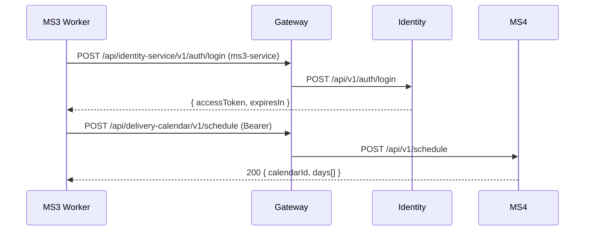

# Integraciones síncronas — MS3

## Resumen
| Destino | Método y ruta | Vía | Auth | Para qué |
|---|---|---|---|---|
| MS4 | `POST /api/delivery-calendar/v1/schedule` | gateway | `service-account:ms3-service` | Crear el calendario de entregas al pagar un contrato |
| MS4 | `GET /api/delivery-calendar/v1/calendars/active-tomorrow?date=` | gateway | `service-account:ms3-service` | Obtener las entregas (con su menú) para la orden de producción |
| Identity | `POST /api/identity-service/v1/auth/login` | gateway | ninguna | Obtener el JWT de `ms3-service` |

## Detalle

### MS3 → MS4: crear el calendario
- **Puerto / adaptador en el código:** `IDeliveryCalendarClient` / `HttpDeliveryCalendarClient` (`Infrastructure/DeliveryCalendar/`). Lo invoca `OutboxRelay`, no el handler del pago.
- **Ruta exacta:** `POST /api/delivery-calendar/v1/schedule` con `{ contractId, patientId, planId, duration, startDate }`.
- **Datos que MS3 decide:**
  - `duration` = días del plan. Sale de la simulación o de `TotalDays` del plan proyectado desde MS2.
  - `startDate` = **el día siguiente al pago** (UTC).
- **Autenticación:** JWT de la service account `ms3-service`, con el scope `deliveryCalendar.calendar:create`.
- **Por qué es síncrono:** MS4 ya diseñó este paso como un POST idempotente por `contractId`; MS3 necesita saber si el calendario se aceptó o se rechazó (por ejemplo, por duración inválida).
- **Por qué sale del outbox y no del handler:** el cobro no debe fallar porque MS4 esté caído. El handler guarda la factura y la fila `CreateSchedule`; el worker la entrega después. **No es la misma transacción:** `ProcessPaymentCommandHandler` llama dos veces a `CommitAsync` (primero el contrato y la factura, después la fila), sin transacción explícita. Si el proceso cae entre ambos, el contrato queda pagado y sin fila, y el calendario nunca se pide (`ms3-gap-11`).
- **Si falla:**
  | Respuesta de MS4 | Estado de la fila | Reintento |
  |---|---|---|
  | 200 (nuevo o ya existente) | `Published` | — |
  | 400 / 422 (p. ej. duración ≠ 15/30) | `Rejected` | no |
  | 401, 5xx o sin respuesta | sigue `Simulated` | cada 5 s (`Outbox__PollingIntervalSeconds`) |
  | `DeliveryCalendar__BaseUrl` sin configurar | `Unroutable` | no |
  | Plan sin duración conocida | `Rejected` | no |
  | El API cae entre los dos `CommitAsync` del pago | no hay fila | nunca (`ms3-gap-11`) |
- **Modo sin dependencia:** en standalone no hay `DeliveryCalendar__BaseUrl`; el cliente es `DisabledDeliveryCalendarClient` y las filas quedan `Unroutable`.

### MS3 → MS4: orden de producción
- **Puerto / adaptador en el código:** `DeliveryCalendarSimulationService`, que decora a `ISimulationService.GetActiveCalendars`.
- **Ruta exacta:** `GET /api/delivery-calendar/v1/calendars/active-tomorrow?date=YYYY-MM-DD`.
- **Autenticación:** `ms3-service`, con el scope `deliveryCalendar.productionOrder:read`.
- **Qué usa MS3 de la respuesta:** `packId` (se traduce a un GUID derivado), `patientId`, `planId`, `hour`, `address`, `latitude`, `longitude` y `menu` (recetas y raciones del día).
- **Por qué es síncrono:** la orden se pide en un momento exacto (la noche anterior) y MS4 la consolidó antes. MS4 no resuelve bajo demanda.
- **Quién lo usa:** `GET /production/daily-order`, el etiquetado de paquetes y la validación de calidad (para la dirección y las coordenadas).
- **Si falla:** no hay valor por defecto honesto. La orden diaria responde 500; no se crea nada. Si MS4 devuelve `[]`, responde 404 `NO_CALENDARS`.
- **Compatibilidad:** `menu` es un campo nuevo que MS3 le propone a MS4. Está en la rama `feat/active-tomorrow-menu` de MS4, **sin PR**; `main` de MS4 todavía no lo devuelve (`ms3-gap-07`). Sin él, MS3 usa la estructura simulada del plan y, si tampoco la hay, responde 422 `NO_RECIPES`.
- **Modo sin dependencia:** sin `DeliveryCalendar__BaseUrl`, `SimulationDataService` devuelve 3 calendarios fijos.

### MS3 → Identity: login de la service account
- **Puerto / adaptador:** `ServiceAccountTokenProvider` + `ServiceAccountTokenHandler` (`DelegatingHandler` que agrega el `Bearer` a cada llamada a MS4).
- **Cuenta:** `ms3-service`, con los scopes `deliveryCalendar.calendar:create` y `deliveryCalendar.productionOrder:read` (mínimo privilegio). La crea `start-stack` de `nur-tricenter-local` con el admin sembrado.
- **Token:** se guarda en memoria hasta 60 s antes de vencer. Si MS4 responde 401 a un GET, renueva el token y reintenta una vez.
- **Si falla:** 401 de identity lanza `InvalidOperationException`; la fila del outbox queda pendiente.

