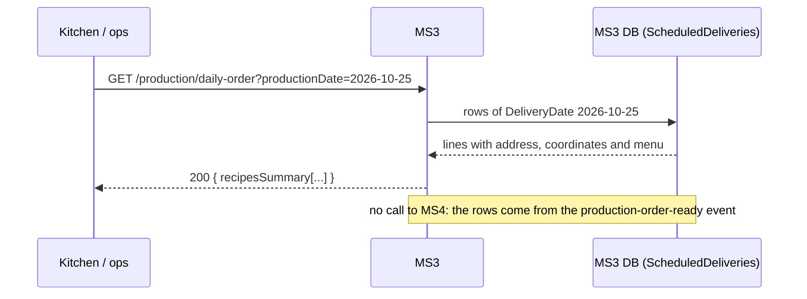

# Integraciones síncronas — MS3

## Resumen
**None.** Since MS3#11 MS3 makes no outbound HTTP call: there is no REST between MS3 and any other service. `sync_calls` in [service.yaml](./service.yaml) is empty.

| Was | Is now |
|---|---|
| MS3 → MS4 `POST /api/delivery-calendar/v1/schedule` (create the calendar) | MS3 publishes `contract-activated`; MS4 creates the calendar ([messaging.md](./messaging.md)) |
| MS3 → MS4 `GET /api/delivery-calendar/v1/calendars/active-tomorrow` (production order) | MS4 publishes `production-order-ready`; MS3 projects it into `ScheduledDeliveries` |
| MS3 → MS1 `GET /api/clinica-nutricional/v1/Patient/{id}` (patient) | MS1 publishes `paciente-published`; MS3 projects it into `ClinicPatients` |
| MS3 → Identity `POST /api/identity-service/v1/auth/login` (token of `ms3-service`) | Gone: nothing to authenticate. `ms3-service` still exists in identity (the demo console's security view uses it) |

What was deleted from the code: `Infrastructure/DeliveryCalendar/` (`IDeliveryCalendarClient`, `HttpDeliveryCalendarClient`, `DisabledDeliveryCalendarClient`, `DeliveryCalendarSimulationService`, `ServiceAccountTokenHandler`/`ServiceAccountTokenProvider`, `DeliveryCalendarRejectedException`), `Infrastructure/Clinic/` (`IClinicClient`, `HttpClinicClient`, `ClinicSimulationService`) and the `Identity`, `Clinic` and `DeliveryCalendar` options (`*__BaseUrl`, login credentials). `contracting.compose.yml` no longer sets them.

## Why events instead of calls
- **Course rule:** avoid synchronous communication between services (no REST unless it is a small query).
- **The old reasons for REST did not hold.** MS3 → MS4 `POST /schedule` was "synchronous so MS3 learns if the calendar was accepted", but it already ran from the outbox, outside the payment, so MS3 never answered the patient with that result anyway. `active-tomorrow` was "the whole picture of the day at a given moment": a full-snapshot event gives the same picture without a live dependency.
- **Autonomy:** MS3 keeps working (daily order, label, validate) while MS1 or MS4 are down, with the last data they published.

## Reading the data MS3 needs
Both projections are read through a decorator over `ISimulationService` (`ProjectedDataSimulationService`), enabled by the flag **`Projections__Enabled=true`** (set on the platform API in `contracting.compose.yml`). Without the flag (standalone) the 3 simulated patients and the simulated calendars answer, as before; on the platform, with the flag, only what was published exists:

- **Patients:** `GetPatient` reads `ClinicPatients` (full name = `FirstName` + `LastName`, phone). An unknown patient is the existing `PATIENT_NOT_FOUND` 404 — also when the sample data knows the id. Used by contract creation, the label and package release (where `PackageValidated.PatientPhone` comes from). If the patient is unknown when the package is released, the event still goes out with a null phone (the package is already approved).
- **Next-day deliveries:** `GetActiveCalendars(date)` reads `ScheduledDeliveries` of that `DeliveryDate`. Used by `GET /production/daily-order`, the label and the quality validation (address and coordinates). If MS4 has not published an order for the date there are no deliveries and the daily order answers 404 `NO_CALENDARS`; there is no "MS4 is down" error any more, because nothing is called.

