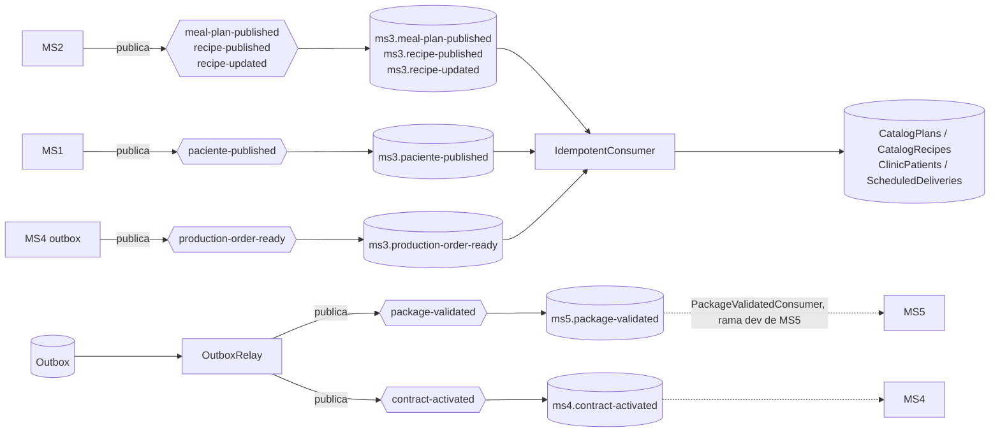

# Mensajería — MS3

## Eventos publicados
| Exchange | Contrato (kernel) | EventType | Se dispara cuando | Outbox |
|---|---|---|---|---|
| `package-validated` | `PackageValidated` | `Package.Validated` | El control de calidad aprueba un paquete (`POST /production/packages/validate`); un evento por paquete | sí |
| `contract-activated` | `ContractActivated` | `Contract.Activated` | A contract is paid (`POST /billing/charge-plan`); one event per contract | sí |

Contrato: `Nur.Tricenter.Integration.Messages.Contracting` (kernel 1.5.0; trae `DeliveryDate`, `PatientName`, `DeliveryDayId` y `PatientPhone`). MS3 **no** referencia el kernel: publica una copia local equivalente, `Nurtricenter.MS3.Infrastructure.Messaging.Contracts.Production.PackageValidated` (mismos campos y `EventType`, otro namespace y base `IntegrationMessage` de Joseco). En el cable el JSON es el mismo (`ms3-gap-05`).

Cuerpo publicado:
```json
{
  "EventType": "Package.Validated",
  "PackageId": "guid", "PatientId": "guid", "ProductionOrderId": "guid", "CatalogPlanId": "guid",
  "ReleasedAt": "2026-10-24T05:51:51Z",
  "DeliveryAddress": "Av. Banzer 123, Santa Cruz", "TrackingNumber": "NTR-A79C734C-20261024",
  "Latitude": -17.78, "Longitude": -63.18,
  "Id": "guid", "CreatedAt": "…", "CorrelationId": "guid", "Source": "contracting"
}
```
- `DeliveryAddress` y `TrackingNumber` salen de la etiqueta del paquete.
- `Latitude` y `Longitude` salen del calendario de MS4 del mismo paciente cuya dirección coincide con la de la etiqueta; van en `null` si ninguno coincide.
- `PackageId` es el id del paquete de MS3, **no** el `packId` (día de entrega) de MS4 (ver `ms3-gap-03`). MS5 lo copia a sus eventos de entrega, y MS4 (PR #3 de MS4, abierto) espera ahí un `packId` entero: con un GUID no puede cerrar el día.

### `contract-activated` (MS3#11; replaces the REST call `POST /schedule`)
Contract: `Nur.Tricenter.Integration.Messages.Contracting.ContractActivated` (kernel 1.6.0). MS3 publishes a local copy with the same wire shape (`Infrastructure/Messaging/Contracts/Contracting/ContractActivated.cs`, `ms3-gap-05`).
```json
{ "EventType": "Contract.Activated", "ContractId": "guid", "PatientId": "guid", "CatalogPlanId": "guid",
  "DurationDays": 30, "StartDate": "2026-10-25",
  "Id": "guid", "CreatedAt": "…", "CorrelationId": "guid", "Source": "contracting" }
```
- **Trigger:** `ProcessPaymentCommandHandler` stores the outbox row of type `CreateSchedule` (the row type name is kept) with `durationDays` (days of the plan, from the simulation or the projected `TotalDays` of MS2) and `startDate` (the day after the payment, UTC). `OutboxRelay` publishes it to `contract-activated` with `declareDestination: true`.
- **Message id:** the outbox row id (`Id`), so a redelivery after a lost ack carries the same id and MS4's inbox drops it. MS4 is also idempotent by `ContractId`.
- **Consumer:** MS4 (`ms4.contract-activated`, `ContractActivatedConsumer`): sends the existing `CreateScheduleCommand`. Data MS4 rejects (a duration that is not 15/30, or one that contradicts the plan) is logged and acknowledged there; **MS3 does not learn about it** (`ms3-gap-06`).
- **Outbox row states:**

| State | Meaning |
|---|---|
| `Published` | The broker accepted the message |
| `Rejected` | The payload has no `durationDays` (unknown plan): MS4 could not build a calendar and no retry would help |
| `Simulated` (pending) | Broker down; retried every 5 s (`Outbox__PollingIntervalSeconds`) |
| `Unroutable` | No destination for that row type, or a malformed payload |

## Eventos consumidos
| Cola | Exchange | Contrato | Handler | Efecto |
|---|---|---|---|---|
| `ms3.meal-plan-published` | `meal-plan-published` | `MealPlanPublished` | `MealPlanPublishedConsumer` | Upsert del plan en `CatalogPlans`. Desde ese momento `POST /contracts` acepta ese `PlanId` y la factura muestra su nombre |
| `ms3.recipe-published` | `recipe-published` | `RecipePublished` | `RecipePublishedConsumer` | Upsert de la receta en `CatalogRecipes` |
| `ms3.recipe-updated` | `recipe-updated` | `RecipeUpdated` | `RecipeUpdatedConsumer` | Actualiza nombre e instrucciones en `CatalogRecipes` |
| `ms3.production-order-ready` | `production-order-ready` | `ProductionOrderReady` | `ProductionOrderReadyConsumer` | Replaces the `ScheduledDeliveries` rows of the order's `DeliveryDate` with the snapshot (rows are matched by date **or** by delivery day id, because a rescheduled day sits under its old date until that date's next snapshot). A snapshot older than the stored rows (`CreatedAt`) is ignored. The daily order, the label and the validation read it |
| `ms3.paciente-published` | `paciente-published` | `PatientPublished` | `PatientPublishedConsumer` | Upserts `ClinicPatients` (patient id, full name = `FirstName` + `LastName`, phone). A snapshot older than the stored row is ignored |

`ProductionOrderReady` and `PatientPublished` (MS3#11) are full snapshots; `ScheduledDeliveries` keeps one row per delivery day (`DeliveryDayId`, `DeliveryDate`, `PatientId`, `PlanId`, `Hour`, `Address`, `Latitude`, `Longitude`, `MenuJson`, `SnapshotAt`). The delivery day id becomes the package id MS3 uses (derived Guid `000000xx-0000-0000-0000-000000000000`) and travels as `PackageValidated.DeliveryDayId`. **Known limit: there is no backfill** (X-15): a patient created in MS1 before the deploy is not projected, so a contract for it answers 404 `PATIENT_NOT_FOUND` until MS1 publishes it again.
Contratos: `Nur.Tricenter.Integration.Messages.Catalog` (and `Clinic`/`DeliveryCalendar` for the two new ones, kernel 1.6.0). MS3 usa copias locales equivalentes en `Nurtricenter.MS3.Infrastructure.Messaging.Contracts.*` (`Catalog`, `Clinic`, `DeliveryCalendar`, `Contracting`; mismos campos y `EventType`, otro namespace), porque no referencia ningún paquete `Nur.Tricenter.*` (`ms3-gap-05`). Código: `Infrastructure/Messaging/` (handlers en `Consumers/`, registro en `MessagingExtensions.cs` y `Nurtricenter.MS3.WorkerService/RabbitMqExtensions.cs`).

## Colas declaradas que no se consumen
La topología crea para MS3 también `ms3.food-published`, `ms3.food-nutritional-info-updated`, `ms3.user-published` y `ms3.user-updated`. **No se consumen:** MS3 no necesita alimentos, y los usuarios no hacen falta mientras sus endpoints sean anónimos. Acumulan mensajes (X-06).

## Garantías de entrega
- **Publicación:** outbox, **no atómico**. `ApproveQualityCommandHandler` guarda primero el paquete `Validated` (`CommitAsync`) y después, en un segundo `CommitAsync` sin transacción explícita, la fila `TransferToLogistics`. Si el proceso cae entre ambos, el paquete queda validado y el evento no sale nunca (`ms3-gap-11`; lo mismo pasa con la fila `CreateSchedule` del pago). `OutboxRelay`, que corre en `Nurtricenter.MS3.WorkerService` cada 5 s, la publica y la marca `Published`. Si RabbitMQ falla, la fila queda pendiente y se reintenta.
- **Id del mensaje:** es el `Id` de la fila del outbox. Si el worker cae entre publicar y marcar, la republicación lleva el mismo `Id` y el consumidor debe descartarla.
- **Consumo:** inbox atómico. `IdempotentConsumer` guarda el `MessageId` en `InboxMessages` en la misma transacción que el upsert; un mensaje repetido se ignora.
- **Reintentos:** los de la librería Joseco (`MaxRetryAttempts`, 3, con espera creciente) y luego la cola de error de esa cola.
- **Persistencia:** la librería publica mensajes **no persistentes** en exchanges **no durables**: si RabbitMQ se reinicia, se pierden los que estaban en cola y se borran los bindings. Por eso la plataforma reimporta la topología en **cada** arranque (`definitions.skip_if_unchanged = false`).
- **Trazabilidad:** `CorrelationId` = `Id` de la fila del outbox. MS3 no tiene OpenTelemetry todavía.

## Diagrama

