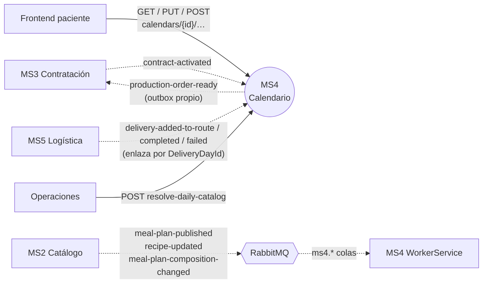

# MS4 — Calendario de entregas

> **Owner:** Franklin Andre Romero Padilla (@franklin-andre) · **Repo:** [Nur-tricenter/ms4-delivery-schedule-management](https://github.com/Nur-tricenter/ms4-delivery-schedule-management) · **Estado de la ficha:** complete

## Propósito
Cuando un paciente contrata un plan nutricional, lo que en realidad compra es **una secuencia de entregas diarias**. MS4 convierte esa promesa en un calendario concreto: qué día se entrega, a qué dirección, qué menú y si la entrega ya ocurrió o falló. Sin MS4 nadie sabe cuándo ni dónde entregar, ni qué hay que cocinar mañana.

## Responsabilidades
- Crear el calendario de un contrato: 15 o 30 días consecutivos, cada uno ligado a su **número de día del plan**.
- Gestionar los cambios del paciente sobre cada día (dirección, reprogramación, cancelación) aplicando la **regla de 48h**.
- Resolver la noche anterior el **menú de cada día** desde su proyección local de las composiciones de plan que MS2 publica (`meal-plan-composition-changed`), y guardarlo como foto propia.
- Consolidar la **orden de producción** de cada fecha y **publicarla** a MS3 (`production-order-ready`, por su outbox propio).
- Registrar el **resultado de la entrega** (entregado/fallido + evidencia), que solo puede informar MS5.

## Lo que NO hace
- No define recetas ni planes → **MS2**. MS4 solo guarda una copia del menú del día.
- No gestiona contratos ni pagos → **MS3** (que publica `contract-activated` cuando el contrato está pago).
- No sabe quién es el paciente más allá de su `PatientId` → **MS1**.
- No arma rutas ni asigna repartidores → **MS5**.
- No emite tokens → **identity**. Solo los valida.
- **Makes no outbound HTTP.** It consumes 7 events (3 of MS2, 1 of MS3, 3 of MS5) and publishes 1 (`production-order-ready`).

## Actores y vecinos
| Actor / servicio | Dirección | Mecanismo | Para qué |
|---|---|---|---|
| MS3 Contratación | entrante | Evento RabbitMQ | `contract-activated`: crea el calendario del contrato |
| MS3 Contratación | saliente | Evento RabbitMQ | `production-order-ready`: la orden de producción de mañana, con menú |
| Frontend (paciente) | entrante | REST vía gateway | Ver calendario, poner dirección, reprogramar, cancelar |
| MS5 Logística | entrante | Evento RabbitMQ (y REST como vía manual) | `delivery-added-to-route`, `delivery-completed`, `delivery-failed` cierran el día; el día se identifica por `DeliveryDayId`, luego `PackageId` numérico y, en último caso, por paciente |
| Operaciones | entrante | REST | Disparar el job diario de catálogo |
| MS2 Catálogo | entrante | Evento RabbitMQ | `meal-plan-published`, `recipe-updated` y `meal-plan-composition-changed` (menú de cada día del plan) |
| Consul | saliente | Auto-registro + `/health` | Que el gateway lo encuentre |

## Mapa de comunicación

The only REST left is people and the frontend calling MS4 through the gateway (`/api/delivery-calendar/**`). **MS4 makes no REST call to any service.**

## Stack y despliegue
- **.NET 10**, .NET Aspire (modo standalone), Clean Architecture, Minimal APIs, MediatR, FluentValidation, EF Core + PostgreSQL.
- **Dos modos con el mismo código** (cambia solo la configuración):

| | Standalone (Aspire) | Plataforma (`nur-tricenter-local`) |
|---|---|---|
| Arranque | `dotnet run --project src/AppHost` | `ms4.compose.yml` incluido en el stack |
| BD | contenedor propio | `ms4_delivery_calendar` en el Postgres compartido |
| Consul | apagado | se registra como `delivery-calendar` |
| MS2 (menus) | `MockCatalogPort` (fixture, `Catalog:UseMock=true`) | `ProjectedCatalogPort` over `PlanDayMenus` (`Catalog:UseMock=false`); no HTTP |
| RabbitMQ | no se usa | `src/WorkerService` consume 7 colas y publica `production-order-ready` con su outbox |
| Esquema | migración + seed al arrancar | job one-shot `--migrate`, sin seed |

- **Procesos en plataforma:** `delivery-calendar-api` (puerto 8080), `delivery-calendar-workerservice` (consumidores y `OutboxDispatcher`; no se registra en Consul) y `delivery-calendar-migrate` (one-shot).

## Índice de la ficha
- [domain.md](./domain.md): modelo de dominio, estados e invariantes
- [api.md](./api.md): endpoints expuestos
- [integrations.md](./integrations.md): llamadas síncronas salientes (none)
- [messaging.md](./messaging.md): eventos publicados y consumidos
- [flows.md](./flows.md): casos de uso de punta a punta
- [gaps.md](./gaps.md): deuda, inconsistencias y dependencias
- [service.yaml](./service.yaml): datos estructurados
