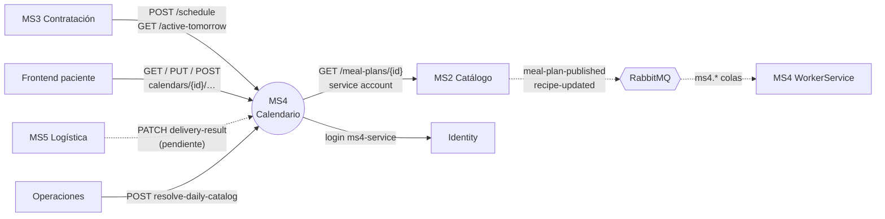

# MS4 — Calendario de entregas

> **Owner:** Franklin Andre Romero Padilla (@franklin-andre) · **Repo:** [Nur-tricenter/ms4-delivery-schedule-management](https://github.com/Nur-tricenter/ms4-delivery-schedule-management) · **Estado de la ficha:** complete

## Propósito
Cuando un paciente contrata un plan nutricional, lo que en realidad compra es **una secuencia de entregas diarias**. MS4 convierte esa promesa en un calendario concreto: qué día se entrega, a qué dirección, qué menú y si la entrega ya ocurrió o falló. Sin MS4 nadie sabe cuándo ni dónde entregar, ni qué hay que cocinar mañana.

## Responsabilidades
- Crear el calendario de un contrato: 15 o 30 días consecutivos, cada uno ligado a su **número de día del plan**.
- Gestionar los cambios del paciente sobre cada día (dirección, reprogramación, cancelación) aplicando la **regla de 48h**.
- Resolver la noche anterior el **menú de cada día** pidiéndolo a MS2, y guardarlo como foto propia.
- Consolidar la **orden de producción** de cada fecha y servírsela a MS3.
- Registrar el **resultado de la entrega** (entregado/fallido + evidencia), que solo puede informar MS5.

## Lo que NO hace
- No define recetas ni planes → **MS2**. MS4 solo guarda una copia del menú del día.
- No gestiona contratos ni pagos → **MS3** (que llama a MS4 cuando el contrato está pago).
- No sabe quién es el paciente más allá de su `PatientId` → **MS1**.
- No arma rutas ni asigna repartidores → **MS5**.
- No emite tokens → **identity**. Solo los valida.
- **No publica eventos.**

## Actores y vecinos
| Actor / servicio | Dirección | Mecanismo | Para qué |
|---|---|---|---|
| MS3 Contratación | entrante | REST vía gateway | Crear calendario; leer la orden de producción de mañana |
| Frontend (paciente) | entrante | REST vía gateway | Ver calendario, poner dirección, reprogramar, cancelar |
| MS5 Logística | entrante | REST vía gateway | Informar entregado/fallido _(aún no implementado en MS5)_ |
| Operaciones | entrante | REST | Disparar el job diario de catálogo |
| MS2 Catálogo | saliente | REST vía gateway + service account | Menú del día N del plan |
| Identity | saliente | REST vía gateway | Login de la service account `ms4-service` |
| MS2 Catálogo | entrante | Evento RabbitMQ | `meal-plan-published`, `recipe-updated` |
| Consul | saliente | Auto-registro + `/health` | Que el gateway lo encuentre |

## Mapa de comunicación

Todas las llamadas REST pasan por el gateway (`/api/delivery-calendar/**` para entrar a MS4).

## Stack y despliegue
- **.NET 10**, .NET Aspire (modo standalone), Clean Architecture, Minimal APIs, MediatR, FluentValidation, EF Core + PostgreSQL.
- **Dos modos con el mismo código** (cambia solo la configuración):

| | Standalone (Aspire) | Plataforma (`nur-tricenter-local`) |
|---|---|---|
| Arranque | `dotnet run --project src/AppHost` | `ms4.compose.yml` incluido en el stack |
| BD | contenedor propio | `ms4_delivery_calendar` en el Postgres compartido |
| Consul | apagado | se registra como `delivery-calendar` |
| MS2 | `MockCatalogPort` (fixture) | `HttpCatalogPort` vía gateway |
| RabbitMQ | no se usa | `src/WorkerService` consume 2 colas |
| Esquema | migración + seed al arrancar | job one-shot `--migrate`, sin seed |

- **Procesos en plataforma:** `delivery-calendar-api` (puerto 8080), `delivery-calendar-workerservice` (consumidores; no se registra en Consul) y `delivery-calendar-migrate` (one-shot).

## Índice de la ficha
- [domain.md](./domain.md): modelo de dominio, estados e invariantes
- [api.md](./api.md): endpoints expuestos
- [integrations.md](./integrations.md): llamadas síncronas salientes
- [messaging.md](./messaging.md): eventos consumidos
- [flows.md](./flows.md): casos de uso de punta a punta
- [gaps.md](./gaps.md): deuda, inconsistencias y dependencias
- [service.yaml](./service.yaml): datos estructurados
