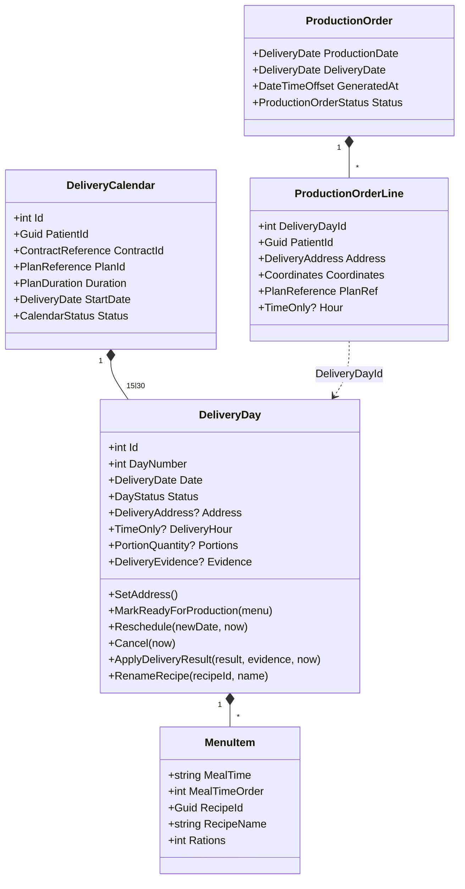
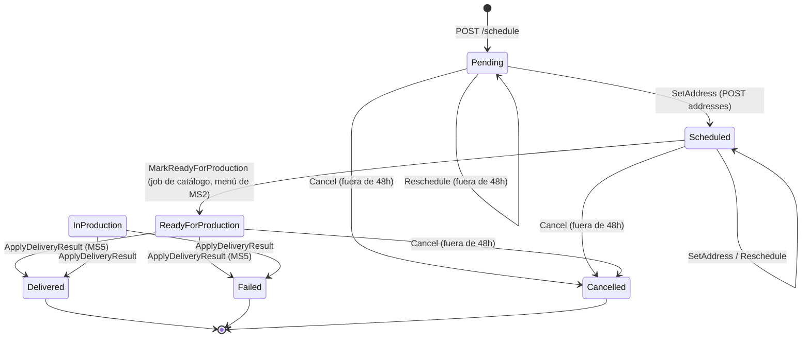

# Modelo de dominio — MS4

## Lenguaje ubicuo
| Término | Significado aquí |
|---|---|
| Calendario (`DeliveryCalendar`) | Las entregas de **un contrato** de un paciente. Hay uno por `contractId` |
| Día de entrega (`DeliveryDay`) | Una entrega concreta: fecha, dirección, menú, estado y evidencia |
| Número de día (`DayNumber`) | Posición 1..N del día en el plan de MS2. **Se fija al crear y no cambia al reprogramar**: el paciente sigue recibiendo el menú del día N aunque se mueva la fecha |
| Menú (`Menu` / `MenuItem`) | Copia local de lo que MS2 define para ese día: tiempo de comida, receta y raciones |
| Porciones (`Portions`) | Total de raciones del día (suma del menú) |
| Ventana de bloqueo de 48h | Tiempo antes de la fecha en el que ya no se puede reprogramar ni cancelar |
| Orden de producción (`ProductionOrder`) | Foto consolidada de todos los días listos para una fecha. Es lo que MS3 lee |
| `packId` | En la respuesta a MS3 equivale al `DeliveryDayId`: es la unidad de entrega identificable |

## Agregados

### DeliveryCalendar (raíz)
- **Representa:** el calendario de entregas de un contrato.
- **Invariantes:**
  - Único por `ContractId` (chequeo en el handler + índice único en BD).
  - Al crearse genera exactamente N días (`PlanDuration` ∈ {15, 30}), consecutivos desde `StartDate`, todos en `Pending`, con `DayNumber` 1..N.
- **Entidades internas:** `DeliveryDay`.
- **Value objects:** `ContractReference`, `PlanReference`, `PlanDuration`, `DeliveryDate`.
- **Estado del calendario:** `Active` | `Completed`.
- **Archivo:** `src/Domain/Entities/DeliveryCalendar.cs`

### DeliveryDay (entidad dentro del calendario)
- **Value objects:** `DeliveryDate`, `DeliveryAddress` (contiene `Coordinates`), `MenuItem`, `PortionQuantity`, `DeliveryEvidence` (foto, firma y momento).
- **Archivo:** `src/Domain/Entities/DeliveryDay.cs`. Allí está **toda** la lógica de transiciones y la regla de 48h, nunca en capas externas.

### ProductionOrder (raíz)
- **Representa:** lo que hay que producir para una fecha de entrega (`ProductionDate` = D-1, `DeliveryDate` = D).
- **Invariante:** única por `DeliveryDate` (índice único). Re-consolidar reemplaza las líneas (`ReplaceLines`), no duplica.
- **Líneas (`ProductionOrderLine`):** `DeliveryDayId`, `PatientId`, dirección, coordenadas, plan y hora.

### Servicio de dominio
- `OrderConsolidationService.Consolidate`: toma los calendarios, filtra los días `ReadyForProduction` de una fecha y crea o actualiza la orden.

## Diagrama de clases

## Máquina de estados de `DeliveryDay`

- `InProduction` está **reservado**: ningún caso de uso lo asigna hoy.
- Cualquier transición no dibujada lanza `InvalidDeliveryDayTransitionException` (→ 422).

## Reglas de negocio
| Regla | Dónde se aplica | Error si se viola |
|---|---|---|
| Un calendario por contrato | `CreateScheduleCommandHandler` + índice único `ContractId` | No es error: devuelve el existente |
| La duración del calendario coincide con la del plan de MS2 (si el plan está en la proyección) | `CreateScheduleCommandHandler.EnsureDurationMatchesPlanAsync` | `ValidationException` → 400 |
| Duración ∈ {15, 30} | VO `PlanDuration` | `ArgumentOutOfRangeException` → 422 |
| No reprogramar ni cancelar a menos de 48h | `DeliveryDay.EnsureOutsideLockWindow` | `DeliveryWindowLockedException` → 409 |
| Reprogramar solo en Pending/Scheduled | `DeliveryDay.Reschedule` | → 422 |
| No pasar a producción con el menú vacío | `DeliveryDay.MarkReadyForProduction` | `ArgumentException` |
| Delivered/Failed solo vía MS5 (`delivery-result` o sus eventos `delivery-completed`/`delivery-failed`) | No existe otro método que lo asigne | — |
| Resultado de entrega idempotente; un resultado distinto sobre un día cerrado es inválido | `DeliveryDay.ApplyDeliveryResult` | → 422 |
| Coordenadas en rango (lat ±90, long ±180) | VO `Coordinates` | → 422 |

### Detalle de la regla de 48h
- Fórmula: `inicioDelDía(UTC, fecha actual del día) − ahora < 48h` → bloqueado.
- Se compara con la fecha **actual** del día, no con la nueva. Se puede mover un día lejano a una fecha cercana; lo que se protege es una entrega que ya es inminente.
- Límite exacto: 48h00m00s → permitido; 48h menos un tick → bloqueado. Está cubierto por tests de dominio.
- No usa `DeliveryHour`: cuenta desde la medianoche UTC.

## Datos que son copia de otro servicio
| Dato | Origen | Cómo se mantiene |
|---|---|---|
| `PlanCatalog` (plan, nombre, días totales, comidas por día) | MS2, evento `meal-plan-published` | Upsert al recibir el evento |
| `DeliveryDay.Menu` (receta, nombre, raciones) | MS2, `GET /meal-plans/{id}` | Se copia en el job diario. El nombre de la receta se refresca con `recipe-updated` mientras el día no esté cerrado |
| `PatientId` | MS1 (vía MS3) | Solo la referencia; MS4 no guarda datos del paciente |
