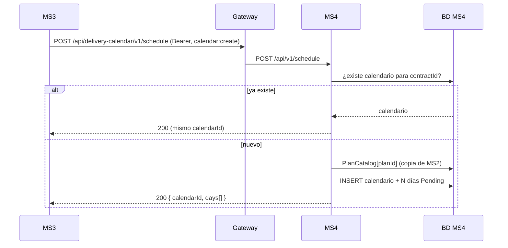
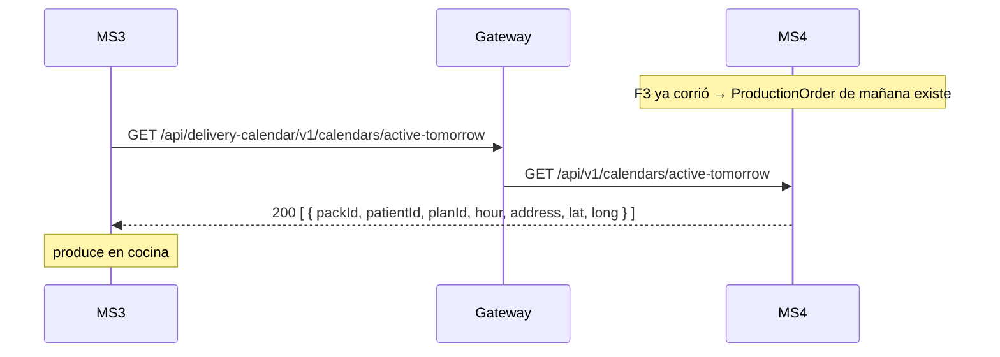
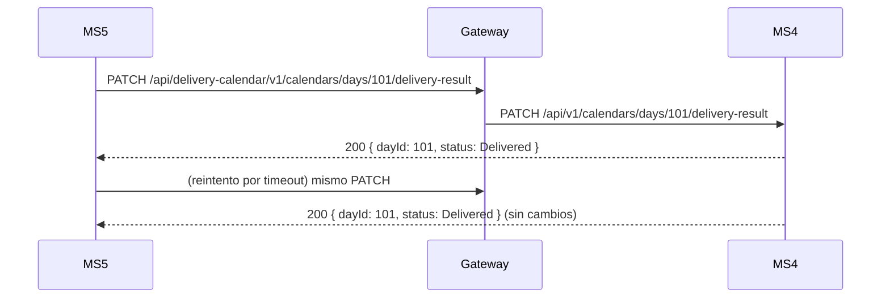

# Flujos — MS4

El orden sigue el ciclo de vida de un día de entrega. Los flujos F1, F3, F4 y F5 cruzan fronteras de servicio.

## F1 — Crear el calendario (MS3 → MS4)
- **Actor:** MS3, al confirmarse el pago del contrato.
- **Disparador:** `POST /api/v1/schedule`
- **Precondición:** ninguna (es el punto de entrada).
- **Camino feliz:**
  1. Busca un calendario existente para el `contractId`. Si lo hay, lo devuelve tal cual.
  2. Si el plan está en la proyección `PlanCatalog`, valida que la duración coincida.
  3. Crea el calendario `Active` con N días `Pending` (`DayNumber` 1..N, fechas consecutivas desde `startDate`).
- **Errores:**
  | Situación | Resultado |
  |---|---|
  | Duración ≠ días del plan (según la proyección) | 400 |
  | Duración ≠ 15/30, GUID vacío | 422 |
- **Idempotencia:** clave `contractId`, chequeada en el handler y con un índice único. Un reintento de red de MS3 no duplica.

## F2 — El paciente gestiona su calendario (Frontend → MS4)
- **Actor:** paciente desde el frontend.
- **Disparadores:** `POST …/addresses`, `PUT …/dates`, `POST …/cancel-day`.
- **Camino feliz:**
  1. Asigna la dirección: `Pending → Scheduled`. Sin dirección el día **nunca** se produce.
  2. Opcionalmente reprograma (cambia la fecha, conserva el `DayNumber`) o cancela.
- **Errores:** 409 dentro de las 48h (reprogramar y cancelar), 422 por estado inválido, 404 si no existe.
- **Riesgo conocido:** cualquier token con `calendar:edit` puede editar cualquier calendario (ver gaps).

## F3 — Resolver el menú de mañana (MS4 → Identity → MS2)
- **Actor:** operaciones (disparo manual; no hay cron).
- **Disparador:** `POST /api/v1/calendars/resolve-daily-catalog?date=` (por defecto, mañana).
- **Precondición:** debe correr **antes** de que MS3 consulte `active-tomorrow`.
- **Camino feliz:**
  1. Busca los calendarios con días en la fecha objetivo.
  2. Por cada día `Scheduled`, pide a MS2 el menú del `DayNumber` (con caché por plan). El día guarda el menú y las porciones y pasa a `ReadyForProduction`.
  3. Consolida la `ProductionOrder` de la fecha con **todos** los días `ReadyForProduction`, no solo los de esta corrida.
- **Errores:**
  | Situación | Resultado |
  |---|---|
  | MS2 no tiene el plan o el día no tiene recetas | El día se omite y queda `Scheduled` |
  | MS2 caído / 5xx / service account rechazada | Los días afectados quedan `Scheduled`; la corrida sigue |
  | Días `Pending` (sin dirección) | Se ignoran en silencio |
- **Idempotencia:** volver a correrlo reemplaza las líneas de la orden existente (índice único por fecha).
- Diagrama de secuencia: ver [integrations.md](./integrations.md).

## F4 — MS3 obtiene la orden de producción (MS3 → MS4)
- **Actor:** MS3, la noche anterior.
- **Disparador:** `GET /api/v1/calendars/active-tomorrow`
- **Camino feliz:** devuelve las líneas ya consolidadas `{ packId, patientId, planId, hour, address, lat, long }`.
- **Sin datos:** `[]` si el job no corrió.
- **Decisión de diseño:** es una **consulta**, no un evento. MS3 necesita la foto completa en un momento concreto y la consulta es idempotente. Reemplaza al evento `ProductionOrderRequired` planteado en la fase de arquitectura.

## F5 — Cierre del ciclo: resultado de la entrega (MS5 → MS4) ⚠ pendiente en MS5
- **Actor:** MS5, después de cada intento de entrega.
- **Disparador:** `PATCH /api/v1/calendars/days/{dayId}/delivery-result`
- **Camino feliz:** `ReadyForProduction` (o `InProduction`) → `Delivered`/`Failed`, guardando la evidencia (foto, firma y momento).
- **Errores:** 404 si el día no existe; 422 si el día no estaba listo o si se envía un resultado distinto al ya aplicado.
- **Idempotencia:** repetir el mismo resultado es un no-op. Así un reintento de MS5 no rompe el estado.
- **Estado real:** MS5 registra entregas pero **no llama a este endpoint** (gap X-01). Los días se quedan en `ReadyForProduction`.

## F6 — Reaccionar a cambios del catálogo (MS2 ⇢ MS4, asíncrono)
- **Actor:** MS2, al publicar un plan o modificar una receta.
- **Disparadores:** eventos `meal-plan-published` y `recipe-updated`.
- **Camino feliz:** actualiza la proyección `PlanCatalog` o renombra la receta en los días abiertos.
- **Idempotencia:** inbox por `Id` de mensaje + upsert.
- Detalle en [messaging.md](./messaging.md).
