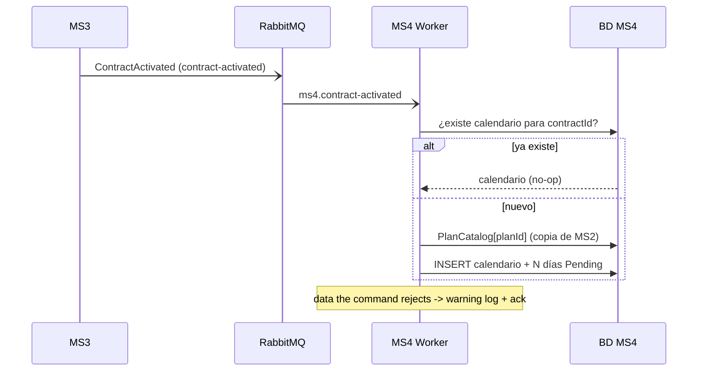
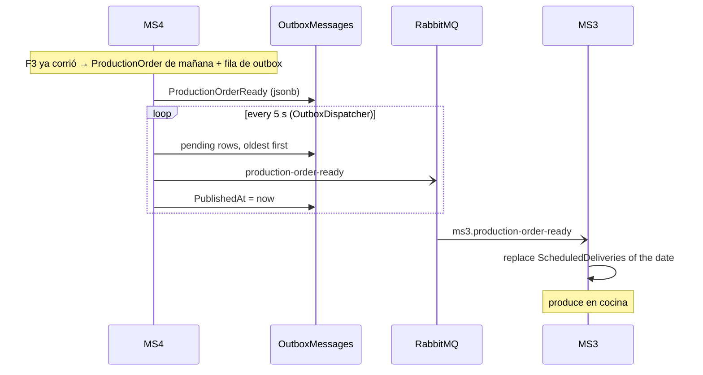
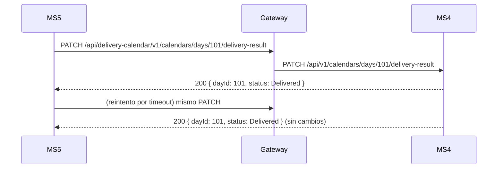
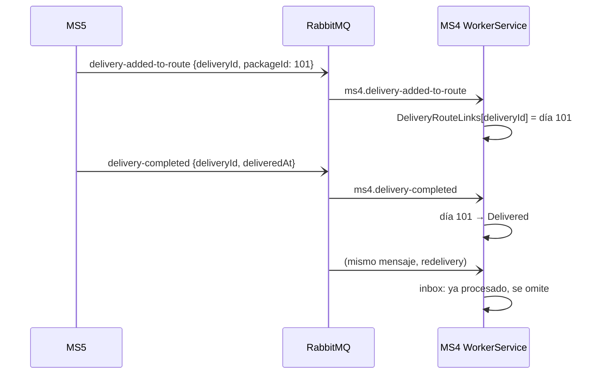

# Flujos — MS4

El orden sigue el ciclo de vida de un día de entrega. Los flujos F1, F3, F4, F5 y F6 cruzan fronteras de servicio, todos por eventos (no hay REST entre servicios).

## F1 — Crear el calendario (MS3 ⇢ MS4, evento `contract-activated`)
- **Actor:** MS3, al confirmarse el pago del contrato.
- **Disparador:** the event `ContractActivated` (exchange `contract-activated`, queue `ms4.contract-activated`, `ContractActivatedConsumer`), which sends `CreateScheduleCommand` through MediatR. `POST /api/v1/schedule` (ops, tests) sends the same command.
- **Precondición:** ninguna (es el punto de entrada).
- **Camino feliz:**
  1. Busca un calendario existente para el `contractId`. Si lo hay, lo devuelve tal cual.
  2. Si el plan está en la proyección `PlanCatalog`, valida que la duración coincida.
  3. Crea el calendario `Active` con N días `Pending` (`DayNumber` 1..N, fechas consecutivas desde `startDate`).
- **Errores:**
  | Situación | Resultado |
  |---|---|
  | Duración ≠ días del plan (según la proyección) | 400 on `POST /schedule`; on the event: logged and **acknowledged**, no calendar |
  | Duración ≠ 15/30, GUID vacío | 422 on `POST /schedule`; on the event: same, logged and acknowledged (a retry would fail the same way) |
- **Idempotencia:** inbox by message `Id` (MS3 uses its outbox row id) and, on top, clave `contractId`, chequeada en el handler y con un índice único. Una redelivery no duplica.

## F2 — El paciente gestiona su calendario (Frontend → MS4)
- **Actor:** paciente desde el frontend.
- **Disparadores:** `POST …/addresses`, `PUT …/dates`, `POST …/cancel-day`.
- **Camino feliz:**
  1. Asigna la dirección: `Pending → Scheduled`. Sin dirección el día **nunca** se produce.
  2. Opcionalmente reprograma (cambia la fecha, conserva el `DayNumber`) o cancela.
- **Errores:** 409 dentro de las 48h (reprogramar y cancelar), 422 por estado inválido, 404 si no existe.
- **Riesgo conocido:** cualquier token con `calendar:edit` puede editar cualquier calendario (ver gaps).

## F3 — Resolver el menú de mañana y publicar la orden (MS4 → MS3, evento `production-order-ready`)
- **Actor:** operaciones (disparo manual; no hay cron).
- **Disparador:** `POST /api/v1/calendars/resolve-daily-catalog?date=` (por defecto, mañana).
- **Precondición:** the composition of each plan must have been projected (`meal-plan-composition-changed`, F6); the job should run before MS3 needs the order (it publishes it as an event).
- **Camino feliz:**
  1. Busca los calendarios con días en la fecha objetivo.
  2. Por cada día `Scheduled`, lee el menú del `DayNumber` con `ICatalogPort` (`ProjectedCatalogPort` over `PlanDayMenus`; no call to MS2). El día guarda el menú y las porciones y pasa a `ReadyForProduction`.
  3. Consolida la `ProductionOrder` de la fecha con **todos** los días `ReadyForProduction`, no solo los de esta corrida.
  4. Stages a `ProductionOrderReady` event with the full snapshot (lines with address, coordinates and menu) as an `OutboxMessages` row: in the same save as the updated lines when the order existed; a new order is saved first because its id is generated by the database and travels in the event. The worker's `OutboxDispatcher` publishes it to `production-order-ready` every 5 s and stamps `PublishedAt`; MS3 projects it.
- **Errores:**
  | Situación | Resultado |
  |---|---|
  | No `PlanDayMenus` row for that plan/day (MS2 has not published the composition yet, no backfill) or the day has no recipes | El día se omite, se registra y queda `Scheduled` |
  | Crash between saving a new order and saving its outbox row | The order exists without an event; re-running the job stages the event (ms4-gap-06) |
  | Broker down | The `OutboxMessages` row stays pending (`PublishedAt` null) and is published when the broker is back |
  | Días `Pending` (sin dirección) | Se ignoran en silencio |
- **Idempotencia:** volver a correrlo reemplaza las líneas de la orden existente (índice único por fecha). Every run stages a **new** snapshot; MS3 keeps the latest by `CreatedAt`.
- Diagrama de secuencia: ver [integrations.md](./integrations.md) y F4.

## F4 — MS3 recibe la orden de producción (MS4 ⇢ MS3, evento `production-order-ready`)
- **Actor:** MS4's `OutboxDispatcher`, after F3.
- **Disparador:** the event `ProductionOrderReady`. The endpoint `GET /api/v1/calendars/active-tomorrow` stays for the frontend and ops, but **no service calls it**.
- **Camino feliz:** MS3 (`ms3.production-order-ready`) replaces its `ScheduledDeliveries` rows for the delivery date with the lines `{ DeliveryDayId (packId), PatientId, PlanId, Hour, Address, Latitude, Longitude, Menu[] }`.
- **Sin datos:** if the job did not run, no event exists and MS3 answers 404 `NO_CALENDARS`.
- **Decisión de diseño (reversed):** it used to be a **query** (MS3 needed the whole picture at a given moment). It is now an event carrying a **full snapshot**, so MS3 gets the same picture without a live dependency on MS4, following the course rule (no synchronous inter-service REST).

## F5 — Cierre del ciclo: resultado de la entrega (MS5 → MS4) ⚠ depende de que `PackageId` sea el `packId`
- **Actor:** MS5, después de cada intento de entrega.
- **Disparador (camino normal):** los eventos `delivery-added-to-route` (enlaza la entrega con el día) y luego `delivery-completed` / `delivery-failed` (cierran el día). Ver [messaging.md](./messaging.md).
- **Disparador (vía manual):** `PATCH /api/v1/calendars/days/{dayId}/delivery-result`
- **Camino feliz:** `ReadyForProduction` (o `InProduction`) → `Delivered`/`Failed`, guardando la evidencia (foto, firma y momento).
- **Errores:** 404 si el día no existe; 422 si el día no estaba listo o si se envía un resultado distinto al ya aplicado.
- **Idempotencia:** repetir el mismo resultado es un no-op. Así un reintento de MS5 no rompe el estado.
- **Estado real:** MS5 ya publica los tres eventos y MS4 los consume (MS4#3). El `PackageId` que MS5 recibe de MS3 es un GUID de MS3, no el `packId`; por eso `DeliveryAddedToRoute` trae además `DeliveryDayId` (kernel 1.4.0). MS4 busca el día por `DeliveryDayId`, luego por `PackageId` numérico y por último por paciente (el día más temprano en `ReadyForProduction`/`InProduction` sin entrega). Sin ninguna coincidencia, la entrega queda sin enlazar y el día no se cierra (ms3-gap-03, X-10).
- **Errores en el camino por eventos:** entrega sin enlace, día inexistente o transición inválida (por ejemplo, día cancelado) → warning y mensaje confirmado, sin reintentos.

Camino por eventos (cuando `PackageId` = `packId`):

## F6 — Reaccionar a cambios del catálogo (MS2 ⇢ MS4, asíncrono)
- **Actor:** MS2, al publicar un plan, componerlo o modificar una receta.
- **Disparadores:** eventos `meal-plan-published`, `recipe-updated` y `meal-plan-composition-changed`.
- **Camino feliz:** actualiza la proyección `PlanCatalog`, renombra la receta en los días abiertos, or upserts the `PlanDayMenus` rows of the plan (the menus F3 reads). MS2 emits one composition snapshot per change, so the last one wins; an older one is ignored by `CreatedAt`.
- **Idempotencia:** inbox por `Id` de mensaje + upsert.
- Detalle en [messaging.md](./messaging.md).
