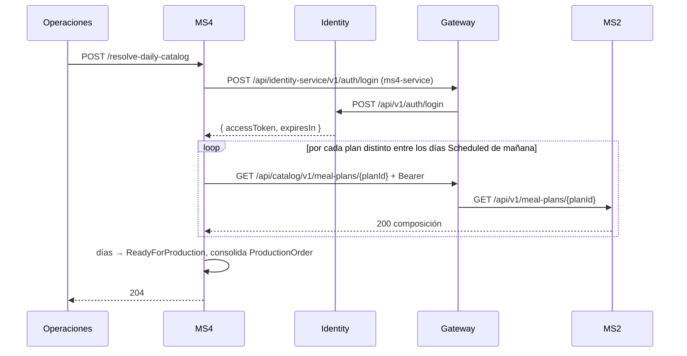

# Integraciones síncronas — MS4

## Resumen
| Destino | Método y ruta | Vía | Auth | Para qué |
|---|---|---|---|---|
| MS2 Catálogo | `GET /api/catalog/v1/meal-plans/{planId}` | gateway | service account `ms4-service` | Menú del día N del plan |
| Identity | `POST /api/identity-service/v1/auth/login` | gateway | ninguna (es el login) | Token de `ms4-service` |

## MS4 → MS2: menú del día
- **Puerto:** `ICatalogPort.GetDayMenuAsync(planId, dayNumber)` (`src/Application/Common/Interfaces/ICatalogPort.cs`).
- **Adaptador real:** `src/Infrastructure/Catalog/HttpCatalogPort.cs`. La ruta es configurable (`Catalog:MealPlanPathTemplate`) y la base es `Catalog:BaseUrl` = `http://gateway:8080` en la plataforma.
- **Qué hace:** MS2 **no tiene un endpoint por día**: los planes se modelan por **número de día**, no por fecha. MS4 trae la composición completa del plan y elige el `PlanDay` cuyo `DayNumber` coincide con el del `DeliveryDay`. Aplana los tiempos de comida y las recetas en `MenuItem` y descarta los de 0 raciones.
- **Forma de la respuesta de MS2** (copiada localmente como DTOs privados; es un read model, no un contrato compartido):
  ```
  ApiResponse { success, message, data: MealPlanComposition { mealPlanId, name,
    days: [ { dayNumber, mealTimes: [ { mealTimeId, name, order,
      recipes: [ { recipeId, recipeName, ration: { quantity } } ] } ] } ] } }
  ```
- **Caché:** una entrada por plan durante una corrida del job (muchos pacientes comparten pocos planes).
- **Por qué es síncrono:** MS4 necesita la composición actual del plan en un momento preciso (la noche anterior). Mantener una réplica completa de los planes por eventos sería más complejo, y `meal-plan-published` no trae la composición.
- **Por qué no se llama bajo demanda:** se resuelve **antes** de que MS3 consulte `active-tomorrow`. Así una caída de MS2 no afecta la consulta de MS3.
- **Si falla:**
  | Respuesta de MS2 | Resultado |
  |---|---|
  | 404 (plan inexistente) o día sin recetas | El día se omite, se registra en el log y queda en `Scheduled` |
  | 401/403 (service account mal configurada) o 5xx | La corrida no puede resolver ese plan; los días quedan en `Scheduled` |
  | Transitorios | Reintentos del resilience handler (ServiceDefaults) |

  **Recuperación:** volver a correr el job (es idempotente).
- **Sin MS2:** `Catalog:UseMock=true` (Aspire y tests) usa `MockCatalogPort`, un fixture determinístico por `planId` + número de día.



## MS4 → Identity: token de servicio
- **Componente:** `src/Infrastructure/Catalog/ServiceAccountTokenHandler.cs` (un `DelegatingHandler` del `HttpClient` de MS2).
- **Cuenta:** `ms4-service`, con el scope `catalog.mealPlan:read` (mínimo privilegio). Las credenciales llegan por configuración (`ms4.compose.yml`), no están en el código.
- **Ciclo:** login → cachea el token hasta 60 s antes de `expiresIn` → si MS2 responde **401**, hace login otra vez **una sola vez** y reintenta.
- **Por qué una service account y no el token del usuario:** el job no corre en nombre de ningún paciente. Es MS4 actuando por sí mismo.
