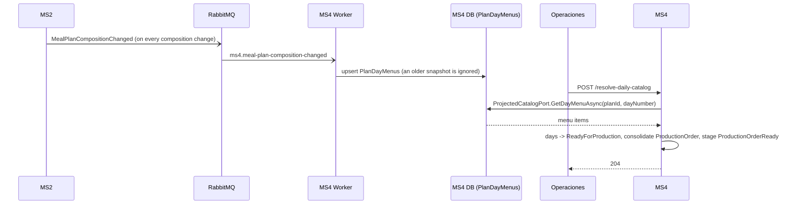

# Integraciones síncronas — MS4

## Resumen
**None.** Since MS4#12 MS4 makes no outbound HTTP call: there is no REST between MS4 and any other service. `sync_calls` in [service.yaml](./service.yaml) is empty.

| Was | Is now |
|---|---|
| MS4 → MS2 `GET /api/catalog/v1/meal-plans/{planId}` (menu of day N, as `ms4-service`) | MS2 publishes `meal-plan-composition-changed`; MS4 projects it into `PlanDayMenus` and `ProjectedCatalogPort` reads it ([messaging.md](./messaging.md)) |
| MS4 → Identity `POST /api/identity-service/v1/auth/login` (token of `ms4-service`) | Gone: nothing to authenticate. `ms4-service` still exists in identity (the demo console's security view uses it) |

What was deleted from the code: `HttpCatalogPort`, `ServiceAccountTokenHandler`, the `Catalog:BaseUrl`, `Catalog:MealPlanPathTemplate` and `Identity:*` options, and the `Catalog__BaseUrl` / identity environment of `ms4.compose.yml`. `MockCatalogPort` stays for Aspire and the tests (`Catalog:UseMock=true`).

## `ICatalogPort`: the menu of a plan day
- **Port:** `ICatalogPort.GetDayMenuAsync(planId, dayNumber)` (`src/Application/Common/Interfaces/ICatalogPort.cs`).
- **Platform adapter** (`Catalog:UseMock=false`, now set on the worker too): `ProjectedCatalogPort` (next to `PlanDayMenu` in `src/Infrastructure/Messaging/PlanDayMenus.cs`). It reads the `PlanDayMenus` row of (`planId`, `dayNumber`) and returns its items ordered by meal time order. No row → `null`.
- **Standalone adapter** (`Catalog:UseMock=true`: Aspire and tests): `MockCatalogPort`, a deterministic fixture per `planId` + day number.
- **Key:** MS2 models plans by day **number**, not by date, so `DeliveryDay.DayNumber` (1..N, fixed at creation) is the lookup key.
- **If the menu is missing** (MS2 has not published that plan's composition yet, or the day has no recipes): the day is **skipped and logged** and stays `Scheduled`. Recovery: re-run `resolve-daily-catalog` once the composition arrived. There is no 401/5xx/timeout any more, because nothing is called.
- **Why an event and not a call:** the course rule (no synchronous inter-service REST), and the old argument for REST ("`meal-plan-published` does not carry the composition") was solved by a new event that does: `meal-plan-composition-changed` is a full snapshot of the plan.

