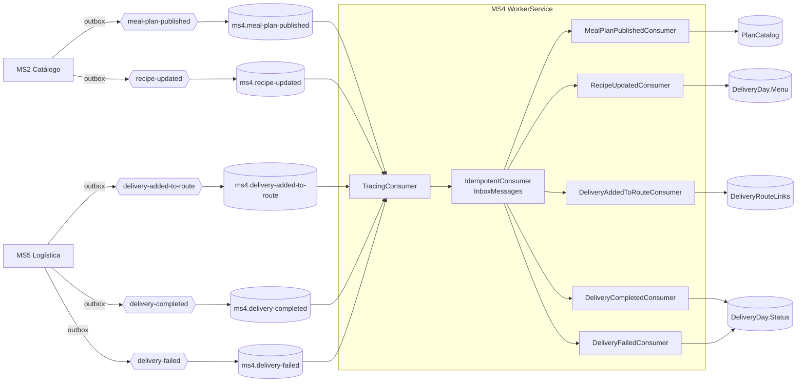

# Mensajería — MS4

## Eventos publicados
**Ninguno.** MS4 no publica eventos y por eso no tiene outbox. Lo que otros necesitan de MS4 se lo piden por REST (MS3 consulta `active-tomorrow`).

Candidatos naturales si en el futuro hiciera falta: `delivery-day-cancelled` (para que MS3/MS5 se enteren de una cancelación) y `production-order-generated`.

## Eventos consumidos
| Cola | Exchange | Contrato | Handler | Efecto |
|---|---|---|---|---|
| `ms4.meal-plan-published` | `meal-plan-published` | `MealPlanPublished` | `MealPlanPublishedConsumer` | Upsert del plan (id, nombre, días totales, comidas por día) en la tabla `PlanCatalog` |
| `ms4.recipe-updated` | `recipe-updated` | `RecipeUpdated` | `RecipeUpdatedConsumer` | Renombra la receta en el menú de los días aún no cerrados (`DeliveryDay.RenameRecipe`) |
| `ms4.delivery-added-to-route` | `delivery-added-to-route` | `DeliveryAddedToRoute` | `DeliveryAddedToRouteConsumer` | Guarda en `DeliveryRouteLinks` la relación `DeliveryId` (MS5) → `DeliveryDay.Id` (el `PackageId` del evento). Un `PackageId` no numérico se ignora |
| `ms4.delivery-completed` | `delivery-completed` | `DeliveryCompleted` | `DeliveryCompletedConsumer` | Busca el día en `DeliveryRouteLinks` y lo pasa a `Delivered`; la evidencia guarda solo `DeliveredAt` |
| `ms4.delivery-failed` | `delivery-failed` | `DeliveryFailed` | `DeliveryFailedConsumer` | Igual, pero el día pasa a `Failed` |

Contratos: `Nur.Tricenter.Integration.Messages.Catalog`. Código: `src/Infrastructure/Messaging/` (registro en `MessagingExtensions.cs`, handlers en `Consumers.cs`).

### Para qué sirve cada uno
- **`meal-plan-published` → validar sin llamar a MS2.** Cuando MS3 crea un calendario, MS4 compara la duración pedida con `TotalDays` del plan **usando su copia local**. Si no coinciden → 400. Si el plan todavía no llegó a la proyección, se acepta con un warning: ausencia significa "desconocido", no "inválido". Es consistencia eventual aplicada.
- **`recipe-updated` → menú coherente.** El menú de cada día es una **foto** tomada la noche anterior. Si MS2 renombra una receta, se actualiza la foto de los días abiertos. Los días entregados, fallidos o cancelados conservan el nombre con el que se produjeron (es un registro histórico).

### Cierre del ciclo de entrega (MS5 ⇢ MS4)
`DeliveryCompleted` y `DeliveryFailed` solo traen `DeliveryId` y `RouteId`, no el día de MS4. Por eso MS4 consume también `DeliveryAddedToRoute`, que sí trae `PackageId`: ahí se guarda la relación `DeliveryId` → día en la tabla `DeliveryRouteLinks`. **Esto solo funciona si `PackageId` es el `packId` de MS4** (el `DeliveryDay.Id`); hoy MS3 manda su propio GUID en `PackageValidated` (ms3-gap-03), así que los eventos se ignoran con un warning hasta que se alinee.

Estos tres consumidores **no fallan por motivos de negocio**: una entrega sin enlace, un día inexistente o una transición inválida (por ejemplo un día cancelado) se registran como warning y se confirman, porque reintentar no cambiaría el resultado. Usan la misma regla de dominio (`DeliveryDay.ApplyDeliveryResult`) y la misma idempotencia que `PATCH /delivery-result`, que queda como vía manual. Código en [MS4#3](https://github.com/Nur-tricenter/ms4-delivery-schedule-management/pull/3) y colas en [nur-tricenter-local#6](https://github.com/Nur-tricenter/nur-tricenter-local/pull/6), ambos pendientes de merge.

## Colas declaradas que no se consumen
La topología crea para MS4 también `ms4.recipe-published`, `ms4.food-published`, `ms4.food-nutritional-info-updated`, `ms4.user-published` y `ms4.user-updated`. **No se consumen a propósito:** MS4 no necesita alimentos ni usuarios, y una receta nueva no afecta a días ya resueltos. Quedan acumulando mensajes (gap transversal X-06).

## Garantías de entrega
- **Pipeline de cada mensaje:** `TracingConsumer` → `IdempotentConsumer` → handler.
- **Idempotencia:** tabla `InboxMessages` con clave en el `Id` del mensaje. Un mensaje re-entregado no hace nada. Además los handlers son upserts o renombres (idempotentes por naturaleza).
- **Reintentos:** 3 reintentos con 500 ms de base (`RabbitMqSettings__MaxRetryAttempts`, `RetryBaseDelayMilliseconds` en `ms4.compose.yml`).
- **Trazabilidad:** `TracingConsumer` continúa la traza con el `CorrelationId` del evento (OpenTelemetry vía ServiceDefaults).
- **Proceso:** corre en `src/WorkerService` (`delivery-calendar-workerservice`), separado de la API. No se registra en Consul.
- **Topología:** MS4 **no declara** exchanges ni colas. Vienen de `nur-tricenter-local/topology/rabbitmq-definitions.json`.

## Detalles técnicos aprendidos
- Los decoradores reciben el **consumidor concreto** (`IdempotentConsumer<T, TInner>`), nunca `IIntegrationMessageConsumer<T>`: Joseco registra el pipeline bajo esa interfaz, así que inyectarla genera un ciclo de DI.
- Npgsql solo escribe `DateTimeOffset` en UTC: `InboxMessage` y `PlanCatalogEntry` normalizan con `ToUniversalTime()`.
- `Joseco.Communication.External.RabbitMQ` 1.1.0 ignora el puerto configurado: el broker tiene que estar en 5672.

## Diagrama

