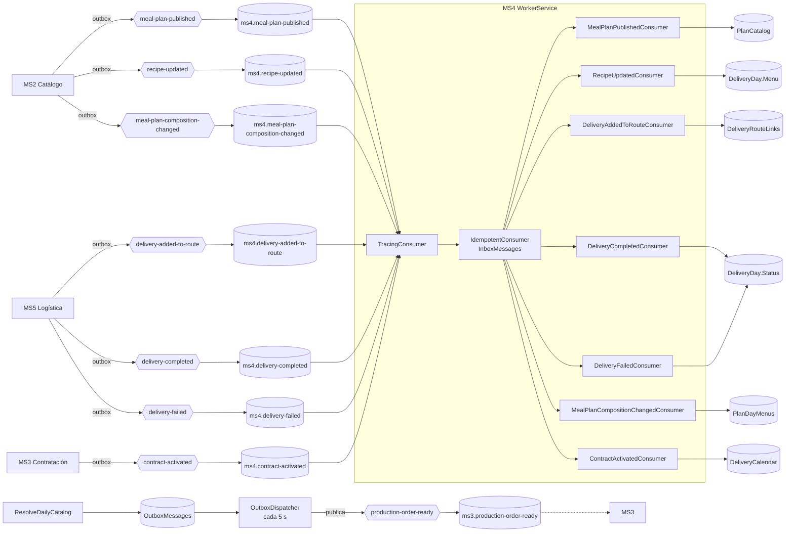

# Mensajería — MS4

## Eventos publicados
| Exchange | Contrato (kernel) | EventType | Se dispara cuando | Outbox |
|---|---|---|---|---|
| `production-order-ready` | `ProductionOrderReady` | `ProductionOrder.Ready` | `resolve-daily-catalog` consolidates the order of a delivery date; one event per run | sí (propio) |

Contract: `Nur.Tricenter.Integration.Messages.DeliveryCalendar.ProductionOrderReady` (kernel 1.6.0), a **full snapshot** of the delivery date's order (MS4#12; replaces MS3's `GET /calendars/active-tomorrow`):
```json
{ "EventType": "ProductionOrder.Ready", "ProductionOrderId": 12, "DeliveryDate": "2026-11-02", "ProductionDate": "2026-11-01",
  "Lines": [ { "DeliveryDayId": 101, "PatientId": "guid", "PlanId": "guid", "Hour": "08:30",
               "Address": "Av. Banzer 123, Santa Cruz", "Latitude": -17.78, "Longitude": -63.18,
               "Menu": [ { "MealTime": "Breakfast", "MealTimeOrder": 0, "RecipeId": "guid", "RecipeName": "Ensalada", "Rations": 1 } ] } ],
  "Id": "guid", "CreatedAt": "…", "CorrelationId": null, "Source": "delivery-calendar" }
```
- `Hour` is an `HH:mm` string (not `TimeOnly`, because of the Newtonsoft serializer) and `null` when the patient chose no hour. `Address` is `street, city`. `DeliveryDayId` is the `packId`.
- **Consumer:** MS3 (`ms3.production-order-ready`), which replaces its `ScheduledDeliveries` rows for the date. Nobody else listens.
- **Every run stages a new snapshot** (re-running the job after a lost publish recovers it); the consumer keeps the latest by `CreatedAt`.

### Outbox propio (minimal)
`Joseco.Outbox.EFCore` is not used: it pins MediatR 12 and EF Core 9, and MS4 runs MediatR 14 and EF Core 10.
- **Table `OutboxMessages`:** `Id`, `Type`, `Destination`, `Payload` (jsonb, the kernel contract serialized), `CreatedAt`, `PublishedAt` (null = pending; indexed). Migration `AsyncMessaging` (also creates `PlanDayMenus`).
- **Staging:** `ResolveDailyCatalogCommandHandler` calls `IProductionOrderEvents.ProductionOrderReady(order, calendars)`; `ProductionOrderEvents` (Infrastructure) maps the order to the kernel message and adds the row to the current unit of work.
- **Atomicity:** for an **existing** order the row commits in the same `SaveChanges` as the updated lines. For a **new** order the order is saved first, because its id is generated by the database and travels in the event (`ProductionOrderId`), and the row is saved right after: a crash between the two leaves an order without an event, and re-running the job recovers it (ms4-gap-06).
- **Dispatch:** `OutboxDispatcher` (a `BackgroundService` in the worker, every 5 s) runs `OutboxPublisher`: up to 50 pending rows oldest first, published through Joseco `IExternalPublisher` to the row's destination with `declareDestination: true`, then `PublishedAt` is stamped. A failure stops the batch (snapshots must keep their order) and is retried on the next run.
- **Delivery:** at-least-once; the message `Id` makes MS3's inbox drop a duplicate.

## Eventos consumidos
| Cola | Exchange | Contrato | Handler | Efecto |
|---|---|---|---|---|
| `ms4.contract-activated` | `contract-activated` | `ContractActivated` | `ContractActivatedConsumer` | Sends the existing `CreateScheduleCommand` (`ContractId`, `PatientId`, `CatalogPlanId` → `planId`, `DurationDays` → `duration`, `StartDate`) through MediatR: creates the calendar (idempotent by contract id). Data the command rejects (`ValidationException`: duration not 15/30, or contradicting the plan in `PlanCatalog`) is logged and **acknowledged**, never retried |
| `ms4.meal-plan-composition-changed` | `meal-plan-composition-changed` | `MealPlanCompositionChanged` | `MealPlanCompositionChangedConsumer` | Upserts one `PlanDayMenus` row per day of the plan (`PlanId` + `DayNumber`, with owned `PlanDayMenuItems`: meal time, order, recipe, name, rations). An older snapshot (by `CreatedAt`) never overwrites a day; a day absent from the message keeps its row |
| `ms4.meal-plan-published` | `meal-plan-published` | `MealPlanPublished` | `MealPlanPublishedConsumer` | Upsert del plan (id, nombre, días totales, comidas por día) en la tabla `PlanCatalog` |
| `ms4.recipe-updated` | `recipe-updated` | `RecipeUpdated` | `RecipeUpdatedConsumer` | Renombra la receta en el menú de los días aún no cerrados (`DeliveryDay.RenameRecipe`) |
| `ms4.delivery-added-to-route` | `delivery-added-to-route` | `DeliveryAddedToRoute` | `DeliveryAddedToRouteConsumer` | Guarda en `DeliveryRouteLinks` la relación `DeliveryId` (MS5) → `DeliveryDay.Id`: el `DeliveryDayId` del evento (kernel 1.4.0); si falta, el `PackageId` si es un `packId` numérico; si no, el día más temprano del paciente en `ReadyForProduction`/`InProduction` que aún no tenga entrega (MS4#5). Sin coincidencia se ignora |
| `ms4.delivery-completed` | `delivery-completed` | `DeliveryCompleted` | `DeliveryCompletedConsumer` | Busca el día en `DeliveryRouteLinks` y lo pasa a `Delivered`; la evidencia guarda `DeliveredAt` y, desde el kernel 1.5.0, la foto y la firma que trae el evento (MS4#10; un valor de más de 1000 caracteres se descarta con un warning para no bloquear el cierre del día) |
| `ms4.delivery-failed` | `delivery-failed` | `DeliveryFailed` | `DeliveryFailedConsumer` | Igual, pero el día pasa a `Failed` |

Contratos: `Nur.Tricenter.Integration.Messages.{Catalog,Contracting,Logistics}`. Código: `src/Infrastructure/Messaging/` (registro con `AddConsumer<,>` en `MessagingExtensions.cs`; handlers en `Consumers.cs` y `ProjectionConsumers.cs`; outbox en `Outbox.cs`; proyección en `PlanDayMenus.cs`).

### `contract-activated` → calendar (MS3 ⇢ MS4)
Replaces `POST /schedule` from MS3. MS3 publishes it from its outbox relay when a contract is paid; the message id is MS3's outbox row id, so a redelivery is dropped by MS4's inbox, and `CreateScheduleCommand` is idempotent by `contractId` anyway. `POST /api/v1/schedule` stays for ops and tests and sends the same command.

### `meal-plan-composition-changed` → menus without calling MS2 (MS2 ⇢ MS4)
Replaces `GET /meal-plans/{id}`. MS2 emits **one snapshot per composition change** (a meal time added, a recipe assigned or removed), so many messages fly while a plan is being composed and MS4 ends up with the latest of each day. Items with 0 rations or an empty recipe id are dropped when projecting; an empty meal time or recipe name gets a placeholder (`Meal time N`, `Recipe <id>`). `ProjectedCatalogPort` serves `GetDayMenuAsync` from this table. **No backfill:** a plan created before the deploy has no `PlanDayMenus` rows; its days stay `Scheduled` until MS2 publishes a composition for it (any change to the plan does), ms4-gap-07 / X-15.

### Para qué sirve cada uno
- **`meal-plan-published` → validar sin llamar a MS2.** Cuando se crea un calendario (`contract-activated` o `POST /schedule`), MS4 compara la duración pedida con `TotalDays` del plan **usando su copia local**. Si no coinciden → 400. Si el plan todavía no llegó a la proyección, se acepta con un warning: ausencia significa "desconocido", no "inválido". Es consistencia eventual aplicada.
- **`recipe-updated` → menú coherente.** El menú de cada día es una **foto** tomada la noche anterior. Si MS2 renombra una receta, se actualiza la foto de los días abiertos. Los días entregados, fallidos o cancelados conservan el nombre con el que se produjeron (es un registro histórico).

### Cierre del ciclo de entrega (MS5 ⇢ MS4)
`DeliveryCompleted` y `DeliveryFailed` traen `DeliveryId` y `RouteId` (el primero, además, la hora y la evidencia) pero no el día de MS4. Por eso MS4 consume también `DeliveryAddedToRoute`: ahí se guarda la relación `DeliveryId` → día en la tabla `DeliveryRouteLinks`. El día se busca en este orden: (1) `DeliveryDayId`, el `packId` de MS4 que viaja desde `package-validated` (kernel 1.4.0, X-10); (2) `PackageId` si es el `packId` numérico (cargas manuales); (3) por paciente ([MS4#5](https://github.com/Nur-tricenter/ms4-delivery-schedule-management/pull/5), reunido con los demás en [MS4#8](https://github.com/Nur-tricenter/ms4-delivery-schedule-management/pull/8)): el día más temprano en `ReadyForProduction`/`InProduction` sin otra entrega enlazada. El paso 3 no es ambiguo mientras el paciente tenga un día por fecha (ver ms3-gap-15). Los paquetes de `package-validated` traen el GUID del paquete de MS3 en `PackageId` (ms3-gap-03), por eso el paso 1 es el camino normal. Validado de punta a punta en el stack local el 2026-10-28 (por paciente; entrega exitosa y fallida).

Estos tres consumidores **no fallan por motivos de negocio**: una entrega sin enlace, un día inexistente o una transición inválida (por ejemplo un día cancelado) se registran como warning y se confirman, porque reintentar no cambiaría el resultado. Usan la misma regla de dominio (`DeliveryDay.ApplyDeliveryResult`) y la misma idempotencia que `PATCH /delivery-result`, que queda como vía manual. Código en [MS4#3](https://github.com/Nur-tricenter/ms4-delivery-schedule-management/pull/3) y colas en [nur-tricenter-local#6](https://github.com/Nur-tricenter/nur-tricenter-local/pull/6), ambos mergeados.

## Colas declaradas que no se consumen
La topología crea para MS4 también `ms4.recipe-published`, `ms4.food-published`, `ms4.food-nutritional-info-updated`, `ms4.user-published` y `ms4.user-updated`. **No se consumen a propósito:** MS4 no necesita alimentos ni usuarios, y una receta nueva no afecta a días ya resueltos. Quedan acumulando mensajes (gap transversal X-06).

## Garantías de entrega
- **Pipeline de cada mensaje:** `TracingConsumer` → `IdempotentConsumer` → handler.
- **Idempotencia:** tabla `InboxMessages` con clave en el `Id` del mensaje. Un mensaje re-entregado no hace nada. Además los handlers son upserts o renombres (idempotentes por naturaleza).
- **Reintentos:** 3 reintentos con 500 ms de base (`RabbitMqSettings__MaxRetryAttempts`, `RetryBaseDelayMilliseconds` en `ms4.compose.yml`).
- **Trazabilidad:** `TracingConsumer` continúa la traza con el `CorrelationId` del evento (OpenTelemetry vía ServiceDefaults).
- **Proceso:** corre en `src/WorkerService` (`delivery-calendar-workerservice`), separado de la API. No se registra en Consul.
- **Topología:** MS4 **no declara** exchanges ni colas. Vienen de `nur-tricenter-local/topology/rabbitmq-definitions.json`.

## Detalles técnicos aprendidos
- Los decoradores reciben el **consumidor concreto** (`IdempotentConsumer<T, TInner>`), nunca `IIntegrationMessageConsumer<T>`: Joseco registra el pipeline bajo esa interfaz, así que inyectarla genera un ciclo de DI.
- Npgsql solo escribe `DateTimeOffset` en UTC: `InboxMessage` y `PlanCatalogEntry` normalizan con `ToUniversalTime()`.
- `Joseco.Communication.External.RabbitMQ` 1.1.0 ignora el puerto configurado: el broker tiene que estar en 5672.

## Diagrama

