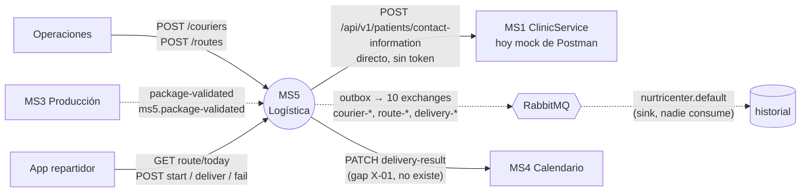

# MS5 — Logística y entregas

> **Owner:** Andres Sebastian Guerrero Camacho (@DruGuerrero) · **Repo:** [Nur-tricenter/ms5-logistics-and-delivery](https://github.com/Nur-tricenter/ms5-logistics-and-delivery) · **Estado de la ficha:** complete

## Propósito
Una vez que la comida está producida, alguien tiene que llevarla a la puerta del paciente. MS5 es dueño de esa **última milla**: registra a los repartidores, arma la **ruta del día** de cada uno, ordena las paradas desde la sucursal y deja constancia de cada entrega, con foto y firma si se entregó o con el motivo si falló. Sin MS5 nadie sabe qué repartidor lleva qué paquete, en qué orden, ni si el paciente lo recibió.

## Responsabilidades
- Registrar repartidores (`Courier`) y su estado (`Available`, `OnRoute`, `OnBreak`).
- Crear la ruta (`Route`) de un repartidor para una fecha.
- Recibir los paquetes a entregar y agregarlos como paradas (`Delivery`) a la ruta del día.
- Calcular la **secuencia de entrega** al iniciar la ruta: vecino más cercano desde las coordenadas de la sucursal (`branchCoordinates`).
- Registrar el resultado de cada parada: entregada (con `DeliveryConfirmation`: momento, foto y firma) o fallida (con motivo).
- Cerrar la ruta automáticamente cuando todas sus paradas terminaron.
- Publicar cada uno de esos hechos como evento de integración (10 exchanges), con outbox transaccional.

## Lo que NO hace
- No produce la comida ni decide qué se entrega cada día → **MS3** (producción) y **MS4** (orden de producción y calendario).
- No guarda datos del paciente: solo su `PatientId`. El nombre y el teléfono se piden a **MS1** (hoy, un mock de Postman) cada vez que hacen falta.
- No actualiza el calendario de entregas: el día de MS4 **no** pasa a `Delivered`/`Failed` porque MS5 no llama a `PATCH /delivery-result` (gap X-01).
- No autentica ni autoriza: **todos sus endpoints son anónimos** (gap X-03). No emite ni valida tokens.
- Consume **un solo** evento: `package-validated` de MS3 (paquetes aprobados por calidad), que agrega a la ruta de hoy. Las otras 7 colas `ms5.*` que declara la topología no las lee nadie.

## Actores y vecinos
| Actor / servicio | Dirección | Mecanismo | Para qué |
|---|---|---|---|
| Operaciones / logística | entrante | REST vía gateway | Alta de repartidores y de rutas |
| MS3 Producción | entrante | Evento RabbitMQ `package-validated` (cola `ms5.package-validated`) | Entregar los paquetes aprobados por calidad, que se agregan a la ruta de hoy |
| App del repartidor (frontend) | entrante | REST vía gateway | Ver la ruta del día, iniciarla, marcar entregado / fallido |
| ClinicService (MS1, hoy mock de Postman) | saliente | REST **directo**, sin token | Validar pacientes y obtener su nombre |
| RabbitMQ | saliente | Outbox → 10 exchanges fanout | Avisar altas de repartidores, rutas y resultados de entrega |
| MS4 Calendario | saliente _(pendiente)_ | — | Debería recibir el resultado de la entrega; hoy no se llama |
| Consul | saliente | Auto-registro + `/health` | Que el gateway lo encuentre como `nurtricenter` |

## Mapa de comunicación

Todas las llamadas entrantes pasan por el gateway con el prefijo `/api/nurtricenter/**`. La arista "no existe" es una llamada REST que el diseño necesita y hoy nadie hace. Los paquetes entran por el evento `package-validated` de MS3; `POST /packages/deliveries` queda como entrada manual de respaldo.

## Stack y despliegue
- **.NET 10**, Clean Architecture + DDD táctico (`Joseco.DDD.Core`), controladores con `Ardalis.ApiEndpoints`, MediatR 14, FluentValidation, EF Core 10 + Npgsql, Serilog, Scalar (solo en Development).
- **BD propia en Neon** (Postgres gestionado), **no** el Postgres compartido de la plataforma. Las migraciones se aplican a mano (`dotnet ef database update`); no hay job de migración.
- **Consul:** se registra como `nurtricenter` (no un nombre de dominio) → prefijo en el gateway `/api/nurtricenter`. El registro es opcional: solo se activa si `ServiceRegistration:ServiceDiscoveryAddress` tiene valor.
- **Kernels:** solo `Nur.Tricenter.Integration` 1.2.0 (contratos; publica `Messages.Logistics` y consume `Messages.Contracting`). No usa `Access`, `Security` ni `Observability`.

| | Standalone (`docker-compose.yml`) | Plataforma (`nurtricenter.compose.yml`) |
|---|---|---|
| Imagen | `aguerreroc/nurtricenter-ms5:0.2.0` (API + worker) | `mcr.microsoft.com/dotnet/aspnet:10.0` con `bin/Debug` montado |
| BD | la que se ponga en `ConnectionStrings__DefaultConnection` | Neon, leída del `.env` (gitignored) |
| Consul | apagado (`ServiceDiscoveryAddress` vacío) | `http://nur-tricenter-consul:8500`, nombre `nurtricenter` |
| ClinicService | por variable de entorno | mock de Postman (`ClinicService__BaseUrl`) |
| RabbitMQ | `host.docker.internal:5672` | `nur-tricenter-rabbitmq:5672` |

- **Procesos en plataforma:** `nurtricenter-api` (puerto 8080, se registra en Consul) y `nurtricenter-workerservice` (outbox → RabbitMQ y declaración de `nurtricenter.default`; no se registra en Consul).

## Índice de la ficha
- [domain.md](./domain.md): modelo de dominio, estados e invariantes
- [api.md](./api.md): endpoints expuestos
- [integrations.md](./integrations.md): llamadas síncronas salientes
- [messaging.md](./messaging.md): eventos publicados y el único consumido (`package-validated`)
- [flows.md](./flows.md): casos de uso de punta a punta
- [gaps.md](./gaps.md): deuda, inconsistencias y dependencias
- [service.yaml](./service.yaml): datos estructurados (los usa la app visual)
