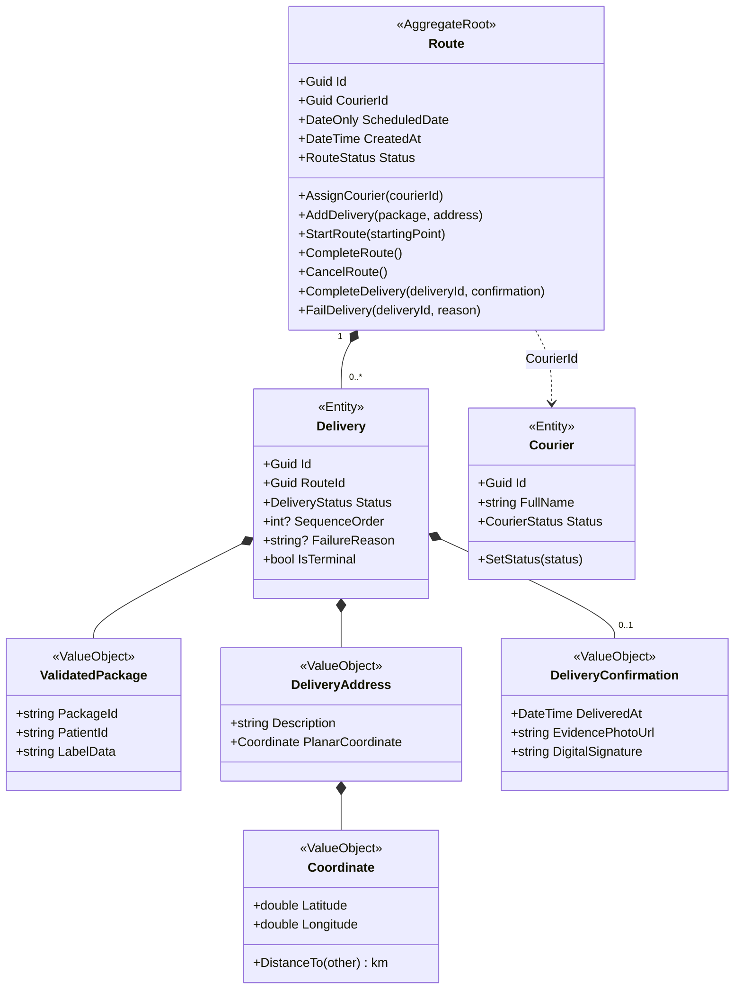
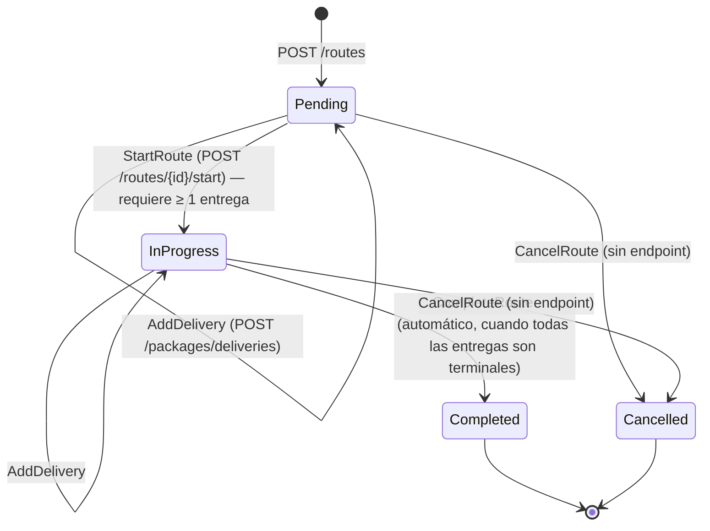
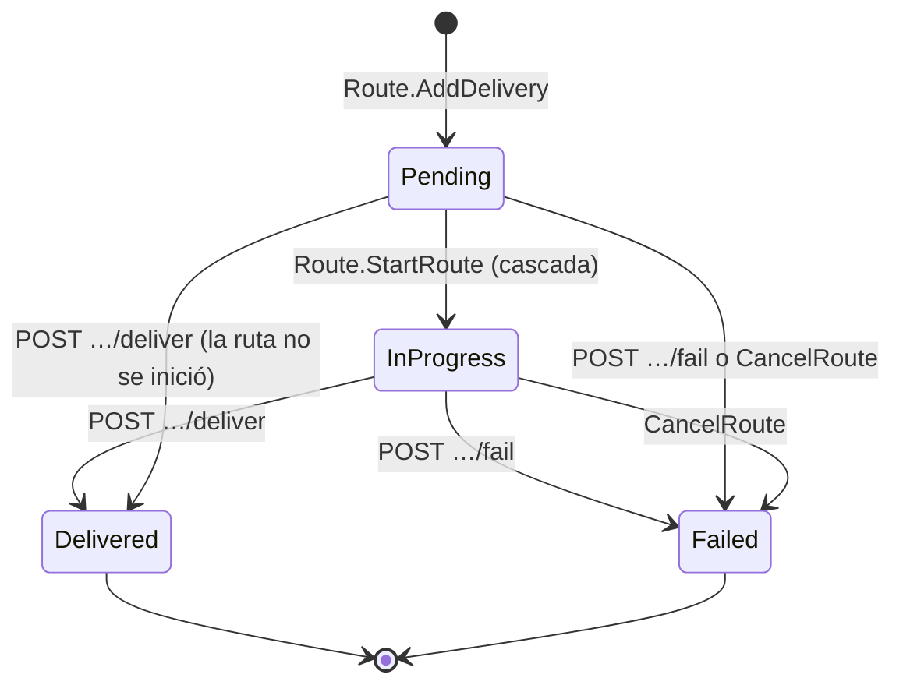

# Modelo de dominio — MS5

## Lenguaje ubicuo
| Término | Significado aquí |
|---|---|
| Repartidor (`Courier`) | Persona que ejecuta una ruta. Solo tiene nombre completo y estado |
| Ruta (`Route`) | Las paradas que **un** repartidor recorre en **una** fecha (`ScheduledDate`). Es la raíz del agregado |
| Entrega / parada (`Delivery`) | Un paquete que hay que llevar a una dirección dentro de una ruta. Es una entidad **hija** de la ruta, no tiene repositorio propio |
| Paquete validado (`ValidatedPackage`) | Lo que se entrega: `PackageId` (texto libre que trae el llamador), `PatientId` (texto) y `LabelData` (los "detalles adicionales" de la etiqueta) |
| Dirección de entrega (`DeliveryAddress`) | Descripción textual + coordenada (`Coordinate`) |
| Sucursal / punto de partida (`branchCoordinates`) | Coordenada fija por configuración desde donde sale todo repartidor. Es el origen de la secuencia |
| Secuencia de entrega (`SequenceOrder`) | Orden 1..N de las paradas, calculado al **iniciar** la ruta con el algoritmo del vecino más cercano (distancia de Haversine) |
| Confirmación de entrega (`DeliveryConfirmation`) | Evidencia de una entrega exitosa: momento (UTC), URL de la foto y firma digital. Las tres son obligatorias |
| Estado terminal | Una entrega `Delivered` o `Failed`. Una ruta solo se completa cuando **todas** sus entregas son terminales |

**Ojo con los ids entre servicios:** en MS5 `PatientId` y `PackageId` son `string`, no `Guid`. MS4 llama `packId` a su `DeliveryDayId` (entero) y usa `Guid` para el paciente. MS5 no valida ni interpreta esos valores: los guarda tal cual llegan.

## Agregados

### Route (raíz)
- **Representa:** la ruta de un repartidor en una fecha, con todas sus paradas.
- **Invariantes:**
  - Solo se inicia en `Pending` y con al menos una entrega.
  - Al iniciarse, todas sus entregas pasan a `InProgress` y reciben su `SequenceOrder`.
  - Solo se completa en `InProgress` y si todas las entregas son terminales.
  - Al cancelarse, toda entrega no terminal pasa a `Failed` con el motivo `"Route was cancelled."`.
  - No acepta entregas nuevas si está `Completed` o `Cancelled` (sí si está `InProgress`).
  - Toda mutación de una `Delivery` pasa por métodos de `Route` (los métodos de `Delivery` son `internal`).
- **Entidades internas:** `Delivery`.
- **Value objects:** `ValidatedPackage`, `DeliveryAddress` (con `Coordinate`), `DeliveryConfirmation`.
- **Referencia por id:** `CourierId` (no hay navegación a `Courier`).
- **Archivo:** `src/Nurtricenter.Core/Domain/Route/Route.cs`

### Delivery (entidad dentro de Route)
- **Representa:** una parada de la ruta.
- **Ciclo de vida:** controlado solo desde `Route` (`StartDelivery`, `RegisterSuccessfulDelivery`, `RegisterFailedDelivery` son `internal`).
- **Archivo:** `src/Nurtricenter.Core/Domain/Delivery/Delivery.cs`

### Courier (entidad independiente)
- **Representa:** un repartidor. Hereda de `Entity`, no de `AggregateRoot`, y tiene su propio `ICourierRepository`.
- **Invariante:** nombre no vacío (máx. 200 caracteres, por el validador).
- **Archivo:** `src/Nurtricenter.Core/Domain/Courier/Courier.cs`

## Diagrama de clases

## Máquina de estados de `Route`

- `CompleteRoute` no tiene endpoint: lo invoca el handler en proceso `CompleteRouteWhenAllDeliveriesCompletedHandler` al recibir `DeliveryCompletedEvent` o `DeliveryFailedEvent`.
- `CancelRoute` y `AssignCourier` existen en el dominio pero **ningún endpoint los llama** (ver gaps).

## Máquina de estados de `Delivery`

- Registrar el resultado **no exige** que la ruta esté iniciada: una entrega `Pending` puede pasar a `Delivered`/`Failed`. Pero si esa era la **última** entrega no terminal de una ruta `Pending`, el handler de cierre llama a `CompleteRoute`, que falla con `Route.CannotComplete`, y **toda la petición se revierte con 422** (ver ms5-gap-08).
- Cualquier otro intento sobre una entrega terminal → `Delivery.CannotComplete` / `Delivery.CannotFail` (422).

## Máquina de estados de `Courier`
`Available` (por defecto) → `OnRoute` / `OnBreak` mediante `SetStatus`. **Ningún endpoint ni caso de uso llama a `SetStatus`**, así que todo repartidor queda en `Available` para siempre (iniciar una ruta no lo pasa a `OnRoute`).

## Reglas de negocio
Todas lanzan `DomainException` con un `Error`; `DomainExceptionHandler` lo traduce a HTTP según su `ErrorType`.

| Regla | Dónde se aplica | Error si se viola |
|---|---|---|
| Nombre del repartidor obligatorio (≤ 200) | `CreateCourierValidator` + ctor de `Courier` | 400 (`FullName` / `Courier.EmptyFullName`) |
| La ruta se crea para un repartidor existente | `CreateRouteHandler` | 404 `Courier.NotFound` |
| La fecha de la ruta no puede ser pasada (fecha local del servidor) | `CreateRouteValidator` | 400 |
| Los paquetes se agregan a la ruta de **hoy** creada más recientemente, sea del repartidor que sea | `AddDeliveriesHandler` + `RouteRepository.GetLatestRouteForTodayAsync` | 404 `Route.NoRouteForToday` |
| Todos los pacientes del lote deben existir en ClinicService | `AddDeliveriesHandler` | 404 `ClinicService.PatientsNotFound` |
| Paquete con `PackageId`, `PatientId` y `LabelData` no vacíos | VO `ValidatedPackage` (el validador no revisa `LabelData`) | 400 `ValidatedPackage.Empty*` |
| Dirección con descripción y coordenada | VO `DeliveryAddress` | 400 |
| No agregar entregas a una ruta `Completed`/`Cancelled` | `Route.AddDelivery` | 422 `Route.CannotAddDelivery` |
| Iniciar solo rutas `Pending` con ≥ 1 entrega | `Route.StartRoute` | 422 `Route.CannotStart` / `Route.NoDeliveries` |
| La entrega debe pertenecer a la ruta indicada | `Route.FindDelivery` | 404 `Route.DeliveryNotFound` |
| Entrega exitosa exige foto, firma y momento | VO `DeliveryConfirmation` + `CompleteDeliveryValidator` | 400 |
| Entrega fallida exige motivo | `Route.FailDelivery` + `FailDeliveryValidator` | 400 |
| Solo se registra el resultado de una entrega `Pending`/`InProgress` | `Delivery.RegisterSuccessfulDelivery` / `RegisterFailedDelivery` | 422 `Delivery.CannotComplete` / `Delivery.CannotFail` |
| La ruta se completa sola cuando todas las entregas son terminales | `CompleteRouteWhenAllDeliveriesCompletedHandler` → `Route.CompleteRoute` | 422 `Route.CannotComplete` si la ruta no estaba `InProgress` |

**Reglas que NO existen** (y un lector podría suponer): no hay unicidad de ruta por repartidor y fecha, ni de `PackageId`; no se valida el rango de las coordenadas; no se comprueba el estado del repartidor al crear la ruta.

### Detalle de la secuencia de entrega
- Se calcula una sola vez, en `Route.StartRoute(startingPoint)`, con el punto de partida `branchCoordinates` (configuración; en la plataforma, una coordenada de Santa Cruz).
- Algoritmo: desde el punto actual, elige la entrega pendiente más cercana (Haversine, km), le asigna el siguiente número y se mueve a ella. Es una heurística voraz, no una optimización de ruta.
- Las entregas agregadas **después** de iniciar la ruta quedan sin `SequenceOrder`. `GET …/route/today` les asigna como respaldo su posición en la lista (`index + 1`), que puede repetir un número ya usado.

## Datos que son copia de otro servicio
**Ninguna proyección local.** El único evento que consume (`package-validated`) crea entregas; no mantiene copias de datos ajenos.
| Dato | Origen | Cómo se mantiene |
|---|---|---|
| `PatientId` (dentro de `ValidatedPackage`) | MS3, evento `package-validated` (GUID convertido a texto); o quien use `POST /packages/deliveries` | Solo la referencia, como texto |
| Nombre y teléfono del paciente | MS1 (ClinicService; hoy un mock de Postman) | **No se guardan**: se piden por HTTP en cada `POST /packages/deliveries` y en cada `GET …/route/today`. El evento `package-validated` **no** consulta a MS1 |
| `PackageId` | Quien llama a `POST /packages/deliveries` | Texto libre. Si el llamador usara el `packId` de MS4, serviría para cerrar el gap X-01, pero el código no lo garantiza |
