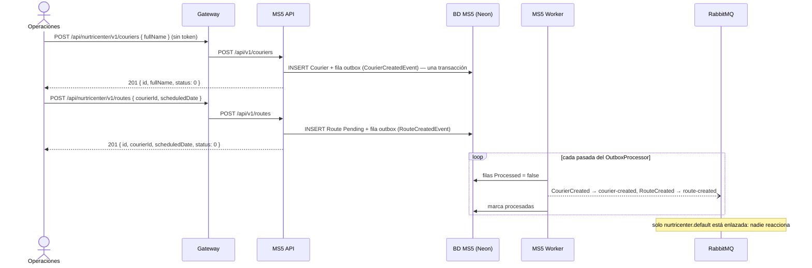
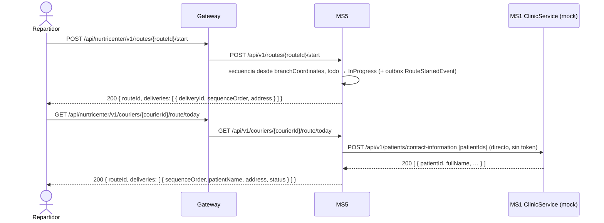
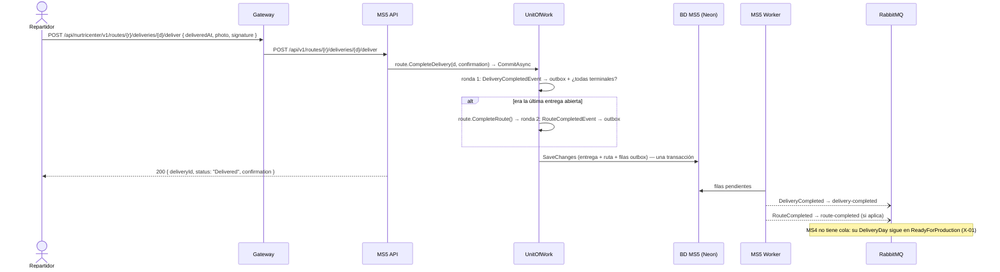
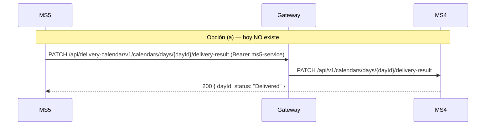

# Flujos — MS5

El orden sigue el día de un repartidor. Todos los flujos cruzan al menos una frontera: el gateway, ClinicService o RabbitMQ. F5 describe la integración que **falta** con MS4.

## F1 — Alta de repartidor y de su ruta (Operaciones → MS5 ⇢ RabbitMQ)
- **Actor:** operaciones / logística.
- **Disparador:** `POST /api/v1/couriers` y después `POST /api/v1/routes`.
- **Precondición:** ninguna para el repartidor; para la ruta, que el repartidor exista.
- **Camino feliz:**
  1. Crea el `Courier` en `Available` → `CourierCreatedEvent` → fila en el outbox, en la misma transacción.
  2. Crea la `Route` `Pending` para `(courierId, scheduledDate)` → `RouteCreatedEvent` → outbox.
  3. El worker publica `courier-created` y `route-created`. Hoy solo los recibe `nurtricenter.default`.
- **Errores:**
  | Situación | Resultado |
  |---|---|
  | Nombre vacío o de más de 200 caracteres | 400 |
  | Fecha pasada | 400 |
  | Repartidor inexistente | 404 `Courier.NotFound` |
- **Idempotencia / reintentos:** **no es idempotente.** Un reintento de red crea un segundo repartidor o una segunda ruta para la misma fecha (no hay índice único). El evento, en cambio, nunca se pierde ni se inventa (outbox).

## F2 — Recibir los paquetes del día (MS3 ⇢ RabbitMQ ⇢ MS5)
- **Actor:** MS3 (producción), cuando su control de calidad aprueba un paquete.
- **Disparador:** evento `package-validated` (contrato `PackageValidated`, kernel 1.2.0) en la cola `ms5.package-validated`, uno por paquete. Respaldo manual: `POST /api/v1/packages/deliveries` (con chequeo de pacientes en MS1).
- **Precondición:** que exista al menos una ruta con fecha de hoy (las crea el administrador).
- **Camino feliz (evento):**
  1. `TracingConsumer → IdempotentConsumer`: si el `Id` del mensaje ya está en `InboxMessages`, se descarta.
  2. `PackageValidatedConsumer` arma `AddValidatedPackageCommand`: `PackageId`/`PatientId` como texto, `TrackingNumber` como datos de etiqueta (o el `PackageId` si viene vacío).
  3. Toma la ruta de hoy **creada más recientemente** (de cualquier repartidor) y agrega una `Delivery` `Pending`. Sin coordenadas → usa las de la sucursal.
  4. Una sola transacción guarda la fila del inbox, la entrega y la fila del outbox de `delivery-added-to-route`.
- **Errores:**
  | Situación | Resultado |
  |---|---|
  | Algún paciente no existe en ClinicService | 404 `ClinicService.PatientsNotFound`; no se guarda nada |
  | ClinicService responde error | 422 `ClinicService.RequestFailed` |
  | No hay ruta para hoy | 404 `Route.NoRouteForToday` |
  | La ruta de hoy ya está cerrada | 422 `Route.CannotAddDelivery` |
- **Idempotencia / reintentos:** **no es idempotente.** Reenviar el lote duplica las entregas. Con varios repartidores el mismo día, todos los paquetes van a la última ruta creada: el reparto entre repartidores no está modelado (ms5-gap-06).
- Diagrama de secuencia: ver [integrations.md](./integrations.md).

## F3 — El repartidor inicia su ruta y la consulta (App → MS5 → ClinicService)
- **Actor:** repartidor desde su app.
- **Disparadores:** `POST /api/v1/routes/{routeId}/start` y `GET /api/v1/couriers/{courierId}/route/today`.
- **Precondición:** ruta `Pending` con al menos una entrega.
- **Camino feliz:**
  1. `start`: calcula la secuencia de entrega desde la sucursal (vecino más cercano) y pasa la ruta y todas sus entregas a `InProgress` → `route-started`.
  2. `route/today`: devuelve las paradas con su secuencia, dirección, estado y el **nombre del paciente** pedido a ClinicService en ese momento.
- **Errores:**
  | Situación | Resultado |
  |---|---|
  | Ruta ya iniciada / sin entregas | 422 `Route.CannotStart` / `Route.NoDeliveries` |
  | No hay ruta de hoy para ese repartidor | 404 `Route.NoRouteForToday` |
  | ClinicService caído | El `GET` falla (422 o 500): **el repartidor se queda sin ver su ruta** |
- **Idempotencia / reintentos:** el `GET` sí lo es. El `start` no: un reintento da 422 aunque la ruta ya haya arrancado bien.

## F4 — Registrar cada entrega y cerrar la ruta (App → MS5 ⇢ RabbitMQ)
- **Actor:** repartidor, en cada parada.
- **Disparadores:** `POST …/deliveries/{deliveryId}/deliver` (con foto, firma y momento) o `POST …/deliveries/{deliveryId}/fail` (con motivo).
- **Precondición:** la entrega pertenece a la ruta y no es terminal.
- **Camino feliz:**
  1. La entrega pasa a `Delivered` (guarda la `DeliveryConfirmation`) o a `Failed` (guarda el motivo) → `delivery-completed` / `delivery-failed`.
  2. Al drenar ese evento en el mismo commit, `CompleteRouteWhenAllDeliveriesCompletedHandler` revisa la ruta: si todas sus entregas son terminales, la completa → `route-completed`.
  3. Todo (entrega, ruta y 1 o 2 filas de outbox) se guarda en **una** transacción. El worker publica después.
- **Errores:**
  | Situación | Resultado |
  |---|---|
  | La entrega no es de la ruta / la ruta no existe | 404 |
  | Falta foto, firma o motivo | 400 |
  | La entrega ya era terminal (p. ej. un reintento) | 422 `Delivery.CannotComplete` / `Delivery.CannotFail` |
  | Era la última entrega de una ruta que nunca se inició | 422 `Route.CannotComplete`; **se revierte también la entrega** (ms5-gap-08) |
- **Idempotencia / reintentos:** la API **no** es idempotente (un reintento tras un timeout da 422 aunque la entrega se haya guardado). La publicación sí es segura: at-least-once vía outbox.

## F5 — Avisar el resultado a MS4 ⚠ no implementado
- **Actor:** MS5, después de cada entrega o fallo.
- **Qué debería pasar:** el `DeliveryDay` de MS4 tendría que pasar a `Delivered`/`Failed` con la evidencia. MS4 expone `PATCH /api/v1/calendars/days/{dayId}/delivery-result` (scope `deliveryCalendar.deliveryResult:edit`) e idempotente.
- **Estado real:** MS5 no llama a MS4, no tiene service account y **no conoce el `dayId`**: su entrega solo guarda `PackageId` (texto libre del llamador). Los eventos `delivery-completed`/`delivery-failed` tampoco llevan ese dato y no hay cola `ms4.*` para ellos.
- **Dos caminos posibles** (decidir con un ADR, ver X-01):
  | Opción | Qué cambia en MS5 |
  |---|---|
  | (a) REST | Service account `ms5-service`, login en identity, `PATCH` vía gateway en el handler de `deliver`/`fail` (o en un handler del outbox, para no acoplar la respuesta al repartidor con la disponibilidad de MS4). El `PackageId` tendría que ser el `packId` de MS4 |
  | (b) Eventos | Agregar `PackageId` (o el `dayId`) a `DeliveryCompleted`/`DeliveryFailed` en el kernel, más la evidencia para `Delivered`; pedir colas `ms4.delivery-completed` y `ms4.delivery-failed` en `nur-tricenter-local` |

