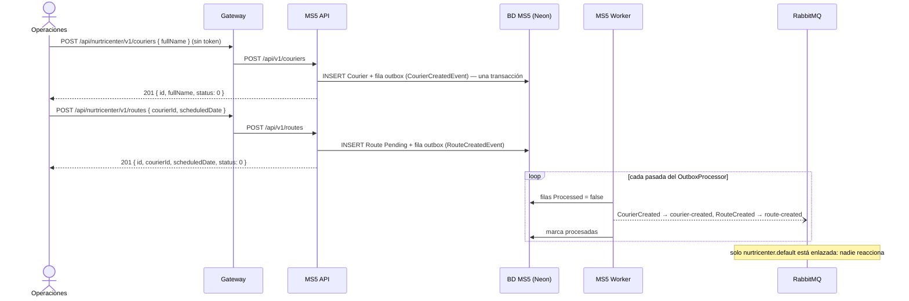
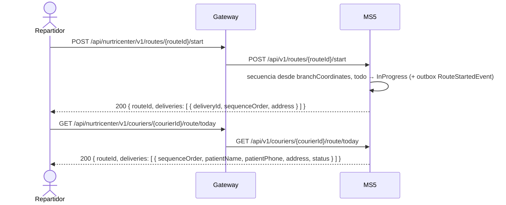
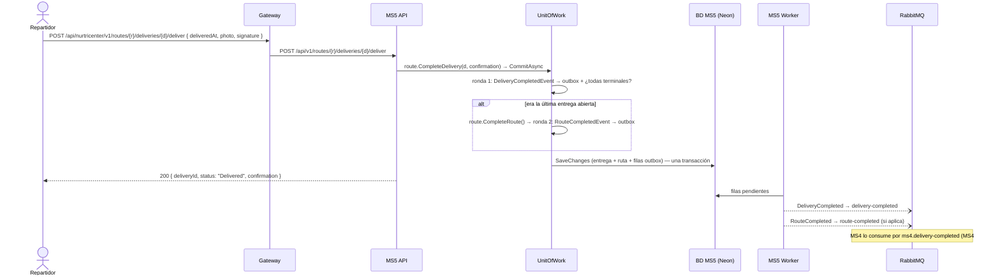
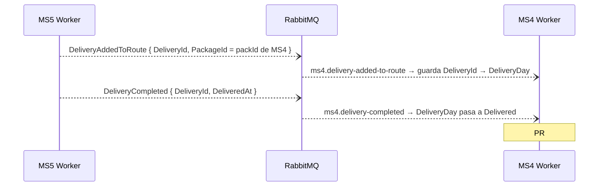

# Flujos — MS5

El orden sigue el día de un repartidor. Todos los flujos cruzan al menos una frontera: el gateway o RabbitMQ. F5 describe cómo MS4 recibe el resultado por eventos y lo que todavía falta.

## F1 — Alta de repartidor y de su ruta (Operaciones → MS5 ⇢ RabbitMQ)
- **Actor:** operaciones / logística.
- **Disparador:** `POST /api/v1/couriers` y después `POST /api/v1/routes`.
- **Precondición:** ninguna para el repartidor; para la ruta, que el repartidor exista.
- **Camino feliz:**
  1. Crea el `Courier` en `Available` → `CourierCreatedEvent` → fila en el outbox, en la misma transacción.
  2. Crea la `Route` `Pending` para `(courierId, scheduledDate)` → `RouteCreatedEvent` → outbox.
  3. El worker publica `courier-created` y `route-created`. Hoy solo los recibe `nurtricenter.default`.
- **Errores:**
  | Situación | Resultado |
  |---|---|
  | Nombre vacío o de más de 200 caracteres | 400 |
  | Fecha pasada | 400 |
  | Repartidor inexistente | 404 `Courier.NotFound` |
- **Idempotencia / reintentos:** **no es idempotente.** Un reintento de red crea un segundo repartidor o una segunda ruta para la misma fecha (no hay índice único). El evento, en cambio, nunca se pierde ni se inventa (outbox).

## F2 — Recibir los paquetes del día (MS3 ⇢ MS5, o operaciones a mano)
- **Actor:** operaciones / logística.
- **Disparador:** el evento `package-validated` de MS3 (cola `ms5.package-validated`, consumidor idempotente desde MS5#3), o a mano `POST /api/v1/packages/deliveries` con un array de paquetes.
- **Precondición:** que exista una ruta con la fecha de entrega del paquete (la `DeliveryDate` del evento; en la carga manual, la de hoy). Las crea el administrador.
- **Camino feliz:**
  1. Valida el paquete. El nombre y el teléfono del paciente ya vienen en el evento (`PatientName`, `PatientPhone`); no se consulta a MS1.
  2. Toma la ruta **más reciente de esa fecha** (de cualquier repartidor) y agrega una `Delivery` `Pending` por ítem.
  3. Una sola transacción guarda las entregas y una fila de outbox de `delivery-added-to-route` por ítem. Si `packageId` es el `packId` de MS4, MS4 vincula la entrega con su día al consumir ese evento.
- **Errores:**
  | Situación | Resultado |
  |---|---|
  | No hay ruta para esa fecha | Evento: 404 `Route.NoRouteForDate`, reintentos y luego cola de error. Carga manual: 404 `Route.NoRouteForToday` |
  | La ruta de hoy ya está cerrada | 422 `Route.CannotAddDelivery` |
- **Idempotencia / reintentos:** el consumo del evento es idempotente (inbox). `POST /packages/deliveries` **no** lo es: reenviar el lote duplica las entregas. Con varios repartidores el mismo día, todos los paquetes van a la última ruta creada: el reparto entre repartidores no está modelado (ms5-gap-06).
- Diagrama de la carga por evento: ver [integrations.md](./integrations.md) y [messaging.md](./messaging.md).

## F3 — El repartidor inicia su ruta y la consulta (App → MS5)
- **Actor:** repartidor desde su app.
- **Disparadores:** `POST /api/v1/routes/{routeId}/start` y `GET /api/v1/couriers/{courierId}/route/today`.
- **Precondición:** ruta `Pending` con al menos una entrega.
- **Camino feliz:**
  1. `start`: calcula la secuencia de entrega desde la sucursal (vecino más cercano) y pasa la ruta y todas sus entregas a `InProgress` → `route-started`.
  2. `route/today`: devuelve las paradas con su secuencia, dirección, estado el **nombre** y el **teléfono** del paciente, guardados con la entrega.
- **Errores:**
  | Situación | Resultado |
  |---|---|
  | Ruta ya iniciada / sin entregas | 422 `Route.CannotStart` / `Route.NoDeliveries` |
  | No hay ruta de hoy para ese repartidor | 404 `Route.NoRouteForToday` |
- **Idempotencia / reintentos:** el `GET` sí lo es. El `start` no: un reintento da 422 aunque la ruta ya haya arrancado bien.

## F4 — Registrar cada entrega y cerrar la ruta (App → MS5 ⇢ RabbitMQ)
- **Actor:** repartidor, en cada parada.
- **Disparadores:** `POST …/deliveries/{deliveryId}/deliver` (con foto, firma y momento) o `POST …/deliveries/{deliveryId}/fail` (con motivo).
- **Precondición:** la entrega pertenece a la ruta y no es terminal.
- **Camino feliz:**
  1. La entrega pasa a `Delivered` (guarda la `DeliveryConfirmation`) o a `Failed` (guarda el motivo) → `delivery-completed` / `delivery-failed`.
  2. Al drenar ese evento en el mismo commit, `CompleteRouteWhenAllDeliveriesCompletedHandler` revisa la ruta: si todas sus entregas son terminales, la completa → `route-completed`.
  3. Todo (entrega, ruta y 1 o 2 filas de outbox) se guarda en **una** transacción. El worker publica después.
- **Errores:**
  | Situación | Resultado |
  |---|---|
  | La entrega no es de la ruta / la ruta no existe | 404 |
  | Falta foto, firma o motivo | 400 |
  | La entrega ya era terminal (p. ej. un reintento) | 422 `Delivery.CannotComplete` / `Delivery.CannotFail` |
  | Era la última entrega de una ruta que nunca se inició | 422 `Route.CannotComplete`; **se revierte también la entrega** (ms5-gap-08) |
- **Idempotencia / reintentos:** la API **no** es idempotente (un reintento tras un timeout da 422 aunque la entrega se haya guardado). La publicación sí es segura: at-least-once vía outbox.

## F5 — El resultado llega a MS4 por eventos (MS5 ⇢ RabbitMQ ⇢ MS4) ⚠ parcial
- **Actor:** MS5 (publica) y MS4 (consume). MS5 no hace nada específico para MS4: publica sus eventos de siempre.
- **Cómo funciona:** MS4 consume `delivery-added-to-route`, `delivery-completed` y `delivery-failed` por las colas `ms4.delivery-added-to-route`, `ms4.delivery-completed` y `ms4.delivery-failed` (topología mergeada en nur-tricenter-local#6; código de MS4 en el PR Nur-tricenter/ms4-delivery-schedule-management#3, **pendiente de merge**). Al recibir `delivery-added-to-route` guarda el vínculo `DeliveryId` (de MS5) → `DeliveryDay`, leyendo `PackageId` como su `packId`. Después, `delivery-completed`/`delivery-failed` (que solo traen `DeliveryId`) le alcanzan para cerrar el día. No hay llamada REST: MS5 no usa `PATCH /delivery-result` ni tiene service account.
- **Lo que falta:**
  | Situación | Resultado |
  |---|---|
  | La entrega se cargó a mano y su `PackageId` no es el `packId` de MS4, ni trae `DeliveryDayId` | MS4 recurre al `PackageId` numérico y luego al paciente; si no encuentra el día, no lo vincula y queda en `ReadyForProduction` (ms5-gap-02) |
  | Entrega exitosa | La evidencia (foto, firma) no viaja en `DeliveryCompleted`: queda solo en MS5 |

