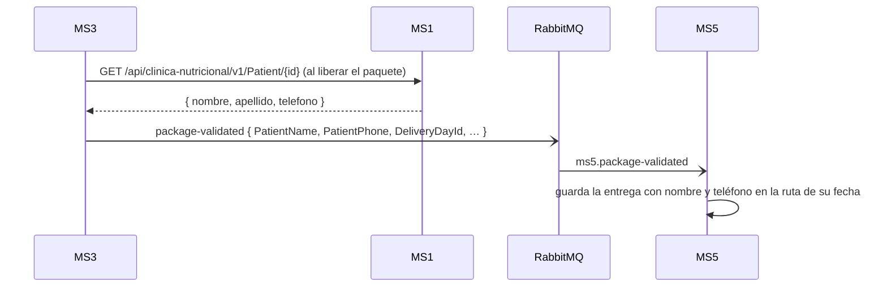

# Integraciones síncronas — MS5

## Resumen
MS5 **no hace llamadas HTTP salientes**. Hasta MS5#4 (2026-10-29) llamaba a «ClinicService» (MS1) para validar pacientes y traer su nombre; esa llamada, el puerto `IClinicService` y la variable `ClinicService__BaseUrl` ya no existen.

| Necesita | De dónde lo obtiene ahora |
|---|---|
| Nombre del paciente | `PackageValidated.PatientName` (kernel 1.3.0); en la carga manual, el campo `patientName` de `POST /packages/deliveries` |
| Teléfono del paciente | `PackageValidated.PatientPhone` (kernel 1.5.0, MS5#8); MS3 lo lee de MS1 al liberar el paquete |
| Día de entrega de MS4 | `PackageValidated.DeliveryDayId` (kernel 1.4.0), que MS5 reenvía en `DeliveryAddedToRoute` |

MS5 tampoco llama a MS4 (no existe cliente HTTP ni service account para `PATCH /delivery-result`): MS4 recibe el resultado por eventos, ver [messaging.md](./messaging.md). Ni a identity: sus endpoints son anónimos (ms5-gap-01).

## Qué cambió y por qué
- **Antes:** `POST {ClinicService:BaseUrl}/api/v1/patients/contact-information` contra un mock de Postman, directo, sin token y sin resiliencia. Si fallaba, el repartidor no podía ver su ruta (ms5-gap-05).
- **Ahora:** el nombre y el teléfono se guardan con la entrega al agregarla. La consulta de la ruta del día lee solo de la base de MS5, así que un MS1 caído no afecta al repartidor.
- **Compromiso:** el dato queda «congelado» al liberar el paquete; si el paciente cambia de teléfono después, la entrega conserva el anterior. Las entregas cargadas a mano o anteriores a 1.5.0 no tienen teléfono (`null`).
- MS1 conserva `POST /api/v1/patients/contact-information` (desde MS1#1), pero nadie lo llama. Ver [ms1-clinic](../ms1-clinic/integrations.md).

